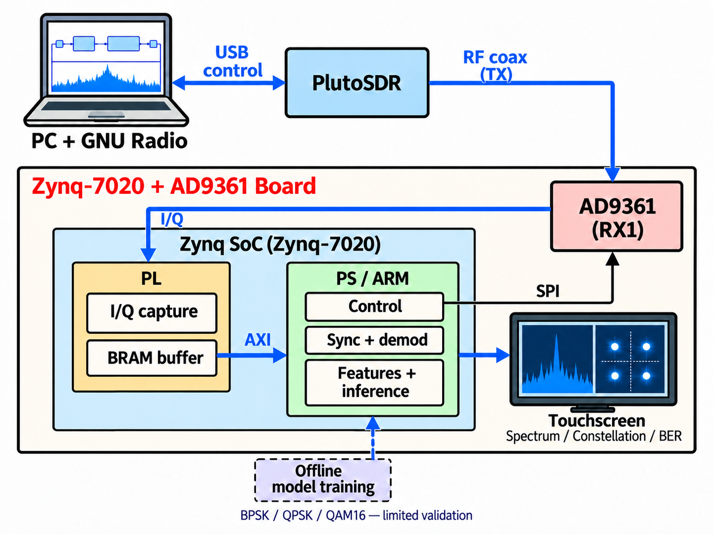

# 最终设计报告：Zynq-7020 + AD9361 便携射频收发与接收分析平台

> 赛道：2026 FPGA 赛道 AMD，**3.3 自主选题赛道**（作品 + 技能包 + 设计报告）。日期 2026-10-31。
> 本报告不新增实验、不重算指标：数字照抄本仓库既有文档并保留其限定语与状态词。本仓库是**脱敏源码副本**，不含位流/HWH、原始 IQ、收据、数据集与模型产物；指标为「文档记载」级，**不能在本仓库内复算**，本地原件在 `<LOCAL_EVIDENCE>/`（不在仓库；见 [证据包](EVIDENCE-PACK.md) §4）。

## 1. 作品与问题

**实际问题**：便携单板条件下，把「射频收发 → 样点采集 → 同步解调/频谱/星座/参考误码 → 触摸屏同帧展示」做成可复现、可核对证据的链路，用于教学演示与受限接收分析：外部 SDR（PC + GNU Radio + PlutoSDR）作独立激励，板卡纯接收。

**作品形态**：Zynq-7020（`xc7z020clg484-2`）+ AD9361（FMCOMMS3 形态）+ 五寸触摸屏（800×480，GT911）；PYNQ 2.7 / Linux `5.4.0-xilinx-v2020.2`；Vivado/Vitis **2025.2**。三条独立流水线、产物不混用：RF 主项目（`rf_overlay/`）、PYNQ 板载应用（`pynq_overlay/`）、辅助 AWG（`src/`、`sdk/src/`、`host/`）。

**当前交付范围（2026-10-26 交付复审口径）**：BPSK/QPSK 有限接收演示 + 有限条件 QAM16；**QAM64 已移出**；演示为外部 SDR 发射、板卡纯接收。

**创新点（按证据，不夸大）**：

1. **单板软硬件协同**：PL 做 I/Q 采集与 BRAM，PS 做控制、同步解调、频谱/星座/参考 BER 与轻量推理，屏上同帧展示；不把 PS 计算说成 PL 实时解调。
2. **有限快照 + 证据链**：4096 点快照携带采样域、配置修订、模型版本与 `capture_id`；判据先于测量，失败帧与日志保留。
3. **发布可回退、安装可读回**：单控制者 daemon 持有 PL/AD9361；发布有清单与父版本回退，试部署失败可自动回滚并独立读回。
4. **可核对的脱敏证据包**：交付 bit 与同次构建 bit 载荷逐字节相同（`payload_equal=true`），原件 SHA-256 与本地路径登记在证据包，仓库只给摘要。

## 2. 系统框图



图说明：PC（GNU Radio）→ PlutoSDR TX → 射频同轴线 → 板卡 AD9361 RX1 → PL I/Q 采集与 BRAM → AXI → PS 同步解调/频谱/星座/参考 BER/轻量推理 → 五寸触摸屏；虚线为离线训练与部署关系；当前为 BPSK/QPSK/QAM16 有限验证。箭头为功能分工与**拟采用演示方式**，不代表已通过完整验收；文字版边界见 [系统结构图说明](system-architecture.md)。

## 3. 软硬件分工与接口

| 层 | 职责 | 接口/边界 |
|---|---|---|
| PL（`rf_overlay/rtl/`） | AD9361 LVDS DDR 收发、I/Q 采集与 BRAM、SPI 从、TX 样点源、`rf_decimate`、IDELAY；BD 内例化辅助 AWG | AXI-Lite/BRAM 与 PS 交互；**未实现**实时同步解调、RRC、多制式 |
| PS / 板载 Linux（`pynq_overlay/sw/`） | 控制与状态（唯一 daemon）、同步解调（BPSK/QPSK/RECT）、频谱/星座/RMS/削顶、参考 BER、环境诊断、轻量 CNN、界面与发布 | daemon 用 TCP/JSON；PL 用 AXI/SPI/MMIO；屏经 framebuffer/UART |
| 外部 SDR 测试台（`sdr_testbench/`） | PlutoSDR+GNU Radio 独立收发、示波器观测、板卡↔Pluto 联调离线准备 | USB IIO、VISA；**RF 输出未验证、有线回环未完成** |
| 离线训练（`ml_training/`） | 仿真数据生成、特征/CNN 训练评估、纯 NumPy runtime | 模型/数据集**不在仓库**；四类模型与板端六类 runtime 合同差异已记录 |

约束：单控制者原则（`rf_daemon` 唯一持有 PL 与 AD9361，其他脚本不得重复 `Overlay()`）；有限快照、非连续接收；建议只填草稿、自动执行永久关闭；安装与读回分离。详见 [设计报告](DESIGN-REPORT.md) §2–§4。

## 4. 关键指标（交付位流绑定）

交付位流对应的合并产品 Overlay（Vivado v.2025.2 Build 6299465，`xc7z020clg484-2`，2026-09-24 构建；交付 release `4814bbc42b9d5e0165a3ed3ebe7eaeef`，交付 bit `d5bfe5d9…`）。完整表与原件 SHA-256 见 [综合与实现指标](SYNTHESIS-METRICS.md) §2–§3.1、[证据包](EVIDENCE-PACK.md) §2。

### 4.1 资源、时序与时钟

| 项 | 数值（照抄） |
|---|---|
| 资源 | Slice LUTs **28745（54.03%）**；Slice Registers **22620（21.26%）**；Block RAM Tile **18.5（13.21%）**（RAMB36=17、RAMB18=3）；DSP48E1 **104（47.27%）** |
| 时序（Routed） | **WNS +0.213 ns / WHS +0.018 ns**；TNS/THS 0.000；失败端点 0/0（67128 端点）；`All user specified timing constraints are met.`；`data_clk` 域 WNS **+0.277 ns** / WHS **+0.066 ns** |
| 时钟 | `clk_fpga_0` 50.000、`clk_fpga_1` 200.000、`data_clk` **239.981**、`sys_clk` 50.000、`pclk_raw` 33.333 MHz |
| 实现状态 | 路由错误 0；DRC routed 0 Errors；bitgen 成功 |

**功耗**：Total On-Chip **2.418 W**（Dynamic 2.247 + Static 0.171 W；Tj 52.9 ℃；Max Ambient 57.1 ℃；预算 `Unspecified`）。**Vivado `report_power` 估计值，非板端实测**；无板级电压/电流/温度实测，不得写成「实测功耗」或据此宣称散热/供电余量。

### 4.2 板上有限结果（按版本与条件）

| 结果 | 数值（照抄；含版本/条件） | 边界 |
|---|---|---|
| 12 帧选用集冒烟 | BPSK 两 ON 均 **0/138**；QPSK 两 ON 均 **0/128**；QAM16 **1/256** 与 **0/256**；OFF clean；QAM64 移除负例 **9/9** 通过（当前交付口径 2026-10-26） | `部分`：非整体 BER 资格；QAM16 非零误码 |
| 外部 SDR 单帧 BPSK | 2026-10-20 一次 4096@60 MSPS 采集；原样/共轭两路均 `reference_sync`、各 **0/138**（同一帧一致性检查） | `部分`：单帧一次、两路不独立计数；非统计 BER/连续锁定 |
| QPSK 5 帧回放 | 均 QI 显式、`sync=true`、BER **0/128**；独立参考一致（2026-10-23 开发版，不重采） | `部分`：非独立 TEST 集 |
| 双 TX 示波器 | 边带 **78.112 / 81.888 MHz**（目标 78.125/81.875，误差 **±13 kHz**）；12/12 检验通过；削波 0（2026-09-30 历史板级，80 MHz、60 MSPS、2R2T） | `非当前版本`：仪器读数，未去嵌频响 |
| 独立 RF Overlay L2 Stage 1 | **8 PASS / 0 FAIL / 2 RECORD**；寄存器 0 读失败（2026-09-18，1R1T，非交付 bit） | `非当前版本`：独立目标记录 |
| 环境诊断标定 | VAL **10/10 CLEAR**；3 OFF 零误判；normal 无 INVALID（2026-10-18 开发期，TRAIN 20 帧） | `部分`：非交付候选 |

### 4.3 证据身份与限定

交付 bit 与本地同次构建 bit（`76e242fe…`）**可编程载荷逐字节相同**（`payload_equal=true`，payload SHA-256 `0ce74071…`；文件级 SHA 不同）；对应 routed DCP `63f679bc…`。该绑定只说明「报告对应的设计 = 交付 bit 的可编程内容」，**不覆盖外部 RF 接口**（§7 第 7 条）。历史候选 ARM P95/RSS（`258.6409` / `272.785` / `278.835 ms`）分属不同候选与日期，标 `非当前版本`，**不得移植**。

## 5. 优化前后对比

### 5.1 当前交付版本：未取得（无同版本同条件基线）

按「同版本 + 同条件 + 同口径」判定，当前交付版本**没有**可配对的前后数据：已合入的优化在交付候选之前已进入源码，交付版本只有单一身份；当前口径 ARM P95/RSS 为 `未取得`；交付 bit 与提交源码**不保证同源**（见 [积压分诊](../reports/2026-09-30-backlog-triage.md) §0）。不编造数字。依据见 [优化与复现](OPTIMIZATION-AND-REPRODUCTION.md) §1.3。

### 5.2 可引用的历史受控配对（**非当前交付版本**，不得移植）

唯一满足「同版本/同条件/同口径」的配对：历史候选 `b3cca2acc2ab6bdbd3e30509205b7382` 的 ARM full-path A/B（2026-10-21，详见 §1.4）。同候选副本内**仅** `ModRec4Adapter.evaluate_iq` 改为「单次共享计算」研究原型；同 4 帧、同顺序、batch=1、warmup 5 + repeats 20（80 samples）、固定顺序、板端空闲零 RF。

| 指标（ARM，80 samples） | baseline（前） | optimized（后） | 变化（照抄） |
|---|---:|---:|---:|
| 五阶段合计 median | 378.8867 ms | 292.0840 ms | −86.80 ms（−22.9%） |
| 五阶段合计 P95 | 444.5217 ms | 311.7357 ms | −132.79 ms（−29.9%） |
| modrec4 阶段 median | 154.5762 ms | 64.8125 ms | −89.76 ms（−58.1%） |

VmHWM 31,704 / 32,440 KiB → 31,520 / 32,516 KiB（无实质变化，≤ 64 MiB）。

等价性：ARM full-path **4/4 帧、0 mismatch**；独立 70/70 case **0 mismatch**。**口径**：`0 mismatch` 是**语义/字段容差比较**，**不是逐字节相等**（最大浮点差 2.84e-14、six margin 1.48e-8，在声明容差内）。限制：optimized 为研究原型（合入产品后未重测 ARM）；单次运行、固定顺序、未热控制；口径为五阶段合计，**不能**与「100 次完整计算 P95 ≤ 300 ms」预算互换。若需当前版本前后数据，按 [OPTIMIZATION-AND-REPRODUCTION](OPTIMIZATION-AND-REPRODUCTION.md) §1.6 方案 A/B 补测（**1 次板端会话、0 次 Vivado**，约 0.5–1 人日）；方案 C 受「交付 bit 与源码不同源」「第三方 RTL 许可未决」约束，**赛前不建议承诺**。

## 6. 复现方式

**环境**：Vivado/Vitis 2025.2；板卡 PYNQ 2.7 / Linux `5.4.0-xilinx-v2020.2` / `gcc 9.3.0` / Python 3.8 + NumPy 1.17.4；可选 GNU Radio 3.10.12 与 PyVISA。

```powershell
vivado -mode batch -source pynq_overlay/build.tcl # 独立 PYNQ Overlay
vivado -mode batch -source rf_overlay/build.tcl   # 独立 RF Overlay
python -B -m pytest -p no:cacheprovider --basetemp .pytest-work-overlay pynq_overlay/sw/tests
python -B -m pytest -p no:cacheprovider --basetemp .pytest-work-scripts scripts/tests
python -B -m pytest -p no:cacheprovider --basetemp .pytest-work-host host/tests
ml_training\.venv\Scripts\python.exe ml_training\run.py all   # 需自建 venv；datasets/artifacts 不在仓库
.\sdr_testbench\run.ps1 probe                     # 外接 SDR：先 probe/offline，再 rx
```

```bash
make -C rf_overlay/sw/board_app                   # 板端 C 原生构建
make -C rf_overlay/sw/board_app host-test         # 主机测试（Git bash 的 sh.exe 在 PATH）
bash pynq_overlay/sw/install.sh                   # 发布安装（需板卡）
sh scripts/rf_teaching_trial_install.sh           # 试部署 + 回滚（单次入口）
```

**Linux 源码回归（2026-10-31，公开快照）**：GitHub Actions `Host regression` 在 Ubuntu 24.04 / Python 3.11 执行 `QT_QPA_PLATFORM=offscreen python -m pytest host/tests -q`，结果 **956 passed / 2 skipped / 0 failed**。两个跳过项分别是 `test_rf_merge` 的 live-overlay 断言缺少 `pynq_overlay/out_merged/awg_merged.hwh`（真实 Vivado 构建产物，不随仓库提交）与 `test_udp_ddr_pp_sdk` 缺少新生成 SDK 工作区；**Vivado/release 作业因无自托管 runner 为 `skipped`，不是构建通过**。复现分三层：CI 可复现 `host/tests`；本机可复现 `pynq_overlay/sw/tests`、`scripts/tests` 与 C 主机套件；板卡/外部 SDR 演示需现场授权与接线。复现命令与依赖见 [README](../../README.md#构建与运行)。

**Linux XSim 快速验证（2026-10-31，Azure Ubuntu 22.04.5 + Vivado/XSim 2025.2，源码提交 `7729ba7`）**：对最小自检 testbench `src/tb/am_stage_tb.v`（6 项断言）执行 `xvlog` → `xelab -relax` → `xsim -runall`，三条命令退出码均为 0，6 项全部 PASS、`$finish`；工具耗时约 9.1 s（1865/2037/5186 ms），临时目录已清理，现有 runner 未受影响。该结果**只证明该最小 testbench 可在 Linux Vivado 2025.2 上复现仿真，不代表完整 `src/tb/` 套件、综合/实现或位流生成**。命令与依赖见 [README](../../README.md#构建与运行)。

辅助 AWG 与 SDR GUI 演示入口见 [README](../../README.md#构建与运行)。**仓库边界**：本仓库是**脱敏源码副本，不是可安装发布包**：无位流/HWH/ELF、发布归档、原始 IQ/收据/日志、数据集/模型产物、照片；不能「下载即部署/推理」，也**不能用本副本验证旧报告 SHA-256**；交付 bit 与提交源码**不保证同源**（交付 bit 为工作区构建）。从零复现见 [OPTIMIZATION-AND-REPRODUCTION](OPTIMIZATION-AND-REPRODUCTION.md) §2。

## 7. 真实限制（必须保留，不得改写为通过）

1. **QAM64 已移出本轮交付**，历史报告只作记录，不追认。
2. **QAM16 非零误码**：12 帧选用集中为 **1/256**（另一 ON 帧 0/256），受限演示，不能倒填成零误码验收。
3. **外部 SDR BPSK 历史统计 23/30 帧同步，整体未通过**；不能只报同步帧零误码。
4. **EVM `NOT_IMPLEMENTED`**；RRC 真实链路未完成；自动选档/档位注册表 `NOT_IMPLEMENTED`（自动执行永久关闭，建议只填草稿）。
5. **完整交付闭环 `CHANGES_REQUIRED`**：独立复审指出验收语义漂移、试部署失败后重派超预算、文档与原始日志不一致；产品缩减与 BPSK/QPSK 演示为 `LIMITED APPROVED`。
6. **完整物理验收、S2 正式 108 物理帧 + 12 离线负控、46 dB HEADROOM 研究、真人验收均 `NOT_RUN`**；触摸时延 `NOT_MEASURED`；PL 未实现实时同步解调/RRC/多制式处理。
7. **RF 源同步 DDR 接口时序未覆盖、板级未测**：`rf.xdc` 无 `set_input_delay`/`set_output_delay`；只读检查 routed DCP：RF 子集 **7 RX 输入 / 8 TX 输出**未被计时（全局 `no_input_delay` 章节 **10 = 9 HIGH + 1 MEDIUM**，`no_output_delay` 章节 **48 = 39 HIGH + 9 MEDIUM**；旧报告 HIGH 段 9/39），lane1 `slack=inf`、`Path Group=(none)`。**内部 WNS/WHS 为正不能证明接口通过或失效**（板级 skew、AD9361 内部 delay、运行期 IDELAY tap 未测）。见 [RF 接口时序](RF-INTERFACE-TIMING.md)。
8. **第三方 RTL 许可未确认**：`rf_overlay/rtl/` 中 5 个文件（`ad9361_phy.v`、`phy_rx.v`、`phy_tx.v`、`axi_ctrl_v1_0.v`、`axi_ctrl_v1_0_S00_AXI.v`）无版权/许可声明，公开再分发前须获许可或替换；另有 1 个 Vitis 生成桩同类未决。见 [LICENSES/UNKNOWN-PROVENANCE.md](../../LICENSES/UNKNOWN-PROVENANCE.md)。
9. **功耗为 Vivado `report_power` 估计值**（2.418 W），无板级实测；**无同版本同条件优化基线**（当前交付版本 `未取得`，只能引用 §5.2 并注明边界）。
10. **本仓库无位流/HWH/原始 IQ/模型产物/收据**，不是可安装发布包；旧摘要不能在本副本内验证。

## 8. 大模型协作与技能包（摘要）

**协作记录**：多代理协作（主代理 / 实现代理 / 独立复审代理 + 用户人工门），结论以可核查文档与收据为准：3 个真实案例见 [大模型协作记录](AI-COLLABORATION-RECORD.md)；7 个有出处的协作事件与硬规则（「测试通过的原因比通过更重要」「退出码不能经管道/包装器失真」「读取失败 ≠ 无错误」「实现者不得自签」）见 [AI 协作案例](AI-COLLABORATION-CASE.md)。

**技能包**（映射见 [skill/README.md](../../skill/README.md)、[skills/README.md](../../skills/README.md)）：`final-prj-rf-development`（本项目 RF 构建/接收/外部 SDR/发布与证据）；`pynq-linux-development`（PYNQ Overlay/AXI、systemd、触摸界面、部署回退；**跨项目/跨板卡复用尚未验证**）；`pluto-gnuradio-testbench`（Pluto/GNU Radio 测试与示波器；有线 RF 回环与 RF 输出未验证）。技能不保存凭据、不新增硬件授权。

## 9. 本报告不证明什么与对外表述建议

**不证明**：外部 RF DDR 接口满足 AD9361 采样/输出时序；当前交付版本整机/ARM 性能（P95/RSS `未取得`，不移植历史数字）；完整物理/真人验收、EVM、功耗/散热（`NOT_RUN`/`NOT_MEASURED`/`NOT_IMPLEMENTED`/`估计值`）；本仓库可独立重建交付 bit（缺 bit/HWH/DCP，且 bit 与源码不保证同源）；QAM64/辅助 AWG 交付能力；5 个第三方 RTL 的再分发许可。

**对外表述（可直接引用）**：

> 「本作品在 Zynq-7020 + AD9361 单板上实现有限快照的射频接收分析链路：PL 采集 I/Q 并缓冲，PS 完成控制、同步解调、频谱/星座/参考 BER 与轻量推理，五寸屏同帧展示；当前交付为 BPSK/QPSK 有限演示与受限 QAM16（记录到 1/256 非零误码），QAM64 已移出。内部已约束路径 routed 时序 WNS +0.213 / WHS +0.018 ns（TNS/THS = 0）；功耗 2.418 W 为 Vivado `report_power` 估计值、非板端实测。AD9361 源同步 DDR 外部接口缺 input/output delay 约束且板级时序未测，故不宣称 RF 接口时序通过。EVM、RRC 真实链路、自动选档、完整物理/真人验收未完成。」
