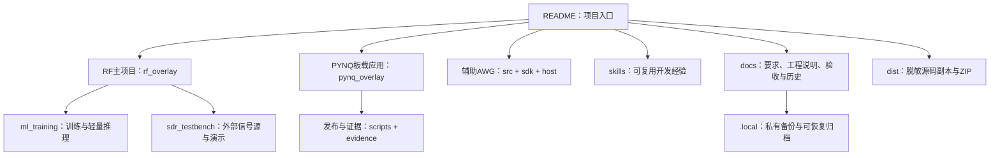

# 工程结构与维护入口

整理日期：2026-10-30。本文是目录导航，不替代原始实验收据，也不声明本日重新验收过板卡。

## 目录职责

| 目录 | 内容与入口 | 整理原则 |
|---|---|---|
| `rf_overlay/rtl/`、`rf_overlay/sw/board_app/` | RF实时样点链、控制与接收分析；原生测试见`board_app/Makefile` | 主项目源码；保留布局避免破坏构建引用 |
| `pynq_overlay/sw/` | 五寸屏界面、客户端、状态拥有者和发布管理 | RF产品界面在板载Linux；不是`host/main.py` |
| `src/rtl/`、`src/tb/`、`sdk/src/`、`host/` | 辅助AWG/裸机PS/PC上位机 | 独立于RF验收；旧说明见`awg-legacy-guide.md` |
| `scripts/` | 构建、打包、验收与恢复入口 | 使用脚本帮助和实际发布清单；不从旧日志猜参数 |
| `ml_training/` | 模拟数据生成、特征、训练、模型与ARM性能验证 | 数据集不是缓存；JSON权重与生成器保留 |
| `sdr_testbench/` | GNU Radio/Pluto、示波器与外部BPSK联调 | `gui_demo/`用于配置演示；历史接线不等于当前接线 |
| `skills/` | 通用PYNQ、本项目、Pluto测试技能的维护副本 | 与个人技能安装目录同步；不写凭据 |
| `docs/requirements/` | 需求与简化审查规则 | 本轮范围与规则先查这里 |
| `docs/rf/` | RF开发/部署runbook与技术说明 | 按问题选读，不全量重审 |
| `docs/reviews/` | 审查结论 | 保留失败和限制，不抹除不利结果 |
| `docs/memory/`、`CLAUDE.md` | 工程记忆与历史索引 | 历史“最新”按日期理解，避免继续复制大段正文 |
| `docs/handoff/` | 旧对话交接、任务板 | 保留开发机；默认不分享 |
| `docs/reference/` | 第三方资料、图片与大参考归档 | 不是缓存，不删除；默认不分享 |
| `evidence/` | 原始IQ、收据、候选、回退件与相关工作树 | 本次不移动或原地脱敏；避免破坏路径/摘要链 |
| `.local/` | 本次原件备份与根目录临时文件归档 | 已忽略；仅开发机私有保存 |
| `dist/` | 自动生成的脱敏文本源码副本和ZIP | 已忽略；不是可安装发布物 |

## 构建与运行路线

- AWG：`python scripts/build_bitstream.py`，PC界面`python host/main.py`。修改BD引用RTL后不能仅重跑旧综合。
- 独立PYNQ：`vivado -mode batch -source pynq_overlay/build.tcl`。
- 独立RF：`vivado -mode batch -source rf_overlay/build.tcl`。
- 合并产品：从`scripts/package_merged_overlay.py`、`pynq_overlay/sw/merged_release.py`和既有安装流程核对实际输入。独立目标不直接覆盖合并产品。
- GNU Radio GUI：见`sdr_testbench/gui_demo/README.md`及该目录实际启动入口。预览与限时真实发射分开。

Vivado/Vitis使用2025.2。板端Overlay只能由一个拥有者重配置；本次整理没有安装、重新加载PL或进行射频操作。

## 为什么不全量搬迁

已有构建脚本、测试夹具、发布清单和报告引用这些目录。现在整体改名会引入路径故障，延误验收。因此本次整理采用清晰入口、可恢复临时文件归档和独立分享副本；后续只有明确引用迁移计划时再改源码布局。

## 后续维护

新增实验使用独立输出目录；原始数据、判据、结果与失败原因同批保存。缓存与可再生文件不进入候选，数据集与收据不当缓存删。整理和分享的具体命令见[分享与隐私处理](SHARING-AND-CLEANUP.md)。
