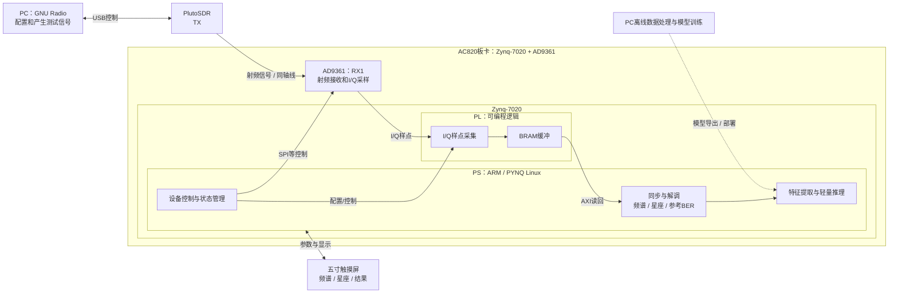

# 系统结构图：外部SDR激励与板卡接收

此图描述工程的功能分工和拟采用的外部信号源演示方式；箭头不代表相应组合已通过完整验收。项目状态以当时原始记录和交付复审为准。

## 各模块与当前边界

- 外部信号源由PC运行GNU Radio控制PlutoSDR；图中指Pluto TX到板卡RX1的方案。实际接线与输入条件应在现场确认。
- PL承担I/Q样点采集及BRAM缓冲；接收同步、解调、特征处理和轻量推理位于PS侧。本图不把PS计算表述为PL实时同步解调。
- 触摸屏用于参数交互和结果显示；参考BER仅适用于存在明确参考数据及有效同步的情况。
- 离线训练与板端运行之间的虚线表示模型准备和部署关系，不表示所有模型已经完成真板集成。
- 本轮范围为BPSK/QPSK与有限条件下QAM16；QAM64已移出。外部SDR的历史统计整体未通过，QAM16有已记录误码；EVM、RRC真实链路和自动档位选择不能由此图推定已验收。

关联说明：[工程结构](PROJECT-STRUCTURE.md)、[交付材料索引](DELIVERY-INDEX.md)、[外部SDR与接收边界](../../skills/final-prj-rf-development/references/receiver-and-sdr.md)。
