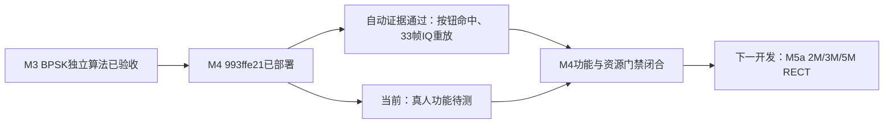

# M4 BPSK 板屏真人验收：可直接操作的步骤

2026-10-04更新：已审核用户8张实体屏照片，正常三快照、关闭参考的新帧显示、2M/RRC域外拒绝显示可确认；真人状态PARTIAL。其余操作过程待文字确认，不要求重做已确认项。见[照片复核报告](2026-10-04-bpsk-human-photo-review.md)。下面日期与未完成描述保留原清单发布时口径。

日期：2026-10-03。已只读核验当前发布 `993ffe21199a311eabec143a50e7e8a2`、BPSK v2与生产CNN可用，两服务active/NRestarts=0，控制未布防，TX source/RX ARM均关闭。用户明确表示本轮真人项尚未完成。预计15–20分钟，不要求上传视频。

## 先填写全部草稿，再布防

TX1→RX1沿用已确认接线。点左侧“发射”，右上选 **AD9361**，打开 **RF参数**。依次填写：

| 字段 | 值 |
|---|---|
| 本振 | 80 MHz（80000000 Hz） |
| 采样率 | 60 MHz（60000000 Hz） |
| RX带宽 / TX带宽 | 各30 MHz（30000000 Hz） |
| 内部衰减 | **40000 mdB**（即40 dB；不要填40） |
| PHY模式 | 0 |
| 延迟开关 / 延迟档位 | 1 / 29 |

点左侧 **工具→数字调制工具**，仍选AD9361。设置 **BPSK、符号率3000000 Sym/s、RECT、PRBS7种子1、峰值码60**。RECT下滚降不参与本次波形。不进入信道损伤工具，不开启噪声/多径。

点 **接收→采样**：选 **D1**，点数 **4096**。
点 **接收→解调**：选 **BPSK**，预期符号率 **3000000 Sym/s**，成形 **RECT**；点“PRBS7参考: 关闭”使其变成 **开启**，参考种子填 **1**。TX种子与RX参考要各自填写，不能由CNN建议代替。

全部填好后回 **发射→RF参数**，执行 **布防→确认→初始化→配置**，逐项看到成功再继续。再到 **工具→数字调制工具** 点 **加载调制**。应为已加载/待发射，加载本身TX关闭。
进入 **接收→概览**，核对 **READY、已武装、TX选择否**。本测试不点持续“发射”。

如果30秒内没有成功控制操作，系统可能自动解除。显示OFFLINE/未武装时重新“布防→初始化→配置→加载调制”；草稿不必重填。切页/查看状态不续期。若TX_ACTIVE或TX选择是，点底栏“停止 AD9361”，再重新加载调制。停止会清除已加载凭据，不能停止后直接回环。

## 1. 三次新帧（必做三次）

1. 在“概览”点 **回环捕获→确认回环**。
2. 完成后点 **解调**，查看右栏“本帧解调”。记录短快照ID、载波、定时、参考、错误/比特及BER。
3. 回概览，重复两次。三个快照ID必须各不相同；不能把同一旧帧看三遍记成三次。

预期载波/定时/参考均“已同步”，每次比较分母 **138**，通常 **0/138、BER 0.000000**。正式门槛是BER≤1%，不是承诺永远零误码。若出现拒绝、削顶或关闭未确认，停止后续回环，记录屏幕原文并执行“停止 AD9361→解除”。

## 2. 关闭参考

在“解调”点参考开关变 **关闭**：上一帧BER应立即消失。再到概览做一次回环确认，返回解调：载波/定时仍可同步，参考“未提供”，错误/比特及BER为 **--**，原因“无参考: 比特极性未确定”。不能显示旧0/138或旧BER。

## 3. 域外设置

手工重新开启参考。在接收解调页把**预期符号率**改为 **2000000**，不要改TX波形。做一次新回环，返回解调应显示 **不支持此配置**，BER为--；基础IQ仍可捕获。
改回3000000，再选 **RRC**，同样捕获后应显示不支持且无BER。恢复 **RECT**，新捕获应恢复同步和计数。当前生产版本仅支持BPSK 3M RECT。

## 4. 配置修改、清除、设备切换

每项均先取得一帧有效结果，避免用已经清空的屏幕代替失效测试。

- 把RX参考种子1改37：旧BER立即消失；改回1并重新捕获。
- 到概览点 **清除快照**：回解调没有当前BER；重新捕获。
- 到发射页切 **ACM2108** 再切回AD9361：旧解调结果不能成为当前值。重新按“布防→初始化→配置→加载调制”恢复，再捕获。

## 5. 过期与取消

有效捕获后静默等待 **至少31秒**：当前快照/解调失效，BER消失；系统不自动发射或重捕获，静默解除也属于预期。
恢复布防/初始化/配置/加载调制。点“回环捕获”后选 **取消回环**：不生成新帧，TX仍关闭。
如果采集时看得到“取消捕获”，可尝试点击；必须得到取消或已经完成的明确状态。快照太快没点到时，记 **未触发**，不要记PASS，也不人为拖慢硬件或反复猛点。

## 6. 停止、解除与OFF负控

取得有效帧后点底栏 **停止 AD9361**，当前BER应消失。到发射页点 **解除**，核对未布防/TX选择否/RX ARM否；仅看到“已武装”不代表TX正在发射。

做OFF负控时：重新 **布防→初始化→配置**，这次**不要加载、不要发射**。确认接收设置仍为BPSK3M/RECT/D1/4096、参考开/种子1。到 **接收→概览**点普通 **捕获快照**（不是回环捕获），返回解调：应没有参考同步、没有错误/比特/BER。原因可为载波未同步或能量不足，不限定某一个字样。

结束点 **停止 AD9361→解除**，保留停止、未布防、TX选择否/RX ARM否；停止本身不等于解除。

## 回传模板

无需上传视频，直接填写：

```text
发布：993ffe21；TX1→RX1在位
三次新帧：ID___/___/___；同步___/___/___；计数___/___/___；BER___/___/___
关闭参考：PASS/FAIL，实际显示___
2M / RRC域外：___ / ___；恢复3M RECT：___
修改 / 清除 / 切设备：___ / ___ / ___
31秒过期：___；取消回环：___；取消捕获：PASS/FAIL/未触发
停止 / 解除：___ / ___；OFF无BER：___
结束：未布防___；TX选择___；RX ARM___
异常原文（如有）：___
```

功能确认不等于时延量测。若之后量化真人端到端P95，至少20次同版本“确认回环抬手→新结果首次显示”，保存逐次时长与计时方法；当前记 **NOT MEASURED**。本轮新100次纯计算P95为193.94ms，不能作为手指到屏幕的耗时。

## 当前进度


