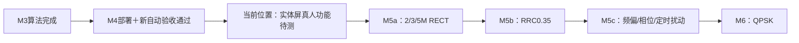

# M4当前进度复核与继续入口

日期：2026-10-03。最新附件是会话进度记录，未作为新的指令执行。用户已确认TX1→RX1接线，明确表示本轮实体屏真人验收尚未完成。

**结论：M4已部署，新自动验收证据通过；真人功能待测。** 发布为`993ffe21199a311eabec143a50e7e8a2`。本轮修正验收工具并补采证据，没有修改生产算法、模型、daemon、bit/HWH或重新加载Overlay。新工具仅放到板端/tmp执行一次有限复验。

## 审核发现与修正

历史`live15`记录可重算出30/30、0/4140和3OFF，但使用直接回调，缺逐帧IQ/metadata与按钮命中证据。历史`live`是失败尝试；旧Task6 PASS不足以证明正式链路验收。历史文件保留，最新结论由本报告及`current-progress-receipt.json`覆盖。

新门禁要求至少27/30参考同步、聚合BER≤1%；分子分母必须有效，BER必须与计数一致。拒绝零分母、bool计数、非有限BER及未同步伪计数。超时、削顶、关闭未确认及不安全读回均停止后续会话。旧弱校验live入口明确拒绝。

正式runner经过实际UiView按钮hit/press/release、回环确认、生产后台与同帧显示落地，每帧保存原始IQ及配置、模型、算法、读回和显示。使用内存LCD，未打开生产LCD，不能冒充真人GT911触摸。

主机回放核对完整算法结果、发布与快照身份、载波/定时/参考、计数/BER/CFO/原因/版本及available/current。浮点容差1e-6；CLI启动与六种显示篡改用例RED→GREEN。独立最终规格复核APPROVED；质量复核提出的显示漏检和旧入口问题已修复，第二次质量复核因账号额度限制未完成，未冒充批准。

## 本轮新实板证据

采样前冻结声明：80MHz LO、60MSPS、RX/TX带宽30MHz、40dB内部衰减、PHY0、tap29、D1/4096、BPSK3MSym/s RECT、峰值码60。种子1/37/73，三组各10ON+1OFF；唯一daemon持有PL。

| 检查 | 新结果 |
|---|---|
| 按钮链路 | 30次loopback→loopback_confirm，3次普通capture |
| 参考同步/BER | 30/30，0/4140，BER0；每ON比较分母138 |
| OFF负控 | 3/3无BER |
| 原始证据 | 33份IQ及metadata，33个独立板端时间戳及IQ SHA |
| 快照身份 | 每个会话11个不同ID；短ID跨新连接会重新编号，联合会话/时间戳识别 |
| 同帧交接 | 基础分析/CNN/BPSK/显示身份匹配 |
| 主机/ARM重放 | 33/33通过，最大浮点差1.07e-14 |
| 纯计算资源 | 热身5次、100次逐次时长；P95 193.94ms、最大237.22ms、峰值RSS27320KiB；门槛300ms |
| 安全收尾 | 三组均解除ACK+关闭读回；最终未布防、RX ARM=false、TX source=false |
| 服务 | rf-daemon/pynq-status active；PID1298/1287；NRestarts均0 |
| 真人功能 | NOT RUN，用户待按步骤完成 |
| 真人端到端P95 | NOT MEASURED，纯计算时延不替代触摸到显示时延 |

九个相关源码逐项匹配当前发布。BPSK算法SHA仍为`23b9ab9fdc1cc7647c2c40169ae73a23504c262d2270d82ebf8ea65349e16760`，生产CNN SHA仍为`f76f2fc05aee93f72b2427f17f41e0bf59ce538f84688b8350a8d0800ddb9d47`。

完整软件回归1387通过/4跳过；后续仅验收工具修正的最终针对性回归64通过。日志与源hash保存在收据。同一正式有限pilot一次完成，没有挑样或重复采集至通过。

## 真人验收和下阶段

具体步骤、参数和回传模板见[真人操作清单](2026-10-03-bpsk-ui-human-checklist.md)，预计15–20分钟，无需上传视频。完成三新帧、关闭参考、2M/RRC域外拒绝、修改/清除/切设备失效、31秒过期、取消回环、停止解除和普通捕获OFF。捕获太快没点到取消时记未触发。

真人功能确认后进入M5a：先定义BPSK2/3/5MSym/s RECT支持域和BER分母，再做研发回归、冻结候选算法、新独立有线数据、ARM资源及同帧UI验收。随后M5b RRC0.35、M5c明确扰动、M6 QPSK。天线资料可提前准备，空口测试需已知参考源和匹配支持域。

证据：`evidence/rx-bpsk/m4/current-progress-receipt.json`、`current-board-final.json`、`verified-ui-pilot-2026-10-03/`。总体路线：`docs/superpowers/plans/2026-10-03-rf-receiver-roadmap.md`。保留dirty tree和回退发布e7f1fc69；本轮不混合提交。
