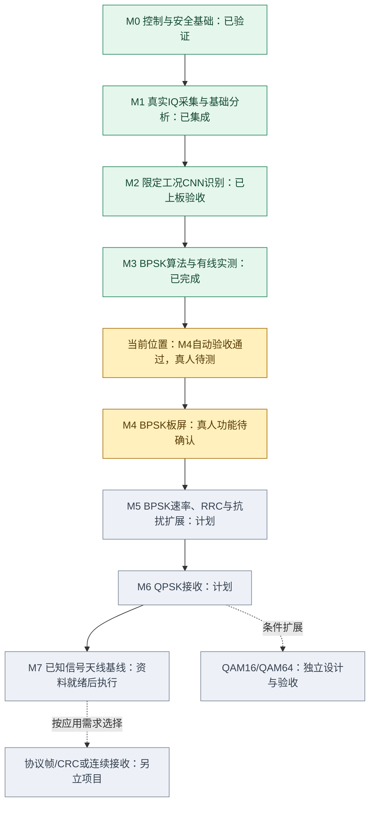
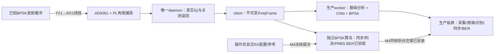

# RF接收项目阶段性总结

2026-10-04范围更新：用户选定“教学演示＋环境诊断”。本轮BPSK必交，QPSK条件扩展，建议人工确认；原M5a多速率/RRC优先路线暂停。当前方向见[作品收敛总结](2026-10-04-work-scope-summary.md)，新总体路线见`docs/superpowers/plans/2026-10-04-teaching-environment-roadmap.md`。下文保留历史阶段与原路线。

2026-10-04补充：用户8张实体屏照片已复核，三不同快照正常显示、参考关闭后无BER、2M/RRC拒绝显示通过；真人状态PARTIAL，失效/取消/停止解除/OFF等仍待确认。最新报告：[真人照片复核](2026-10-04-bpsk-human-photo-review.md)。本轮未访问板卡，下文2026-10-03实板数据维持原口径。

日期：2026-10-03。已接续最新会话包并只读核验板端。本文是当前状态入口；历史阶段证据保持，最新复核见2026-10-03-bpsk-ui-progress-audit.md。

当前位于 **M4已部署，新自动验收通过，真人功能待确认**。发布993ffe21已接入BPSK v2；最新用户明确表示真人测试尚未完成。下一主线仍是M4收尾，随后M5a多速率RECT。

## 已完成到什么程度

| 阶段 | 状态 | 已有成果 | 完成边界 |
|---|---|---|---|
| M0 控制与安全基础 | 已验证基础链路 | 既有PL/PS、唯一daemon、版本化发布、布防/加载/停止/解除、实际watchdog | 不是宣称整个AWG工程所有功能都验收完毕 |
| M1 真实IQ采集与分析 | 已集成、已实测 | RX1 I/Q、4096点快照、RMS/dBFS/频谱/削顶、后台采集和生命周期 | 有限快照；不是连续接收，码值不是插口dBm/Vpp |
| M2 轻量CNN识别 | 限定有线工况正式验收 | 冻结测试macro-F1=0.95695；ARM100次P95=67.75ms；生产板屏与建议仅填草稿 | 分类不是载波/定时同步；有线准确率不是空口准确率；AUTO关闭 |
| M3 BPSK同步、判决、BER | 算法/ARM/新有线pilot完成 | 30/30参考同步，0/4140错误；3OFF无BER；33帧主机/ARM一致；100次计算P95=92.88ms | 仅60MSPS/D1/4096点、BPSK3MSym/s RECT；现已由M4接入生产板屏 |
| M4 BPSK板屏完整交互 | 已部署，自动验收通过 | 新实际UiView按钮链路30/30、0/4140、3OFF无BER；33帧IQ重放；100次纯计算P95 193.94ms | 真人功能待测；触摸端到端时延未量测 |

此前用户已确认现有采集交互正常，并确认单次真人生产回环、建议仅改草稿、>31秒失效、停止及解除布防通过。该确认针对现有采集/CNN界面，**不算M4新BPSK界面验收**。真人端到端P95、完整真人OFF/三ON/OFF和真人静默watchdog计时仍未单独测定。

## 开发位置图

这个图是RF接收子项目路线，不给整个AWG工程编造总完成百分比。天线准备资料可与软件开发并行；实际天线测试等待M4及相应输入工况准备完成，不把缺天线资料当作有线开发的阻塞。

## 当前链路与缺口

产品链路已经安装。新正式自动验收证据已补齐，当前缺口是实体屏真人验证；详细操作见2026-10-03-bpsk-ui-human-checklist.md。本次不需要新PL综合。

## 本轮最关键的结论

1. 合成测试通过不能替代真实接收。BPSK v1逐点相位展开在真实滤波过零处积累周跳；使用旧TRAIN/VAL定位并补回归后，v2在正式pilot前修复。
2. BER必须有可查分子/分母。每帧203个积分符号，丢两端后201个，63位用于参考对齐，138位独立比较；0/4140只是本次观察值，不承诺长期零误码。
3. 算法、生产能力与真人结果分开。BPSK已接入板屏，但M4实体交互仍须单独验收，不能把回调直接调用冒充手指触摸。

## 发布与证据基线

最近核验生产发布：`993ffe21199a311eabec143a50e7e8a2`。本轮只读核验算法/模型可用、两服务active、NRestarts=0、未布防、source=false/RX ARM=false；证据current-board-audit.json。e7f1fc69保留作回退。

- BPSK交付报告：[2026-10-03-bpsk-receiver-acceptance.md](2026-10-03-bpsk-receiver-acceptance.md)。
- BPSK总收据：`evidence/rx-bpsk/2026-10-03/final-receipt.json`；260项相关测试记录、33对新实测IQ/metadata及ARM性能均已保存。
- 生产CNN与ARM报告：[2026-10-03-production-board-continuation-audit.md](2026-10-03-production-board-continuation-audit.md)，后续物理及真人结果见CLAUDE.md最新条目。
- 下一步总路线：`docs/superpowers/plans/2026-10-03-rf-receiver-roadmap.md`。
- M4设计：`docs/superpowers/specs/2026-10-03-bpsk-ui-integration-design.md`。
- M4实施计划：`docs/superpowers/plans/2026-10-03-bpsk-ui-integration.md`。
