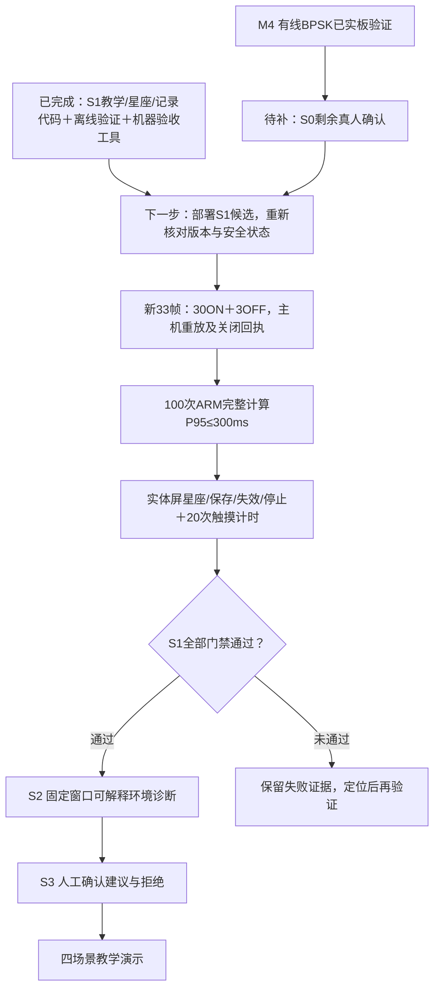

# S1 接续：机器验收工具已闭合，待实板验收

2026-10-04。本次完成S1 Task 6的验收工具，不改生产接收算法、PL、守护进程或候选发布。候选仍为 `c3bf915c544563324778d1c879b38e3a`，未安装；S1总体未通过，S2/S3尚未开发。

新增 `scripts/rf_teaching_acceptance.py`，取回证据后自动重放33帧同输入IQ，并独立汇总三组种子1/37/73的30ON+3OFF。它要求≥27帧参考同步、聚合BER≤1%、OFF无参考同步/BER/星座、三组关闭安全且解除ACK；核对实际屏幕显示与同帧解调字段，拒绝重复IQ/重复会话内ID及提交域错配。

资源门禁独立重算100次完整计算的P50/P95/最大值，P95≤300ms；要求5次热身、CNN与真实星座计算启用、记录RSS，输入必须来自首帧201符号/128点。候选模型、算法、运行时与获批基准脚本哈希必须匹配。它不将后台计算时长当作触摸时延。

`scripts/rf_bpsk_ui_board_run.py --teaching`现在要求联网前提供本地 `--candidate` 并通过完整发布校验。联网、采集或取证失败也保存transport与明确拒绝的机器收据；非零远端退出不能离线重验成通过。三个上传脚本与主机验收器的哈希独立核对。旧M4无教学参数调用继续兼容。

## 本次验证

| 检查 | 结果 | 限制 |
|---|---|---|
| 新验收测试 | 31通过，含RED→GREEN负控 | 测试生成33帧IQ贯通生产数学重放，非实板 |
| 验收/数学重放/资源路径/板端会话/旧M4工具六组回归 | 91通过 | 未执行新ARM计算或触摸 |
| 候选隔离加载 | CNN生产、BPSK、教学模块均available | 主机加载，未安装 |
| 独立复审 | APPROVED，修复三项缺口后复审69项通过 | 只读代码审阅 |
| 板端只读预检（北京时间11:44:52） | 993ffe21完整校验通过，服务active/NRestarts=0；未布防、TX选择否、RX ARM否 | 当时状态；未布防/发射/部署，未调用Overlay |

板端当前 `status_only`，在正式有限测试前须依既有受控会话流程配置并重新预检；不通过强制接管或第二个Overlay继续。S0尚缺修改/清除瞬间失效、31秒、取消、停止→解除、OFF负控的真人确认，已通过照片不要求重测。具体步骤见 `2026-10-03-bpsk-ui-human-checklist.md`。

## 当前阶段与接下来顺序



S0关闭且S1已部署后，有限验收命令如下；`--cable-confirmed`须以现场TX1→RX1仍在位为依据，输出目录每次唯一，不自动重试：

```powershell
python scripts/rf_bpsk_ui_board_run.py --release c3bf915c544563324778d1c879b38e3a --candidate evidence/rf-teaching/s1/candidate/releases/c3bf915c544563324778d1c879b38e3a --teaching --cable-confirmed --output evidence/rf-teaching/s1/board-pilot-<唯一编号>
```

重验已取回的完整目录不连接板卡：

```powershell
python scripts/rf_teaching_acceptance.py <完整pilot目录> --candidate evidence/rf-teaching/s1/candidate/releases/c3bf915c544563324778d1c879b38e3a --release c3bf915c544563324778d1c879b38e3a --output <新收据.json>
```

即便 `machine_passed=true`，本工具仍写 `stage_passed=false`、`human_touch=NOT_RUN`、`touch_latency=NOT_MEASURED`；真人结果须另立证据后汇入S1总收据。本次新收据在 `evidence/rf-teaching/s1/continuation-2026-10-04/continuation-receipt.json`，与上一轮offline-receipt哈希相连，不覆盖旧证据。
