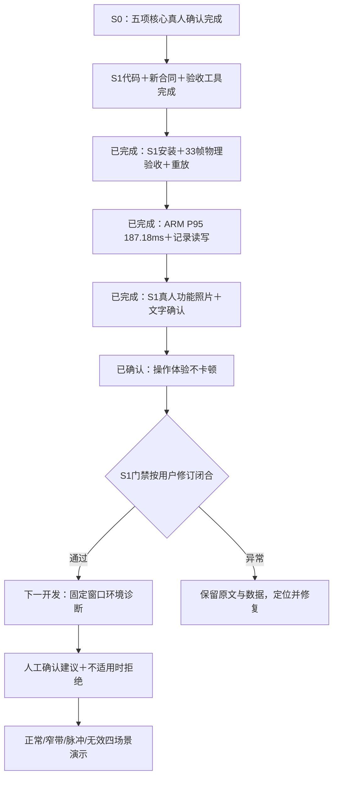

# S1已通过：功能与操作体验确认，开始S2

**最新门禁修订：** 用户明确“每次捕获的时间间隔体验不卡顿，无需为体验专门计时，可以开始下一阶段”。S1按机器＋真人功能＋用户体验确认关闭；精确触摸计时保持NOT_MEASURED、按用户决定非阻塞。S2已授权开发。新闭合收据见 `evidence/rf-teaching/s1/closure-2026-10-04/receipt.json`，旧机器/照片收据保留原始状态，以下待计时描述为修订前历史。

2026-10-04。用户确认S0剩余五项均通过且TX1→RX1仍在位后，安装候选 `c3bf915c544563324778d1c879b38e3a`，新合同 `cnn-bpsk-teaching-v1`。S1机器门禁通过；本轮11张实体屏照片和用户补充文字确认闭合真人功能验收。20次触摸时延用户明确未测；“预计通过”不记实测。S1整体仍未关闭，S2/S3未开始。详见 [本轮照片复核](2026-10-04-s1-human-photo-review.md)。

## 完成结果

| 项目 | 实测结果 | 证据边界 |
|---|---|---|
| S0部署前真人门禁 | 修改/清除立即失效、31秒、取消、停止解除、OFF五项均通过 | 用户明确文字确认；独立切设备/采集中短时取消未另报告 |
| S1安装 | 新发布完整校验；两服务active/running、NRestarts=0；准确active-release标记与正数PID | 旧993ffe21及原服务文件保留为回退；未重建PL/守护程序 |
| 新物理有限采集 | 三组种子1/37/73，各10ON+1OFF；30/30参考同步 | TX峰值码60、3M RECT、Fs60M/D1/4096、LO80M/BW30M、40dB内部衰减、PHY0/tap29；非连续发射 |
| BER与负控 | 0/4140，聚合BER=0；3OFF无BER及同步星座 | 每帧真实IQ均保留，33个不同IQ SHA；跨会话capture ID允许重新计数 |
| 真实接收星座 | 30ON各128显示点/201有效符号；3OFF均无点 | 归一化同步测量；128不是BER分母，不作为EVM或射频功率校准 |
| 同输入主机/ARM重放 | 33/33逐字段一致，星座浮点容差1e-6；显示身份、同步、BER、CFO、版本均一致 | 实际UiView按钮命中/按下/抬起走内存LCD；不冒充GT911真人验收 |
| 每组关闭 | 3/3 safe及解除ACK，超时/削顶/未关闭停止条件均未触发 | 独立自动收尾读回见下文；用户随后手测会改变状态 |
| ARM完整计算 | 热身5次、100次：P50 170.93ms、P95 **187.18ms**、最大254.74ms；RSS峰值22608KiB | 同时含基础分析/CNN/BPSK/真实星座，P95≤300ms；不含捕获、网络或触摸时延 |
| 板端实验记录 | 4条历史记录生产模块写入/读取，取回后4/4数学重放通过 | 两条ON、一条OFF、一条同ON IQ关闭参考重分析；不是额外4帧新物理采集或真人按钮验证 |
| 无参考同输入检查 | 真实IQ保留128点/201符号、BER为空 | 使用刚采集的S1 IQ在ARM重新分析；实体屏关闭参考后的新捕获仍由用户验收 |
| 部署工具回归 | 新20项；部署/验收/重放/资源四组共67项通过，shell语法通过 | 回滚服务与板/主机资格不一致均RED→GREEN，独立复审通过 |

北京时间14:20:58独立自动收尾读回：新发布校验通过、未布防、TX source=false、RX ARM=false；pynq-status PID1072、rf-daemon PID1094，均NRestarts=0。这仅是自动验收结束时的状态，用户随后在实体屏测试中，不能据此推断手测中的实时状态。

## 当前开发位置

## 真人功能通过；剩余实体触摸计时

用户提交11张照片，并对补充问题回复“1.对2.成功3，通过4.未测，但是测试预计通过”。三次开启参考的正常回环、关参考新帧有星座无BER、保存当前/31秒失效/历史保存、RRC拒绝及恢复、取消回环、停止解除、OFF及最终双路关闭，按照片与文字确认共同记真人功能通过。第三个正常参考帧的ID未记录，照片图3/4为同帧，不重复计数；图1/10的2M拒绝不冒充OFF证据。真人保存对应新文件完整性及短时采集中取消未另验证。逐图读数和原图SHA见本轮复核收据。

剩余实测触摸时延另量20次“确认回环抬手→新ID/结果首次显示”，保留逐次值与计时方法。无需重复已确认功能或再上传照片。当前ARM纯计算187.18ms不能代替该数值。步骤详见 [实体屏清单第8步](2026-10-04-s1-teaching-human-checklist.md)。

专门触摸计时按用户最新指示不再阻塞S2。S2沿既有总体Plan实施：已知BPSK固定68.27µs窗口的正常/窄带/脉冲/未知/无效规则诊断，保留特征及判断理由；受控注入真值来自实验声明，不能直接填接收诊断。档位40需单独正常资格与成对收益验证，建议始终由人工确认，不自动恢复发射。

## 证据入口

- S0：[真人闭合收据](../../evidence/rx-bpsk/m4/s0-human-closure-2026-10-04.json)。
- S1真人功能：[本轮照片与文字复核收据](../../evidence/rf-teaching/s1/human-photo-review-2026-10-04/photo-review-receipt.json)，含11张原图SHA、逐图读数、文字确认和未测门禁。
- 安装：[安装收据](../../evidence/rf-teaching/s1/deployment-2026-10-04/install-v1/install-receipt.json)、pre/post状态与install.log。
- 新机器验收：[machine-acceptance.json](../../evidence/rf-teaching/s1/board-pilot-2026-10-04-v1/machine-acceptance.json)，同目录含33份IQ/metadata、声明、原采集报告、100次耗时及transport。
- ARM记录：[记录读写收据](../../evidence/rf-teaching/s1/deployment-2026-10-04/arm-record-roundtrip/receipt.json)，同目录含四个完整历史记录。
- 自动最终状态：[关闭读回](../../evidence/rf-teaching/s1/continuation-2026-10-04/board-after-s1-pilot.json)。
- 接续总收据：`evidence/rf-teaching/s1/deployment-2026-10-04/live-receipt.json`。旧offline/continuation收据仍保留，最新状态以上述实板收据为准。
