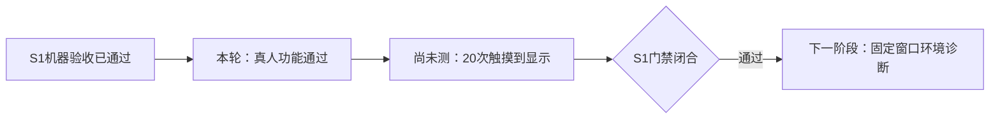

# S1实体屏照片复核：功能通过，触摸计时未测

2026-10-04。用户提交11张实体屏照片，并补充确认：`1.对2.成功3，通过4.未测，但是测试预计通过`。本次将照片直接可见的状态和用户文字确认分别记录。S1真人功能验收通过；20次实体触摸到新结果显示计时仍为 **NOT MEASURED**，S1整体门禁未关闭，S2/S3未开始。

对应已安装发布为 `c3bf915c544563324778d1c879b38e3a`；照片快照ID可见前缀为 `c3bf915c`。完整发布身份沿用此前安装收据，不声称照片显示了完整manifest。本轮只归档原图、复核结果和更新文档，未连接板卡或改变硬件状态。

## 照片逐张复核

编号按本次用户附件顺序，不假设附件顺序就是测试时间顺序。屏幕显示截短的ID仅记录可见部分；一帧的星座页和解调页不重复计数。

| 图 | 可见内容 | 可以确认及证据边界 |
|---|---|---|
| 1 | BPSK、2M、RECT、参考关闭；无同步/BER；“不支持此配置”，可见ID尾部 `15c-g37999-c18-8` | 2M域外配置被拒绝。不是有效域下OFF负控的证据 |
| 2 | 星座双簇；`rx-c3bf915c-g36295-c4-1`；128/201、0/138、载波/定时/参考同步 | 开启参考的正常帧A，真实星座与计数符合预期 |
| 3 | 星座双簇；`rx-c3bf915c-g36366-c6-2`；128/201、0/138、同步 | 开启参考的正常帧B |
| 4 | 图3同帧解调；3M RECT、参考开启、种子1；载波/定时/参考同步；频偏-10.5Hz；0/138、BER0 | 正常解调结果正确；与图3同帧，不另计第三帧 |
| 5 | `rx-c3bf915c-g36619-c8-3`；真实星座128/201；错误/比特为空；参考关闭 | 关闭参考后的新帧仍有真实同步符号 |
| 6 | 图5同帧解调；3M RECT、参考关闭；载波/定时同步；频偏-7.2Hz；无计数/BER；“无参考: 比特极性未确定” | 无参考时不报告BER，符合设计；该帧不计入开启参考的三帧测试 |
| 7 | 域外帧ID尾部 `c3bf915c-g37165-c14-6`；0/0、无BER、UNSUPPORTED；“历史记录已保存” | 域外无伪点，有保存成功提示；仅凭此图不能判定保存按钮、保存对象或31秒等待过程 |
| 8 | 快照为空、0/0、无计数；`INVALIDATED: daemon 已停止武装`；保存成功提示仍在 | 失去武装后当前星座失效。文字表示会话不再武装，不表示守护进程崩溃 |
| 9 | DONE、READY、已武装；Fs60M/D1，复数RMS约-29.8dBFS、未输出削顶、主峰10MHz、99%占用带宽51.74MHz | 一帧采集和基础分析已完成。没有TX/RX关闭字段或有效域下无BER，不能单独证明OFF或最终关闭 |
| 10 | 图7对应解调；2M RECT、参考关闭、无BER、不支持此配置 | 与图7共同证明域外拒绝；无BER也可能由域外设置造成，不能据此计OFF通过 |
| 11 | 3M RECT、参考开启、种子1；旧快照/同步/BER无效；`INVALIDATED: daemon 已停止武装` | 解调旧值被作废，符合停止/解除后的显示要求；双路实际关闭另外由用户文字确认 |

保存成功提示会在后续页面状态变化时保留，图7/8/10的域外或失效原因是当时的接收状态，不能据此断言保存失败，也不能把保存提示当成当前帧仍有效。

## 用户补充确认

原问题第一项为“三次正常回环是否都在参考开启下完成”，用户回答“对”。照片直接支持其中两帧，第三帧由该文字确认支撑，第三帧ID未记录；不拿关闭参考的帧凑足三帧。

| 功能项目 | 结果 | 证据来源 |
|---|---|---|
| 三次开启参考的正常回环 | 通过 | 两帧照片＋用户明确确认三次均开启参考 |
| 新帧128点/201符号与同步计数显示 | 通过 | 图2～6，正常参考帧0/138、BER0 |
| 关闭参考后新帧有星座无BER | 通过 | 图5/6同帧，身份与正常参考帧不同 |
| 保存当前、等待至少31秒后清点/清BER、另存历史 | 通过 | 图7/8保存/失效状态＋用户对这三个操作“成功”的明确确认 |
| 2M拒绝、RRC拒绝及恢复3M RECT后的新帧 | 通过 | 2M拒绝照片；RRC拒绝及恢复由用户明确确认 |
| 取消回环不进行新采集 | 通过 | 用户文字确认；采集进行中的短时取消未单独报告 |
| 停止/解除使结果失效 | 通过 | 图8/11＋用户确认 |
| 有效接收域下OFF普通捕获无同步/无BER | 通过 | 用户文字确认；图1/10本身不作为OFF证据 |
| 最终TX/RX关闭 | 通过 | 用户文字确认；不是用此前机器收尾读回替代本次手测结果 |
| 20次实体触摸计时 | 未测 | 用户明确“未测”；“预计通过”不计作实测通过 |

本轮真人保存的对应板端IQ/metadata/receipt尚未取回，不把照片提示升级为新保存文件的哈希/重放验收。此前开发端4条ARM写入/读取/数学重放通过仍是独立机器证据。

## 当前位置和剩余操作

剩余必需提交的是20次计时数据：在接收星座页，从手指离开“确认回环”计到新ID与对应新结果首次出现；逐次记录耗时、ID、失败和计时方法。会话恢复时间不计入一次捕获；后台ARM纯计算P95不能替代该测量。具体准备/恢复流程沿用实体屏清单第2/8步。

无需重复已确认的功能测试，也无需再上传照片。独立短时采集中取消未报告，继续保留该证据边界，不扩大本轮用户确认的含义。

## 归档

- 原图及逐图哈希：[照片复核收据](../../evidence/rf-teaching/s1/human-photo-review-2026-10-04/photo-review-receipt.json)。11张原图按附件顺序逐字节复制，源文件与归档SHA256逐张匹配。
- 操作流程：[S1实体屏清单](2026-10-04-s1-teaching-human-checklist.md)。
- 最新总体状态：[S1上板验收报告](2026-10-04-s1-board-validation.md)。
- 既有机器证据 `deployment-2026-10-04/live-receipt.json` 保留不改，本次收据绑定其SHA256；不修改旧证据快照来制造阶段通过。
