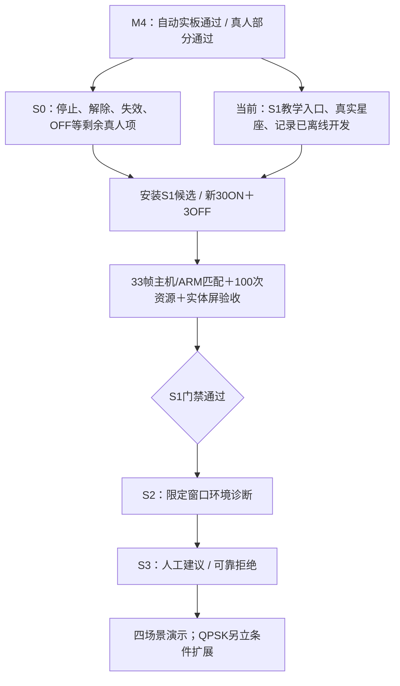

# S1 BPSK教学观察与实验记录：离线开发收据

日期：2026-10-04。用户批准“教学演示＋环境诊断”后开始S1。当前状态 **OFFLINE_IMPLEMENTED / BOARD_NOT_RUN**；S1整体仍待新实板、资源与真人门禁。分支 `codex/s1-teaching-observation`，保留工程原有dirty tree。

## 已实现的功能

- **教学配置入口**：固定AD9361/BPSK3M RECT/Fs60M/D1/4096、LO80M/BW30M/衰减40000mdB/PHY0/tap29、TX峰值码60，RX参考默认关闭。按钮只修改草稿并清除旧结果/加载凭据；布防、初始化、配置、加载与发射仍是独立操作。高级QAM/RRC发射、ACM2108和六分类CNN保留。
- **真实接收星座**：从同帧不可变IQ与已冻结BPSK同步估计提取符号，去DC、频偏/相位补偿、RECT积分、去边缘后按符号RMS归一化；显示最多128点、有效符号201。绘图点数不作为BER分母。参考关闭时允许同步散点，无BER；域外、失步和不匹配返回空点及原因。原发射图明确标“理想发射示意”。
- **实验记录**：显式保存到板端本地默认 `/home/xilinx/experiments`，独立后台线程写IQ、metadata、最后提交receipt；唯一目录，不覆盖；IQ≤16384字节、metadata≤131072字节。记录RF配置在捕获提交时冻结，重新配置/断连不能改写旧帧的配置。历史保存明确标历史，不恢复实时状态；无网络上传、无凭据，尚无控制结果写`NOT_RECORDED`。
- **同帧界面与失效**：raw_frame/analysis/model/demod/constellation由同一后台交接；遵循原代次、修订与30秒规则。取消、停止、异常、断连、换设备、旧配置和过期清除当前点/BER。写盘等待不阻塞STOP。
- **发布与验收工具**：新增完整合同`cnn-bpsk-teaching-v1`，带profile/constellation/record及所有旧依赖；保留旧合同隔离导入。有限实板驱动支持`--teaching`、保存真实星座和显示证据，拒绝缺星座/OFF假星座；新离线验证器核对数学、采集配置、哈希、行/显示身份和重复证据。100次资源工具加入一次BPSK和星座计算，尚未在ARM运行。

冻结 `rf_bpsk_receiver.py` SHA256仍为 `23b9ab9fdc1cc7647c2c40169ae73a23504c262d2270d82ebf8ea65349e16760`，`rf_bpsk_pipeline.py`同样未改变。不新增环境策略、QPSK接收、EVM或自动发射。

## 验证结果与实际边界

| 项目 | 本次证据 | 结论 |
|---|---|---|
| 完整Python软件回归 | `evidence/rf-teaching/s1/final-closure.log` | 1496通过、4跳过；独立最后工具与资源资格负控38项通过，见`green-resource-path.log` |
| C守护启动主机测试 | `c-startup.log` | 92 PASS / 0 FAIL；未改C生产控制逻辑，无真实板卡运行 |
| 新旧发布隔离与真实引擎 | `green-release.log`、`candidate-engines.log` | 旧cnn/cnn-bpsk无新模块可隔离导入；新候选的生产CNN、BPSK、教学模块均available |
| 已有M4实采IQ离线回放 | `saved-m4-replay/result.json` | 33/33通过，30ON有128真实点、3OFF无点；原BPSK逐字段匹配，0/4140；关闭参考的ON仍有点且无BER |
| 本地记录再读取 | 同33条历史记录与新record/verify测试 | 原IQ/metadata哈希一致；改写点、IQ、配置、版本或身份拒绝 |
| 界面预览 | `preview/reference-on.png`、`reference-off.png`、`off-negative.png` | 800×480记忆帧缓冲目视检查；底栏STOP/回环确认仍可达，不等于实体屏/GT911通过 |
| 独立审阅 | 收据`review_notes` | 身份/版本、回放采集配置及历史RF配置三类问题已新增RED→GREEN修复；最后规格/质量复核Approved |
| 新候选安装及30ON+3OFF | NOT_RUN | 等S0停止/解除/失效/OFF真人闭合，随后执行声明的有限新实板 |
| 新ARM 100次完整计算 | NOT_RUN | 不借用M4旧193.94ms，300ms门禁待测 |
| 新实体屏与20次触摸耗时 | NOT_RUN / NOT_MEASURED | 不用离屏点击或后台计算代替真人量测 |

记录中保留旧M4源发布 `993ffe21199a311eabec143a50e7e8a2`，并标`historical=true`；这些33帧不计作S1的新实板/ARM验收。原照片真人结论仍PARTIAL，本轮没有改变板上发布或控制状态。

## 候选与回退

候选发布：**`c3bf915c544563324778d1c879b38e3a`**。

目录：`evidence/rf-teaching/s1/candidate/releases/c3bf915c544563324778d1c879b38e3a/`。候选manifest、哈希、隔离panel导入和实际引擎加载已验证，**未安装**。软件清单/模型声明见`candidate-receipt.json`；构建收据明确`hardware_rebuilt=false`、`daemon_rebuilt=false`。

FPGA bit/HWH/daemon复用M4已验证产物（d5bfe5d9/ed8d011a/c33f9c5c），生产模型f76f2fc0保留。旧993ffe21发布重新校验可回退；未修改旧不可变发布。基线源码、规划原稿和本阶段diff保存供复查，不混合提交原有无关修改。

## 当前位置和下一步

先按[旧版本真人清单](2026-10-03-bpsk-ui-human-checklist.md)补齐未确认项；已有正常照片不重复。S0闭合后，在未布防且双路关闭状态安装候选，按冻结的三组种子1/37/73有限声明执行新实板和资源门禁。

新发布实体屏测试的逐项操作、预期结果、记录读取命令及回传模板见[S1真人清单](2026-10-04-s1-teaching-human-checklist.md)。S1全部门禁通过后才进入S2详细实现，不直接跳到环境决策或QPSK。
