# S2 固定窗口环境诊断：阶段进度与后续方向

2026-10-06后续：observer版本663b9f72已安全安装，三次初始化后真实原码读取完成（mode2/index76/digital0），0个新RF帧；最终停止解除安全通过，1707软件测试通过/4跳过、ARM P95294.90ms。最新总结及流程见`2026-10-06-s2-observation-stage-summary.md`；下方7be30345等为此前开发证据，正式TEST仍未开始。

2026-10-06更新：S1功能与体验验收已关闭；专门触摸计时已由用户取消，精确时延NOT_MEASURED且不阻塞。S2 v3软件、ARM预算及安装已完成，但开发实采出现接收削顶，正式范围尚未冻结，正式实板和真人NOT_RUN，S3尚未开始。当前位置是接收增益与削顶稳定性调查，不继续试探场景幅度。

```mermaid
flowchart LR
  S0["S0 BPSK链路与失效保护 已通过"] --> S1["S1 教学星座与实验保存 已通过"]
  S1 --> S2A["S2 软件与离线检查 已通过"]
  S2A --> S2B["ARM预算与安全安装 已通过"]
  S2B --> PILOT["开发pilot：判据改善，削顶停止"]
  PILOT --> STABLE["当前位置：只读增益观测与削顶定位"]
  STABLE --> CHECK["修复后完整18帧开发复验"]
  CHECK --> FREEZE["冻结实验范围、阈值及采集工具"]
  FREEZE --> TEST["90已知＋18实板负控＋12离线拒绝"]
  TEST --> HUMAN["实体屏功能验收"]
  HUMAN --> S3["S3 可解释建议与人工确认"]
```

## 本次增加的功能

- 接收页新增“环境”页，展示窗口未检出、窄带异常、脉冲异常、不确定或无效；保留数值特征和判决依据。
- 正常基线、窄带、脉冲、复合负控四种受控实验草稿。选场景、确认加载、确认有限回环是独立步骤。
- 诊断仅读取收到的IQ、冻结接收/RF配置和基线；发射场景声明单独展示及保存，不作为诊断答案输入。
- 修改、取消、停止、过期和错配继续清除当前诊断；实验记录能保存IQ、配置、诊断和独立场景声明，再按原基线重算。

本阶段仍限定BPSK 3M RECT、有线TX1→RX1和4096点约68.27微秒窗口。“窗口未检出”只描述本窗口，不代表持续环境正常。QPSK、RRC接收、EVM、连续空口监测和自动发射不在本阶段交付。

## 已有证据及边界

| 项目 | 当前结果 | 证据 |
|---|---|---|
| 开发基线 | 20旧实采TRAIN＋10独立会话VAL；v3基线仍属development | `evidence/rf-teaching/s2/calibration-v4/` |
| 离线开发检查 | 正常10/10、窄带30/30、脉冲30/30、复合30次UNKNOWN、OFF无假CLEAR | `evidence/rf-teaching/s2/offline-val-v2/` |
| 完整软件回归 | 最新1668通过、4跳过；正式工具拒绝/证据测试另计 | `evidence/rf-teaching/s2/full-regression-v10.log` |
| 主机/ARM同输入 | 当前候选四种输入重放一致 | `evidence/rf-teaching/s2/arm-v3-headroom-v1/` |
| ARM完整后台链路 | 5热身＋100次；P95=292.52ms，RSS=30276KiB，原生CNN启用 | 同上 |
| 安装 | 7be30345候选已安装，保留51bdaa34回退 | `evidence/rf-teaching/s2/deployment-2026-10-05-v4/` |
| 最终只读状态 | 未布防、TX/RX关闭；双服务active，NRestarts=0 | `evidence/rf-teaching/s2/post-pilot-2026-10-06-v2/state.json` |
| 新S2开发实采 | 四轮共60帧，各轮结果独立；最近两轮因削顶停止 | 见下表，不作为正式TEST |
| 正式实板/真人 | NOT_RUN | 不以离线或安装成功替代 |

离线窄带/脉冲/复合数据由旧实采叠加生成，与其父IQ同组；这些不是新物理样本。初版离线判决错误及ARM超预算记录均保留。仅在开发阶段调整规则；正式TEST不用于调阈值。

当前候选：`7be30345b482ca48e6e5e3675237cd20`，合同`cnn-bpsk-environment-v1`，环境判据v3，基线SHA `64a00c6a2975252ff2c0fa055318b06912084b07dc5db759b784e95b131501a3`。回退链7be30345→51bdaa34→d237469c→427dfa8a→S1 c3bf915c。BPSK、bit/HWH、daemon、CNN未改。

| 开发轮次 | 新帧/已知分类 | 结果与收尾 |
|---|---|---|
| v1 | 18，7/9 | 窄带残差误触发复合；3安全关闭ACK |
| v2 | 18，8/9 | 中等幅度平台漏检；3安全关闭ACK |
| v3 | 16，9/9 | 第三会话复合有7个-2048 rail，停止；3安全关闭ACK |
| 保守复合15＋15 | 8，4/5 | 第二会话窄带仍CLIPPED，停止；2安全关闭ACK；另只读核对最终安全 |

v3增加TRAIN q99平台门限、同组至少16点、密度≥0.35、跨度≤256且占比≤0.1。任一宽密集组或超占比平台返回UNKNOWN，小事件不能绕过；单音拟合残差不使用平台判据。边界与旧36帧开发重放通过。复合由20＋20收缩至15＋15保留A60，不整体缩放；这不能证明RX有足够余量。代码中的slow-attack AGC与跨会话RMS差异是调查线索，尚未证明因果。

正式工具已经加入冻结版本/基线/配置/场景、原始IQ、真实handoff、显示与保存记录、完整header/解调/星座及采集工具SHA交叉核验，正式负控必须完整UNKNOWN/INVALID；已知拒绝计错。冻结器重新核算开发标签并排除此前所有IQ，不信自报9/9。未产生正式冻结文件、未执行正式108帧或12离线TEST拒绝。

## 接下来的固定顺序

1. 先增加由唯一daemon拥有者读取的RX增益/模式观测，记录有限采集前后读值及IQ峰值/rail；不改AGC、不直接访问第二个MMIO或Overlay。
2. 根据实测证据确定根因；若必须改变接收模式或增益，将其加入独立配置/读回/支持域，重新开发校准及验收。然后完成三会话18帧开发pilot及原始记录数学重放，削顶即停止，失败不能替换为新成功帧。
3. 冻结算法、基线和正式声明，再采90已知＋18实板负控，补12离线低能量/削顶拒绝；每已知类至少27/30正确、正常误报最多3/30、负控假CLEAR为0。
4. 机器验收通过后提供按点击顺序的实体屏步骤。真人只检查新环境功能及失效保护，不要求专门触摸计时。
5. S2通过后进入S3：基于已验证档位提供解释和草稿，用户独立确认加载/发射；不增加自动控制链路。

安装工具已独立复核，开发pilot工具在实采前另做规范和安全复核。现有大量未提交历史改动保留，本轮未提交或重置仓库。
