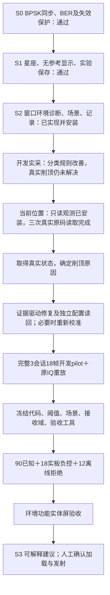

> 后续进度：2026-10-07已完成两会话4新帧启动时序调查并安装69290425；无rail但最后窄带帧BPSK失步，不能宣称削顶修复或S2验收。最新阶段总结和流程见`2026-10-07-s2-capture-timing-progress.md`，本报告保留为只读gain观察阶段历史。

# 教学与环境诊断平台：阶段总结及固定推进方向

2026-10-06。交付方向维持“BPSK教学演示＋可解释环境诊断＋人工确认”。S1已完成用户实体屏验收；S2尚未完成实板稳定性及正式验收。专门触摸计时已由用户取消，保留NOT_MEASURED，不再阻塞。

## 本阶段完成了什么

S1提供真实接收星座、参考开启时的BER、参考关闭时保留星座且隐藏BER，以及当前/历史实验保存；修改、清除、过期、取消、停止解除和OFF负控由照片及用户文字验收闭合。

S2提供固定BPSK 3M RECT有线4096点窗口诊断、特征和判据说明、四种独立场景草稿、两次确认加载及有限回环、带原始IQ的记录与数学重放。场景声明不作为诊断输入；“窗口未检出”仅描述约68.27微秒本窗口。

开发四轮共60个新物理帧，保留各轮独立结果和失败原IQ。最近两轮分别在复合和窄带场景遇到真实rail/CLIPPED而停止；关闭均有ACK，最终另行只读确认未布防、TX/RX关闭。现有slow-attack AGC及跨会话幅度差只是线索，尚不能宣称根因。

## 本轮新增与验证

| 项目 | 结果及范围 |
|---|---|
| core只读原码API | 90断言通过；独立规范与质量审核批准 |
| daemon显式观察 | RED新增5项失败→255断言通过；旧status_only/readback/操作集保留 |
| Python显式客户端 | 39新测试通过；旧协议、原客户端及候选联合71通过 |
| 完整板载软件回归 | 1707通过、4跳过；日志`evidence/rf-teaching/s2/rx-observation-2026-10-06/full-regression.log` |
| 原生ARM编译 | 45源摘要与当前一致；假硬件/core/daemon/协议/供应商完整性通过；无硬件访问 |
| 新候选离线ARM | 5热身＋100次；P95=294.90ms、RSS30376KiB；四输入主机/ARM一致，原生CNN启用 |
| 当前安装 | `663b9f7296cb55d4bdc4ae212a8d0774`；daemon1.0.1/协议minor3；已安全安装 |
| 回退与最终状态 | 保留`7be30345b482ca48e6e5e3675237cd20`；未布防、TX/RX关闭、双服务正常/NRestarts=0 |

只有`device.info`显式`observe_rx_gain:true`才读取RX1实际模式、full-table标志、RX启用、两次gain-index及digital-gain原码。默认轮询和采集不新增这些读。初始化/READY/无pending以及真实SRC_SEL、CAP_ARM前后检查必须满足；活动状态、读取失败或不支持返回null及原因，不把零当测量、不停止业务、不设置增益。

原码不转换总增益dB，不调用缓存模式或可能写表地址的vendor getter。时间戳覆盖顺序读取，索引两次相同只代表这两个读值相同，不能当作原子快照或采集期间的AGC轨迹。

本轮新增有限probe：复用既有初始化/配置/加载路径，在TX/RX关闭状态观察三次，然后停止解除并读回。probe不发射、不采集IQ，缺数据或收尾失败保留记录。整合规范与质量复审已批准；初始化后三次真实观察成功，0个物理IQ帧，解除ACK和最终独立安全检查通过。正式TEST和实体屏验收均NOT_RUN。

## 真实状态与下一项证据

三次硬件观察均为RX_ENABLE原码220（0xDC）、AGC_CONFIG1原码234（0xEA）、AGC_CONFIG2原码8；RX1模式2（slow-attack）、full-table有效；gain-index前后76→76，digital-gain原码0。未布防时正确返回null。它们只证明TX关闭时的顺序读值，不能说明采集中增益未变化，也不转换成总增益dB。

源码初始化请求`agc_gain_update_interval_us=1000`；4096点/60MHz窗口约68.27微秒。这是需要验证的时间尺度假设，不是实际更新间隔或因果结论。下一调查应记录开启TX到武装RX的实际顺序/间隔、原IQ峰值和rail及完整配置，区分启动瞬态、稳定增益与数据路径问题。现有观察接口拒绝活动路径，不能据此冒充采集中AGC轨迹。

若需增加有限稳定等待或固定接收增益，先定义支持域、上限、取消/错误收尾和真实读回，再做同条件对照及重新校准。本轮未添加等待、未改AGC或增益，也未重跑失败pilot替换旧失败。

实板证据：`evidence/rf-teaching/s2/rx-observation-2026-10-06/board-probe-v1/{result,receipt,final-state}.json`；安装：`evidence/rf-teaching/s2/deployment-2026-10-06-observation-v1/install-receipt.json`。

## 下一步顺序和验收条件

1. 本轮已完成新接口、候选与probe整合审核、安全安装及三次真实原码读取。保持唯一daemon/Overlay拥有者，实际收尾为未布防、TX/RX关闭、双服务active/running及NRestarts=0。
2. 根据观测设计有上限、有失败保留的定位实验。若必须改接收增益或AGC，将配置、实际读回和支持域作为独立变更；重新校准及回归。保持CLIPPED拒绝，不通过放宽判据隐藏问题。
3. 完整18帧开发复验和同IQ重放通过后才冻结。正式90已知＋18实板负控＋12离线拒绝，已知各类至少27/30正确、正常误报最多3/30、负控假CLEAR为0；失败帧不能换成功帧，正式数据不能调阈值。
4. 机器验收通过后再给按点击顺序的环境页真人测试。S2闭合后进入S3人工确认建议，不增加自动发射、QAM、多协议或连续空口监测。

历史错误、超预算和开发失败均保留；本轮未提交、重置或清理已有工作。详细计划：`docs/superpowers/plans/2026-10-06-s2-receive-observation.md`。
