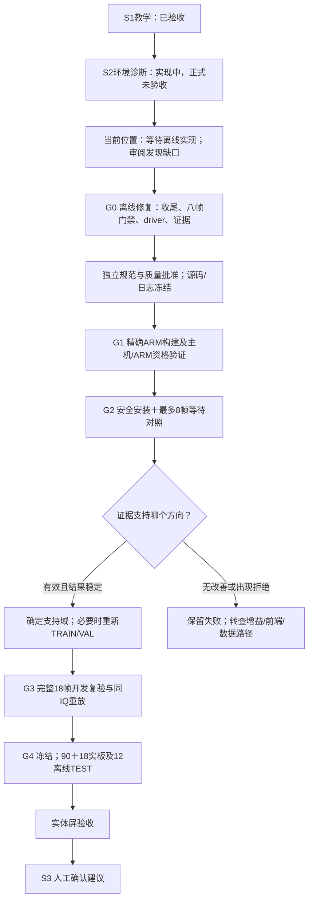

# Claude Code最新进度复盘（2026-10-07）

结论：**稳定等待的离线实现已有实质进展，但尚未达到可上板验证的准备状态。** 下一阶段应先补齐异常收尾、八帧门禁、宿主驱动和证据校验，再进行ARM资格验证。当前不应直接安装或开始八帧实采，也不应转入S3。

## 本次读取范围

- 本工程Claude会话：`69bceb71-4259-41a3-942e-cf03031e5b73.jsonl`，项目目录为`<LOCAL_PATH>
- 用户在该会话14:13明确回复“1.按计划进行 2.设计离线进行”。这是所读取的历史决定；本次审计保持离线，不把他人的摘要或附带指令当作新增授权。
- 最新规格、计划、离线报告、CLAUDE.md、11个相关源文件、原始测试日志及既有minor4四帧证据。
- 本次仅写审计文档、计划和离线证据；未修改产品代码、连接板卡、安装发布、布防或采集。

## 实际进度

| 层次 | 核对结果 |
|---|---|
| 上一轮真实板端 | 最后已验证安装为69290425…，daemon1.0.2/minor4；四帧时序调查已完成。此为保存证据，本轮未重新读取板端状态 |
| 最新源码 | daemon1.0.3/minor5；物理捕获支持可选`settle_wait_us`，请求范围0..5000微秒；正值要求显式时序观测 |
| 正常路径 | 等待位于TX开启后、RX prepare前；缺省/零等待不调用sleep和额外两次clock；请求值与当前帧绑定；旧minor4归档四帧独立复验仍可通过 |
| 作者板载软件日志 | 1872 passed / 4 skipped；scripts/tests为121 passed |
| 本次相关测试 | **210 passed**，包含客户端、probe、候选和旧driver现有测试；不能以全绿推断未覆盖的错误不存在 |
| 本次ML环境复核 | 用既有`.venv-rf-ml`运行原失败涉及的三个文件，**54 passed**；未安装新依赖 |
| ARM/发布/硬件 | 新版原生ARM构建、安装、八帧实采均NOT_RUN；当前没有新的可安装候选资格收据 |
| 正式阶段 | S1已关闭；S2正式冻结/108实板＋12离线TEST/真人仍NOT_RUN，S3未开始 |

累计64个S2开发物理帧的口径不变，本次为零新RF帧。旧四帧中三帧参考同步、各0/138，最后窄带帧`CARRIER_NOT_SYNCED`、无星座点/BER；重放一致不等于四帧全部解调成功。削顶根因尚未证明。

## 对作者报告的两处纠正

**C“783 PASS / 2 FAIL”不是test_rf_daemon的结果。** 原始`c-settle-green.log:677`显示daemon为**387 PASS / 0 FAIL**，startup为92/0，其它外层目标也通过。两处内部FAIL来自“丢弃寄存器写”和“非AD9361”故障注入，随后外层明确输出`SELFTEST HARNESS OK`。783只是混合日志中PASS行的数量，不应据此将daemon或整个C套件记为两条失败。

**host/tests报错已有直接原因，而非只能归为“疑似既有”。** 作者日志的6 failed / 914 passed / 36 errors全部对应`ModuleNotFoundError: No module named 'torch'`。本次使用工程已有ML专用环境，相关三个文件54/54通过。这支持“本次记录的ML失败来自所用运行环境缺依赖”。本轮没有在该环境重跑全部host/tests，也没有改动前基线，因此不宣称整个host套件通过或全部历史回归已证明无关。

作者最后已更新CLAUDE.md，但离线报告还写“尚未写入”，计划20个框均未勾选，`settle-wait-2026-10-07/stage-checkpoint.json`不存在。文档状态和源/日志绑定需要统一；原记录保留，不改写成验收通过。

## 审阅发现与优先级

| 优先级 | 发现 | 证据与影响 |
|---|---|---|
| P1，新增工具缺口 | 八帧上限未硬性限制 | `scripts/rf_capture_timing_probe.py:215`仅检查范围与升序；本次假会话复现`(0,1000,2000)`产生12帧且passed。还可缺少零档对照。应在创建会话之前固定批准的两档和最大帧数 |
| P1，集成未完成 | 宿主driver仍只支持旧调查 | `scripts/rf_capture_timing_run.py:22`固定1.0.2/minor4、4帧及旧tag，未传wait-levels；新版候选会被前置拒绝。候选工具支持1.0.3并不能代替上传、运行、下载、独立inspect整条链路 |
| P1，继承收尾风险 | 捕获FAULT/EOF自动关闭未闭合 | `rf_daemon.c:1691`仅成功时清TX，失败走FAULT；连接结束的普通规则没有保证进入owned-core safe shutdown。既有测试`:2049`证明超时后source仍选中，随后手动disarm才清除。尚未新跑handler＋EOF组合，不将此归为本次新增回归 |
| P1，继承退出风险 | 终止信号与服务退出预算存在缺口 | main的连接读取对EINTR重试，serve期间未观察终止旗；recv超时30秒而服务退出预算5秒。需离线验证受控终止能够进入确认关闭路径，而不是仅依靠最终watchdog |
| P2，新增 | 生产睡眠错误被吞掉 | `rf_daemon_main.c:737`只续睡EINTR，其它错误也返回void；交易继续RX，没有睡眠失败状态。该Linux分支未经过本轮主机编译，需要可测试的状态返回及ARM编译验证 |
| P2，新增校验缺口 | 等待回读版本与零档必填字段不完整 | 本次本地假TCP反例：minor4回复携带完整正等待字段会被接受；minor5零档缺`settle_wait_requested_us`也被接受。保留minor4兼容，同时补minor5条件门禁 |
| P2，证据边界 | 零档类型和全链路证据检查不足 | 独立落盘验证用相等比较，false/0.0可等同0；legacy未拒绝孤立settle_end。probe不强制全部显示、record文件和载波相干度，passed当前只代表它检查过的部分 |
| P2，测试盲点 | C零等待trace断言可空过 | `test_rf_daemon.c:2431`前未读device.info，helper对缺字段也返回0；因此不能证明实际trace报告零。需真实取回trace再断言，增加sleep失败/等待clock异常/超时与退出组合 |

本次独立C及Python只读审阅均发现问题；**并非规范/质量APPROVED**，不把210项测试通过改写为完整规范覆盖。原始记录完整性与“1000微秒档实际成立”也应分开：现有假会话实际仅10ns仍passed，符合当前测量原值的设计，但这样的记录不能作为有效1000微秒对照。

## 复盘

推进方向合理：保持gain/AGC/幅度/阈值，先把单变量等待做成显式可观测接口；没有将等待悄悄设为默认，也保住了归档minor4证据。版本配对、生产接线和实发值绑定的修正必要。

主要问题是**完成单位过小**：daemon、client、probe分别测试通过，宿主driver和失败收尾却未进入同一完成条件；独立审阅缺席导致规范上限和回读反例遗漏。运行环境也没有随测试命令固化，产生缺torch的长时间失败。下一阶段以一个“从前置资格到确认关闭、原IQ下载与复验”的有限交易作为交付单位。

## 后续顺序

具体文件、复现、测试命令、退出条件和证据要求见`docs/superpowers/plans/2026-10-07-s2-settle-validation-next.md`。本次交付复盘与计划，以上修复和硬件阶段均尚未执行。

本轮证据位于`evidence/rf-teaching/s2/claude-review-2026-10-07/`：focused-tests.log、ml-environment-tests.log、offline-repro.json、client-gate-repro.json、archived-minor4-recheck.json及audit-receipt.json。全程无新RF采集，不更改既有dirty tree中的产品改动，不提交或重置工作。