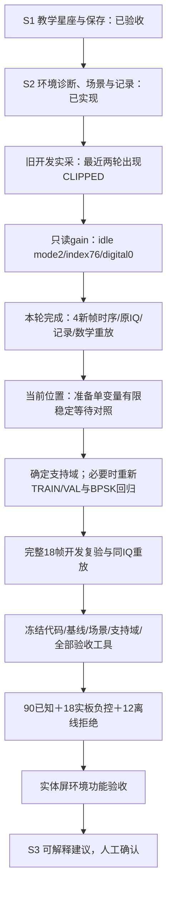

# S2接收启动时序：实板调查结果与固定后续方向

本轮完成显式时序观测、客户端版本与同帧门禁、有限实验工具、独立复审、原生ARM构建及安全安装，随后一次性完成两会话四个新物理帧。**调查证据闭合，削顶问题尚不能认定修复。** S1已验收，S2正式冻结/108实板/12离线TEST/真人仍NOT_RUN，S3未开始。专门触摸体验计时继续由用户豁免，本轮计时用于接收启动故障定位。

## 实板结果

保持TX1→RX1、40dB衰减、LO80MHz、Fs60MHz、BW30MHz、2R2T、IDELAY1/tap29、BPSK 3M RECT、D1、4096点。两个独立初始化会话参考seed1/37，实际场景PRBS7 seed1。每会话只捕获normal和narrowband各一帧；未插入等待、未修改gain/AGC、场景幅度或环境判据。

| 新物理帧 | 环境诊断 | TX开启→RX武装API间隔下/上界（微秒） | TX源API跨度（毫秒） | 原始复数RMS码值 | 最大分量绝对码值 | rail |
|---|---|---:|---:|---:|---:|---:|
| s00-normal-00 | CLEAR | 5.217 / 11.562 | 2.946 | 1079.875 | 1470 | 0 |
| s00-narrowband-00 | NARROWBAND | 5.193 / 11.670 | 2.840 | 1293.483 | 1941 | 0 |
| s01-normal-00 | CLEAR | 5.418 / 12.078 | 2.904 | 999.415 | 1377 | 0 |
| s01-narrowband-00 | NARROWBAND | 5.106 / 11.727 | 2.916 | 1202.438 | 1848 | 0 |

所有前后idle gain观察均76→76、mode2、digital0；它们不表示采集中gain始终不变。两会话均有停止解除ACK；独立最终检查确认未布防、TX源关闭、RX解除、双服务active/running，NRestarts=0。4组原IQ/header/实际handoff/诊断显示/完整实验记录/独立timing sidecar全部下载，同一原IQ的BPSK、星座、环境、记录及时序证明离线重放4/4一致，无额外RF采集。

BPSK同步并非4/4通过：两帧normal及第一帧narrowband参考同步、各0/138；第二会话narrowband为`CARRIER_NOT_SYNCED`，无星座点、无BER，其环境诊断仍为NARROWBAND。该失步原帧与重放结果完整保留，未重采或改同步门槛。四帧重放一致表示忠实复现这些成功和拒绝结果，不表示四帧全部成功解调。后续对照同时记录载波相干度、同步/拒绝和RMS/削顶，避免只关注rail。

scope严格为`monotonic_api_brackets_not_sample_edges`。TX源开启和RX武装各自包在软件调用begin/end之间，差值给出调用间隔范围；不把它当精确样点边沿或RF已稳定时间。8次clock读取会轻微扰动被测间隔，结果属于instrumented capture，不能倒推旧失败采集的精确时延。

名义采样窗口4096/60MHz约68.27微秒。完成/等待DONE/复制BRAM/解除RX的调用跨度约2.82～2.93毫秒，其中包含读取和收尾，**不是采样窗口时长**。header timestamp在关闭后取得，也不是采样触发时间。

源码请求slow-attack的更新间隔1000微秒；当前测得RX武装调用在TX开启后约5～12微秒开始。这为“短窗口发生在增益充分稳定前”的假设提供时间尺度线索，但未读回真实AGC更新时间、未观测采集中增益，四帧也未复现削顶，因此尚不能证明因果。窄带最大分量1941，距2048约5.2%码值余量；两次正常RMS约有8%差异，仍需跨初始化稳定性对照。

旧四轮60个新S2开发帧与本轮4帧独立保存，共64个开发物理帧；不混算成正式TEST准确率、不覆盖旧CLIPPED原帧，不把三次idle观察或数学重放计为新RF帧。

## 已完成验证与版本

| 项目 | 本轮证据 |
|---|---|
| C时序实现 | daemon348/state64/startup92/core90等完整回归通过，vendor10文件完整性通过；规范及质量独立批准 |
| Python客户端 | 旧版本发送前拒绝、当前连接/帧身份、8有序正uint64、可选JSON错误保留/网络错误drop；客户端组合286通过 |
| 完整板载软件 | 1845通过、4跳过 |
| 独立整合质量复测 | 273通过；主机工具59通过 |
| 原生ARM | 45个输入与当前源码匹配；ELF SHA `03c8d38b0e656ad6a5821cf384f3c11016e436d79a9cc2a020f44b551dce49bf` |
| 精确候选离线资格 | 四输入主机/ARM一致、原生CNN启用；100次P95=281.68ms，RSS30476KiB；不是体验计时或新RF验收 |
| 当前安装 | `692904251e024a1254aecee679c6322a`，daemon1.0.2/major1/minor4，保留663b9f72回退 |

默认UI/捕获不请求时序，零新增timing clock或gain读取。只有显式物理捕获才记录8brackets；完整frame发送成功后才能发布trace，控制/断连/解除/看门狗清旧。实验工具逐项保存已收到的frame/trace，后置gain失败也不丢前面的证据；任何源码上传检查失败均禁止实验，最终检查脚本须另验SHA才执行。

## 下一阶段固定方向

1. 先设计显式、非默认、有上限的单变量稳定等待对照：同一RF/场景/接收配置比较0与1000微秒，最多两初始化会话×正常/窄带×两个等待档，共8帧；等待上限建议5000微秒，实际等待与关闭均需时序读回。保持gain/AGC/诊断规则不变，削顶或证据失败保留并停止，无自动重试。此处为下一实验设计，当前版本尚无该等待参数。
2. 若对照支持有限等待，再定义生产捕获支持域与记录来源；重新校准必要的TRAIN/VAL及BPSK回归。若等待无效，转查实际接收增益/前端余量和数据路径，不同时修改多个参数。
3. 选定方案并完成完整18帧开发复验后才能冻结。正式90＋18＋12和实体屏验收保持原门槛，不能用本轮4帧替代。S2闭合后再进入人工确认建议的S3。

## 证据位置

- 实板原始证据与最终状态：`evidence/rf-teaching/s2/capture-timing-2026-10-06/board-2026-10-07-v1/`。
- 四帧完整数学重放：上述目录`same-iq-replay.json`。旧18帧pilot验收器拒绝本次不同声明，失败日志保留；未放宽旧门槛，使用原record数学验证函数逐帧重放。
- 安装与回退：`evidence/rf-teaching/s2/deployment-2026-10-07-capture-timing-v1/`。
- 独立审阅、源SHA、RED/GREEN、完整回归与原生构建：`evidence/rf-teaching/s2/capture-timing-2026-10-06/`。10-06是任务起始目录，10-07为此次用户日期，不改写历史。
- 最终阶段收据：上述目录`stage-checkpoint.json`，绑定安装、回退、四帧联合身份、原IQ、35项实板摘要、独立重放、失步拒绝及最终安全状态；仅本阶段调查闭合，不关闭S2正式验收。

本轮未修改bit/HWH、core/vendor、CNN、BPSK/环境判据或基线，也未提交、重置或删除已有工作。
