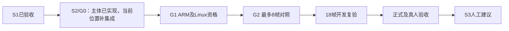

# Claude Code今日进度与简审（2026-10-08）

**结论：G0离线主体实现已明显推进，但当前驱动闭环与终止处理仍有缺口，不能直接进入八帧实采。** 继续主线S2，先补当前集成问题，再做G1资格验证。

## 对话与完成范围

读取本工程Claude会话`69bceb71-4259-41a3-942e-cf03031e5b73`，最后实质工作总结为北京时间12:30；文件13:27修改不是新的验收结果。最新证据为`settle-closure-20261007-v1/stage-checkpoint-round2.json`。

已核对的进展：成功捕获重复清RX ARM已修，零等待trace不再空检查；正等待与minor5必填字段门禁补齐；批准档位固定为{0,1000}，最多两会话八尝试且会话顺序反转；短等待停止并保留原IQ；显示、保存记录及同IQ重放加入验证；新driver已建立1.0.3/minor5资格与独立最终inspect。规范首轮发现的档位测试错因已修正并作独立变异复验。

本次20项源码SHA全部匹配round2清单；重新运行相关Python测试**241 passed**，C隔离构建**daemon417/0、core98/0、sleep22/0、startup92/0、state64/0，make退出0**。作者完整日志为board1874/4skip、tools155、host非ML902、ML54；本次未重复全部Python套件。测试通过不等于未覆盖的部署路径成立。

新版ARM构建、安装、任何RF采集、八帧对照、S2正式/真人及S3均NOT_RUN；本次无板端接触，削顶根因仍未证明。

## 简要review（按修复优先级）

| 项目 | 当前问题 | 下一步 |
|---|---|---|
| P1 板端重放依赖 | `scripts/rf_capture_settle_run.py:33`只上传六个脚本；`rf_capture_timing_probe.py:71`必需的`scripts.rf_environment_verify`及其`rf_teaching_verify`/`rf_bpsk_replay`依赖未上传，也不在发布software map内。干净板端缺模块；残留脚本也未被本次SHA门禁资格化 | 补完整依赖及package布局、递归来源SHA；在干净、隔离的模拟板端目录验证实际导入与成功8帧闭环，不能仅mock重放边界 |
| P1 终止检查窗口 | daemon在read_line前查should_stop，但main的conn_read先recv，只有EINTR后查旗。若信号在前置检查后、recv前或分片两次recv之间到达，之后仍可能阻塞30秒；完整请求到达后也可能继续dispatch。本次为源码可达分析，未动态复现Linux信号窗口 | 用能主动唤醒等待或原子协调信号与阻塞的机制；覆盖检查前后、阻塞中、分片中、完整请求dispatch前及等待中的终止，不靠放宽5秒退出预算 |
| P2 旧driver兼容回归 | 旧`rf_capture_timing_run.py:95`未传下载后的records_root，新共享验证器却无条件read_record，采用板端绝对path在主机读取。旧driver正文不变不代表行为不变 | 将主机下载目录传入验证，保留旧minor4四帧与新minor5八帧两条真实成功路径测试 |
| P2 baseline前置不完整 | 新driver:62仅检查文件类型和大小，不验证schema、非空或与候选冻结baseline一致。空baseline能到连接入口，之后才失败 | 连接前加载并验证baseline、来源/冻结摘要及与候选关系；错误baseline不得创建会话或开始采集 |
| G0待办 | 超长等待交易期限、偏差报告仍未实现 | 明确每帧期限、实际等待偏差与不合格条件；保留原IQ和失败原因，超期停止，确认TX/RX收尾 |

**本次离线反例：** 同一归档真实帧，旧driver形状的调用报“missing or symbolic record component”；传入下载records_root后通过。使用假资格候选＋空baseline，确实到达connect哨兵，未发生真实网络连接。见`integration-repro.json`。板端缺依赖与信号窗口为源码审阅结论，不冒充真实板端复现。

F2应保持为结果测试未观测到调用差异的覆盖项，不宣称当前FAULT gate错误，也不要声称两判别在所有可达路径等价；continuous RX仍可区分。与本次固定有限对照相关的真实集成缺口优先。

生产睡眠范围要准确区分：`rf_sleep.c`真实nanosleep适配器已在主机编译/调用；尚缺的是ARM ABI、板载接线以及真实Linux transport/sigaction运行验证。ARM编译通过本身不能证明信号收尾时序正确。

## 下一步安排

1. **离线补齐当前闭环：** 依赖上传/包布局与摘要、旧driver本地record路径、baseline连接前门禁；增加新八帧和旧四帧的有效成功路径，补信号窗口与超长等待期限。目标是可执行的有限交易，不只增加测试数。
2. **G1资格验证：** 允许设备工作后，在隔离环境进行准确ARM构建、原生假硬件及真实Linux信号/套接字测试，之后完成精确候选的主机/ARM同输入与资源资格。连接设备与安装/采集分开管理；本次只审计和规划。
3. **G2及后续：** 安全安装合格候选，按批准声明一次最多8帧对照；不重采替换失败。确定支持域并完成18帧开发复验后，再正式90＋18＋12与真人验收；最后S3人工建议。八帧无削顶不等于根因证明。

本次独立简审结论为**CHANGES_REQUIRED**；与作者记录的审阅通过不矛盾，审阅范围与新发现不同。产品代码未修改，下一步仍沿用既定接续计划。本轮复核日志与收据：`evidence/rf-teaching/s2/claude-review-round2-2026-10-08/`。