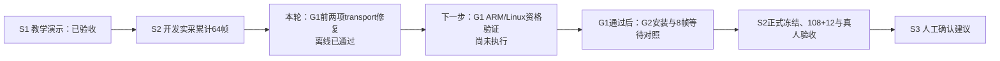

# G1前 transport 离线补齐与交接（2026-10-08）

用户授权：“你尝试补齐，然后后续我让agent跑G1”。两项 C transport P1 已补齐并通过本轮离线回归；规范与质量两项独立复审均批准进入 G1 资格验证。本轮没有连接板卡，没有 ARM 构建、安装或新增 RF 采集；G1 尚未执行。

## 修复结果

1. `rf_stop_channel_init` 将 pipe、两端 F_GETFL/F_SETFL、SIGTERM/SIGINT handler 安装作为必需条件。失败后撤销 handler 可见 FD、恢复已装 handler、关闭已分配 FD。生产 main 在 status mapping、daemon/listener 和获取控制硬件之前执行硬门，失败退出。
2. `conn_write_all` 使用同一受测 `rf_transport_write_all` 策略。POSIX send 使用 MSG_DONTWAIT|MSG_NOSIGNAL；遇背压同时 poll socket 和 self-pipe；停止优先于继续发送，不能因 EINTR 无条件重试而困住收尾。
3. 每次非空 write_all 使用固定 **1000ms 整体期限**，从首次取得起始时钟、首次 send 之前计时。partial send、EAGAIN、EINTR 都不刷新期限。最后一次 send 后也检查停止与期限；失败回既有断连/解除路径。该时钟直接读取 CLOCK_MONOTONIC，不调用 capture/trace 的 cfg.now_ns。
4. 生产 main 保存/恢复 handler 中的 errno，用 sig_atomic_t 暴露写 FD；清理先撤销 FD，再恢复 handler/close，避免 handler 写向已关闭或复用的描述符。

新增 `rf_transport_policy.c/.h` 与策略测试；修改 main、Makefile 和 daemon 集成测试。`rf_daemon.c`、core、协议版本、PL/vendor、增益、模型及 Python 业务源码未改。源码仍为 daemon1.0.3 / major1 minor5；它不代表当前已安装版本。

## 实际验证

| 本轮验证 | 结果与范围 |
|---|---|
| 语义 RED | 旧的未检查初始化/阻塞发送行为提取为基线，编译0、测试1；17 PASS / 47 FAIL；不是缺符号导致的失败 |
| 共享 transport 策略 | 64 PASS / 0 FAIL，生产与主机链接同一模块 |
| daemon + 新背压收尾 fixture | 445 PASS / 0 FAIL；增加21条，覆盖 FAULT 拒绝回复遇停止、期限超出和 poll 错误时，连接关闭、无队列后续派发、TX/RX 清除及 owned core 释放顺序 |
| startup / state / platform | 分别92 / 64 / 39，均0 FAIL |
| core / IQ / protocol / sleep | 分别98 / 40 / 58 / 22，均0 FAIL |
| 完整 C make | 新建 `.hostobj-g1-transport-final`，host-test/core/iq/protocol/sleep全部执行，exit0 |
| selftest harness | 整体exit0；日志中2条FAIL是既有故障注入负例，不计为回归故障，也不描述为零FAIL日志 |
| vendor | 10文件完整，exit0 |
| 相关 Python | 78 passed / 13.12s，采集新旧driver/probe及构建合同，exit0；不是本轮全量Python回归 |
| 变异检验 | 三份仅证据目录内的变异均确认已应用、编译0、测试1：忽略sigaction（8 FAIL）、忽略stop（6 FAIL）、刷新deadline（3 FAIL）；正常源码保持不变 |
| 实际离线 package() | 51个native输入，新增C/H/测试完整；逐字节匹配，板卡函数禁用，无网络调用 |

C编译保留原有vendor/host shim告警，不称为无警告构建。MinGW未编译 `#ifndef PLATFORM_HOST` 下的 POSIX main：真实 pipe/fcntl/sigaction/send/poll、Linux异步信号及ARM路径必须由 G1 补证，主机 mock 不能替代。

原14文件前快照中，仅 main、Makefile、test_rf_daemon 三项发生变化；其余11项未变。上轮round3清单中除 main/test_daemon 外的9项哈希仍相同。51个native输入保存于 `evidence/rf-teaching/s2/g1-transport-closure-2026-10-08/package-check/sources/`，最终源码清单、回归/变异/打包退出码和摘要绑定在本轮收据。

## 阶段与后续顺序

下一 agent 按 `docs/reports/2026-10-08-g1-agent-checklist.md` 执行 G1，先冻结准确输入，再做隔离ARM构建、真实Linux transport场景、同IQ一致性及100次完整计算预算，输出独立资格收据。不要把“编译成功”当作所有信号和背压场景通过，也不要跳到安装或采集。

本轮新增物理帧0，S2开发累计仍64；S2正式freeze/108实板+12离线TEST/真人、S3均未完成，削顶根因仍未证明。5ms等待资格上限是在采集返回后判断的测量门禁；1s发送期限与5s service退出预算是不同约束，不能称为实时切断TX的5ms硬截止。

## 复审与完成状态

规范与质量复审均为 `APPROVED_FOR_G1_QUALIFICATION`，未发现新增阻塞问题。独立复审只读，质量审阅读取了回归/变异/打包证据，未代跑ARM/G1。意见保存于本轮spec-review.md/quality-review.md，与准确源码和日志共同绑定stage-checkpoint.json。本轮离线补齐已完成，可交后续agent跑G1；不代表G1或G2已通过。
