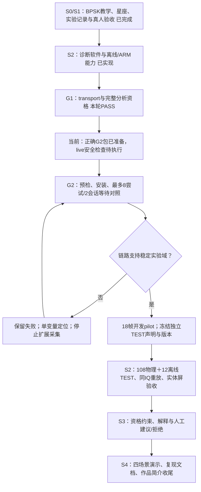

# Claude 进度复盘与收尾计划（2026-10-10）

**结论：G1 资格验证已补齐并通过；G2 准备包已修正，安装和实采仍为 NOT_RUN。** 当前处于 S2 稳定性调查与正式验收之间。S0/S1 已关闭，S2 正式 TEST、S3 人工建议和 S4 展示收尾还没有完成。

本轮确实连接 AC820，但只在用户授权的 `/tmp` 隔离目录做 fake PL 和保留 IQ 的离线 G1 补测，没有安装发布、加载 Overlay、布防或新增 RF IQ。S2 开发累计物理帧仍为 64。本报告取代 10 月 9 日的 G1 PARTIAL 当前判断，历史证据与原作者收据保留。

## Claude 实际完成情况

核对主会话 `69bceb71-4259-41a3-942e-cf03031e5b73.jsonl` 及 `g1-qualification-2026-10-09` 产物：最新实质工作为 10 月 9 日补测和规范第三轮 APPROVED，最后会话中断不代表完成。项目入口未同步该补测。

Claude 已修复旧退出 harness 的未初始化 fd 问题，增加真实 socket 背压下 FAULT/owned-core 场景、完整行后的停止派发 guard、两个信号的时点矩阵、慢读与 EINTR 固定期限、make 真实 exit code、四类同 IQ 五阶段判等以及六项有效变异。冻结 51 native/17 handoff 输入没有漂移，准确 ARM daemon 仍为 1.0.3/major1/minor5。

但作者最终质量 verdict 仍为 null，质量文件仅有未完成的一句工作说明；不能把规范批准当成最终双复审。G2 目录只有 prepare 产物，没有安装与实采证据。

## 本轮审查与补齐

| 发现 | 修正与结果 |
|---|---|
| 判等工具用 zip 截断记录，可能把不完整 ARM 输出报为通过 | 严格校验四类输入、数量/标签/SHA/身份/五阶段/完整字段；实际 run 使用新 comparator。65 项新回归＋17 项既有回归，共 82 通过 |
| 原 FAULT 用例计时没有覆盖完整 daemon 进程释放、清理到 waitpid 的链路 | 补充真实 socket＋fake PL 的完整子进程 fixture；本地 16/0、两个有效负控；新 ARM 16/0，TERM/INT 信号至 reap 2/3ms，关闭后释放一次且保留 FAULT |
| 开启参考的四类数据不足以证明关闭参考仍显示同步星座、不生成 BER | 相同 16KB 正常 IQ，仅私有 metadata 参考种子 73 改为 null；host/ARM 五阶段一致、128 点/201 符号、REFERENCE_NOT_PROVIDED、无 BER |
| 原 G2 prepare 的 parent 为较早 S1 发布，与实际 current 不匹配 | 重新 prepare，parent 绑定当前 692904251e024a1254aecee679c6322a 和真实父安装收据，离线包验证通过；未安装 |

没有改动冻结的生产 native 源码、候选内的分析代码、模型、阈值或 PL，因此复用已核验候选和资源证据，避免无依据地重新构建或重复基准。基线原始文件 SHA 与结果 canonical SHA 含义不同，已分别核对。

独立 C 规范/质量审阅与 Python/parity 审阅均通过，结论摘要见 `evidence/rf-teaching/s2/claude-progress-2026-10-10/independent-reviews.md`；总绑定收据为同目录 `stage-checkpoint.json`。

## 验证证据与边界

| 验证 | 结果 | 来源 |
|---|---|---|
| 冻结输入、准确 daemon/candidate | 51 native＋17 handoff 无漂移；daemon SHA 42469036… | 原冻结收据及本轮 supplement-verification |
| Claude ARM Linux harness | 123 PASS/0 FAIL；原归档 53 文件及板端源码回显一致 | 10 月 9 日保存证据，本轮逐项核验 |
| 六项 transport 变异 | 同一准确基准 123/0，每项编译成功且测试非零失败 | 保存的 mutation 日志，本轮核验；不宣称本轮在 ARM 重跑六项 |
| settle make | 22/0，MAKE_EXIT=0 | 保存的板端日志，本轮核验 |
| 四类同 IQ 完整分析 | base/CNN/BPSK/constellation/environment 无差异 | 实际保留 host/ARM 结果经修复 comparator 再比较 |
| 关闭参考完整分析 | host/ARM 一致、无 BER、保留同步星座 | 本轮新 ARM 离线补测 |
| 完整背压/FAULT 收尾 | ARM 16/0；两信号 2/3ms 完整退出 | 本轮新 fake PL 子进程补测；不代替 live PL 状态读回 |
| 完整后台资源 | 100 次 P95 290.805352ms，RSS 30816KiB | 相同候选已验证历史数据；P95≤300ms，RSS无另设硬门槛 |

候选为 `adfac1f14c3cdb379cb92569a21a9054`。本轮 live current 读到 `692904251e024a1254aecee679c6322a`，双服务 active/running、NRestarts=0；这些读数不证明当前 PL 已关闭。准确新候选尚未安装，源码 1.0.3 不代表板上 daemon 已更新。

最终只读 live PL 安全读回已获单独用户授权，但调用未执行：自动审批因额度耗尽失败，明确不是判定该操作不安全。待执行脚本是本轮 `read-final-state.py`。没有生成新 safe=true 收据，也没有用旧安全收据或服务在线状态代替。G2 必须重新预检，不因 G1 PASS 自动开始 RF。

## 当前阶段与固定推进顺序

图中的返回调查需要新的具体有限声明，不允许在 G2 中无限重试或突破最多 8 次预算。

### 1. G2 有限等待对照

使用本轮 `g2-prep/`，重新检查 current、双服务和 TX/RX/布防状态，按真实父发布保留回退。沿用 TX1→RX1、40dB、LO80MHz/Fs60MHz/BW30MHz、2R2T/tap29；只比较批准的 0/1000us，两个会话交叉档位顺序，一次最多 8 尝试。保留全部失败帧、requested/actual 参数、原 IQ 和完整同输入重放；每会话解除 ACK，最后独立安全读回。停止异常不自动增加 RF 重试。

它回答的是等待是否支持这一受控实验条件，不能据此宣称 AGC/削顶根因已证明，也不直接把某等待改成所有场景默认值。

### 2. S2 开发稳定与正式冻结

G2 支持后完成已计划的 18 帧开发 pilot，确认诊断域与有效窗口，再冻结算法、基线、发布、来源分组和 TEST 声明。TRAIN/VAL 与 TEST 按源/会话分离，不用种子偏移伪装独立序列，不拿 TEST 调阈值。

正式 108 物理帧：正常/窄带/脉冲各 30，OFF/复合/域外各 6；另 12 离线输入为削顶/低能量各 6。每已知类≥27/30，正常误报警≤3/30，负控误判正常为 0，已知类拒绝计错。削顶拒绝测试走离线，不人为推动硬件过载。完整下载、同 IQ 重放、混淆矩阵、失败原件及最终安全状态组成收据。随后按三场景清晰步骤做实体屏新诊断及失效/过期/停止验收。

用户已取消专门触摸计时，继续保留精确时延 NOT_MEASURED，不再作为真人验收阻塞项。ARM 计算预算和触摸体验是不同指标。

### 3. S3 人工建议与拒绝

核心流程为当前诊断→解释→建议或拒绝→人工确认填草稿→独立检查/加载/确认回环。policy 无硬件 IO，升级/错配/无效/过期时拒绝，任何点击建议都不能直接发射。缺少有效第二档或收益资格时只能观察/提示停止，不能制造档位切换建议。

P0 峰值码60/P1峰值码40 是可选的档位收益分支：每档 3 会话30ON＋3OFF，共66物理帧；另每档30帧成对异常收益测试，共60帧，总计额外126帧。必须交错顺序、异常分量不变、叠加后不整体归一化，保留失步和采集失败。此分支没有通过时，核心交付按诚实拒绝路径收尾，不能宣称已实现自适应改善或校准功率控制。

### 4. S4 展示与交付

冻结正常、窄带、脉冲、无法判断/过期四场景演示，统一板上版本、实验文件和作品简介，给出从启动、配置、捕获、读图、保存到停止解除的顺序与回退方法。限定为有线受控窗口实验；不扩展 QAM、RRC 接收、EVM、空口或自动发射。QPSK 继续作为后续条件扩展，不占本轮收尾预算。

## 距离收尾的工作量

以下是工程估计，前提是 G2 能支持稳定有线链路、硬件可用且真人反馈及时。它不是按已通过测试数推算的完成百分比。

| 剩余工作包 | 估计有效工作日 |
|---|---:|
| G2 新鲜预检、安装与最多8尝试对照 | 0.5–1 |
| 18帧开发稳定、版本和TEST声明冻结 | 0.5–1 |
| S2 正式108＋12、证据分析与真人验收 | 1–2 |
| S3 人工建议/拒绝、资格与UI回归及真人流程 | 2–3 |
| S4 演示、文档与作品简介收尾 | 0.5–1 |

核心交付约 **5–8 个有效工作日**；当前最大不确定性是 RF 稳定性与正式 TEST。若 G2/开发稳定性失败，预计另需 2–5 日定位，先诊断再重新估计。若选择完成两档实际收益分支，可另留 1–3 日及126新物理帧。下一项明确是 G2 的新鲜安全预检，正式 S2 未通过前不扩展调制功能。
