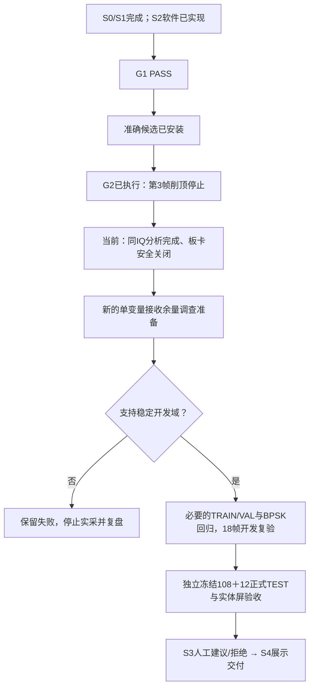

# G2 安装、有限等待对照与接收余量复盘（2026-10-10）

**准确候选已安全安装；G2 在第3帧 CLIPPED 后停止，等待对照证据不足，未通过。** 本轮不是“等待无效”的证明：只取得正常0/1000us两帧和窄带0us一帧，没有窄带1000us及第二会话反向顺序。

当前板上发布为 `adfac1f14c3cdb379cb92569a21a9054`，daemon 1.0.3/major1/minor5 已由本轮 capture timing 回读验证。最终独立检查确认未布防、TX source未选择、RX未武装、PL读回正常，双服务active/running、NRestarts=0。回退发布为 `692904251e024a1254aecee679c6322a`。本轮新增3物理帧，S2开发累计由64增至67；正式108＋12、实体屏新诊断验收和S3仍未完成。

## 已完成的接续

1. 自动审批恢复后执行此前用户授权的只读检查。第一次上传时主审将文件命名为 `inspect.py`，遮蔽Python标准库，导入dataclasses失败；检查未读到设备状态，原日志保留于 `claude-progress-2026-10-10/live-final/`。
2. 用相同检查源码做本地红/绿复现：错误文件名exit1，`rf_state_check.py` exit0。只在新 `/tmp` 目录改上传名，生产检查脚本和已冻结输入不变；重新检查旧发布safe=true、双active，成功收据位于 `g2-preflight-2026-10-10/live-state/`。
3. 核验G1的53绑定、51 native/17 handoff、候选software与本地源码、正确父发布安装包和基线；G2相关两文件测试 **69 passed in 12.09s**。固定声明为0/1000us、最多2初始化会话/8尝试，不补采。
4. 经现有部署入口安装准确候选，安装后状态 `VERIFIED_SAFE_NEW_RELEASE`，新旧发布摘要与服务均核验。没有另开Overlay。安装日志中板端时钟较旧产生tar时间戳提示；资格依据是内容SHA、版本和状态，不以文件mtime作证明。
5. 执行一次既定G2 campaign，第三帧触发CLIPPED即停；原IQ/header/真实handoff/显示/实验记录/timing sidecar完整下载，下载错误0，原会话解除ACK。独立最终检查safe=true；没有重试、替换或补齐剩余5帧。

本轮只新增证据、运行包装器和报告，没有修改生产C/Python分析、PL、模型、基线、阈值、增益模式或默认等待。此前G1资格通过保持成立；G2物理证据未通过不能反写成G1失败。

## 三帧实测

固定TX1→RX1、40dB、LO80MHz/Fs60MHz/BW30MHz、2R2T/tap29、BPSK3M RECT、D1、4096点、场景PRBS7 seed1；每帧IQ为16384字节，身份和SHA不同。

| 帧 | 请求/实际等待 | I范围 | Q范围 | 触边分量 | 同步/BER | 窗口诊断 |
|---|---|---|---|---:|---|---|
| 正常0us | 0 / 0us | -1442..1451 | -348..323 | 0 | 同步，0/138 | CLEAR |
| 正常1000us | 1000 / 1106.709us | -1257..1423 | -219..304 | 0 | 同步，0/138 | CLEAR |
| 窄带0us | 0 / 0us | -2048..1792 | -1045..1079 | 4 | CLIPPED，无BER/无点 | INVALID/CLIPPED |

正常两帧载波相干度约0.99322/0.99260，各有128个显示点、201有效符号。1ms档实际等待1.106709ms，满足请求与5ms测量资格上限。等待trace为软件API时间括号，不是ADC采样边沿或AGC轨迹。

窄带帧4个触边分量均为I=-2048，样点编号为1094/1194/3134/3644（从0计）；27个分量绝对值≥2000。4/8192分量触边约0.0488%，仍按既定规则整帧拒绝，未调低阈值或绕过CLIPPED。拒绝后星座点数0、BER为空，失败帧保留。

三帧原IQ分别经共享验收器独立重放，显示、BPSK、星座与环境结果均一致，mismatches为空。这证明软件处理与记录一致，不证明RF输入正常。只有正常两帧的0/276可作为该子集诊断，不能用它掩盖第三帧拒绝或宣称整个实验BER通过。

## 能推断什么

保存的场景声明可逐字段复现源波形：正常BPSK分量60码；窄带为60码BPSK＋40码窄带分量，合成峰值100码，生成器无整体归一化。正常接收分量峰值1451/1423，距名义2048边界约2.99/3.16dB；源分量峰值100/60的比值约4.44dB。**这提示接收余量是合理的下一调查方向**，不是将源码值换算为已校准RF功率，也不是线性链路增益的实测证明。

各帧前后空闲增益原码均为mode_rx1=2、gain index=76、digital gain code=0，单次读内index稳定；这些是顺序读的捕获前后观测，不能据此断言窗口内增益恒定或AGC根因成立。

可以确认：窄带输入在本次受控条件下出现无效触边采样，拒绝和安全退出有效。不能确认：等待能否改善窄带、削顶发生于ADC/模拟前端还是数字路径、两会话可重复性、S2分类精度。未采到的帧不填成通过或失败样本。

## 下一阶段安排

停止这份G2声明的RF执行，不重跑相同对照凑齐8帧，不改等待默认值。下一工作包为**接收余量的单变量调查准备**，具体方案见 `docs/superpowers/plans/2026-10-10-s2-receive-headroom-investigation.md`。

优先准备降低输入强度的有限研究，而不是同时改RX模式、TX幅度、环境阈值。拟单独改变TX衰减40→46dB，保留源60＋40码与其余时序/RF参数；这是新研究域，不能继承原40dB的S2诊断资格。新工具必须先证明真实参数回读、数量上限、原IQ保存、拒绝与停止、最终关闭，再执行新声明。当前仅形成计划，**未执行46dB实采、未改生产合同**。

此前5–8有效工作日估计以链路稳定为前提；该前提本次尚未建立。按此前风险分支先预留2–5日定位，余量实验完成后重估，不把更多采集数量当作进度。

## 证据入口

- 预检：`evidence/rf-teaching/s2/g2-preflight-2026-10-10/preflight-receipt.json`
- 安装：`evidence/rf-teaching/s2/g2-execution-2026-10-10/install/install-receipt.json`
- 原始对照：同目录 `campaign/receipt.json`、`result.json`、3份IQ与记录
- 独立离线分析：同目录 `analyze-saved.py` / `analysis.json`
- 最终板态：同目录 `campaign/final-state.json`
- 本轮绑定：同目录 `stage-checkpoint.json`

上一轮CLAUDE与roadmap在更新前保存到 `prior-document-snapshots/`，与原G1收据绑定SHA一致。历史报告、失败和G1收据没有改写；本报告为当前接续结论。
