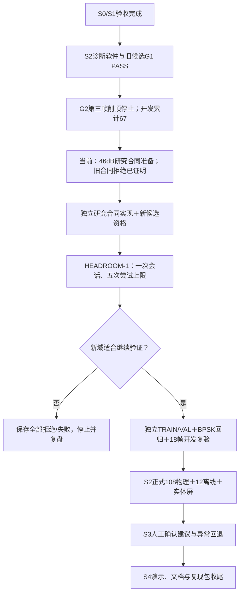

# HEADROOM-1合同准备与接收余量调查进度

当前更新：**Claude未完成的审查与合同准备收尾已接续完成；准备器、30项新鲜测试、规范及质量审查通过。** 当前旧合同仍阻断46dB RF，研究合同本身尚未实现；旧G2已在第三帧削顶停止，不能重跑补采。

## Claude Code最新执行情况与接续

读取本工程最新Claude会话 `69bceb71-4259-41a3-942e-cf03031e5b73`，最后记录为2026-10-10 20:07用户中断。它已生成 `prepared/`、真实候选校验通过及28项测试收据，转录两个先前Codex独立审查，并启动准备器规范/质量审查；中断前两项新审查报告和最终checkpoint均未落盘。没有新研究合同实现、安装或46dB实采。

本轮接续这份材料，避免重建或改写历史。独立规范审查重新核对完整native51、软件、candidate、baseline、载荷和固定参数，原28项测试通过，真实prepared verify通过；另5项共同重写摘要的反例仍拒绝。质量审查区分了变异的实际行为：删去冗余校验的存活不证明产品漏洞，但完整build receipt字节身份、全部output摘要、receipt自身字节核验有真实覆盖缺口，已补测试。最终新鲜运行 **30 passed，0 failed**；A04/A12/A23在隔离module执行中分别触发真实失败，准备器源码SHA始终不变，没有原地产品变异。

发现并修正封存脚本的真实衔接问题：Claude审查汇总输出角色对象（verdict/report/sha256），原finalizer按字符串读取。现在逐项检查明确批准、实际审查文件SHA，同时核验测试源码、准备器和日志SHA，以及三份独立证明的源码/输入/产物摘要。原Claude中间日志和测试收据保留，最终只绑定当前重新验证结果。

## 发现与开发边界

当前候选 `adfac1f14c3cdb379cb92569a21a9054` 的daemon1.0.3/协议1.5只能以精确40000mdB确认物理回环。原生状态门禁拒绝46000；即先configure46000再以40000确认，原子捕获会把真实TX衰减重新设成40000。因此scripts-only子类无法完成有效46dB调查。UI环境load和client也分别固定40dB。

真实配置必须来自native vendor getter读回，不能把worker外层发送args或UI applied草稿当作硬件证据。将来研究动作须贯穿同一controller/worker/client/daemon，明确允许仅46dB，保留旧40dB门禁，并在捕获前验证两路实际衰减。

## 本轮已核实证据

| 项目 | 结果 | 能说明什么 |
|---|---|---|
| 旧G2输入和证据绑定 | 65/65匹配 | 历史证据未被改写 |
| 现有纯C状态门禁 | 本地WSL编译成功、4/4通过 | 40dB批准，46dB拒绝，拒绝清旧批准，不能继续物理事务 |
| 旧正常IQ的离线反事实 | 40dB CLEAR，46dB INVALID/RF_DOMAIN_MISMATCH | 旧baseline正确拒绝新RF域；不是46dB实测 |
| 板卡只读检查 | 当前发布正确、safe=true、未布防/TX/RX关闭 | 双服务active/running且NRestarts=0 |
| 新增实采/初始化 | 0/0 | 开发物理累计保持67 |
| 准备包真实校验 | verified=true、execution_ready=false | 离线材料完整；旧合同阻断46dB执行 |
| 准备器规范审查 | APPROVED，28项测试与5个额外反例 | 满足本轮离线范围；不授予RF资格 |
| 最终增量规范和代码质量审查 | 两项APPROVED | 绑定最终30项测试版本及未改准备器 |
| root最后新鲜测试 | 30 passed，0 failed，exit0 | 收据绑定实际日志、源码和测试SHA |

纯C证明只链接现有状态模块及独立harness，不连接MMIO/板卡；它是本地x86验证，不是ARM资格。反事实分析用原G2保存IQ，仅改变函数输入RF配置，原metadata/记录未改；不能证明6dB衰减效果或接收余量改善。

## 固定研究及后续任务

HEADROOM-1仍固定TX1→RX1、TX衰减46dB，其余LO80M/Fs60M/BW30M/2R2T/tap29/BPSK3M RECT/D1/4096、源60码/干扰40码/seed1不变。一次初始化，五次上限：OFF普通RX→正常物理回环→窄带物理回环→脉冲物理回环→OFF普通RX。0wait观测时钟，不调整RX模式或分析阈值；任一触边、错配、超时、缺IQ、OFF伪结果或关闭错误即停，保留失败，不重试或补齐。

下一工作包是实现独立研究合同及资格候选，先完成旧40dB回归、新合同拒绝/预算/安全事务、实际双TX读回和同帧身份的审查，再完成ARM假硬件/分析完整链回归。现G1 PASS属于旧候选，不能继承给新合同。资格通过后才安装并执行五次研究。

若新域无触边且正常BPSK可靠，进入独立TRAIN/VAL、BPSK回归及18帧开发复验；随后才能冻结108物理+12离线正式TEST、实体屏新诊断验收、S3人工建议和S4文档演示。干扰帧失步或环境拒绝均照实保留；不能挑正常子集宣布S2通过。

原先5–8有效工作日的估算依赖链路稳定，该前提现在尚未成立。新增研究合同资格是实际工作量，接收根因仍未证实；此时不能给确定收尾日期。QPSK、多阶QAM、RRC接收、EVM和自动RF决策仍不进入本轮必交。

## 文件

- 设计：`docs/superpowers/specs/2026-10-10-s2-headroom-research-design.md`
- 执行计划：`docs/superpowers/plans/2026-10-10-s2-headroom-contract-preparation.md`
- 本轮证据：`evidence/rf-teaching/s2/headroom-preparation-2026-10-10/`
- 历史G2报告：`docs/reports/2026-10-10-g2-wait-comparison.md`

最终阶段收据为 `evidence/rf-teaching/s2/headroom-preparation-2026-10-10/stage-checkpoint.json`，审查见 `reviews/codex-spec-round2.md`、`reviews/codex-quality-round1.md`。Claude原28项测试收据保留于 `claude-fresh-tests.json`，原日志保留；本次续审未新增板联系，包内安全状态来自此前已授权只读检查，未冒充新实采。正式S2/真人仍NOT_RUN，S3仍NOT_IMPLEMENTED。
