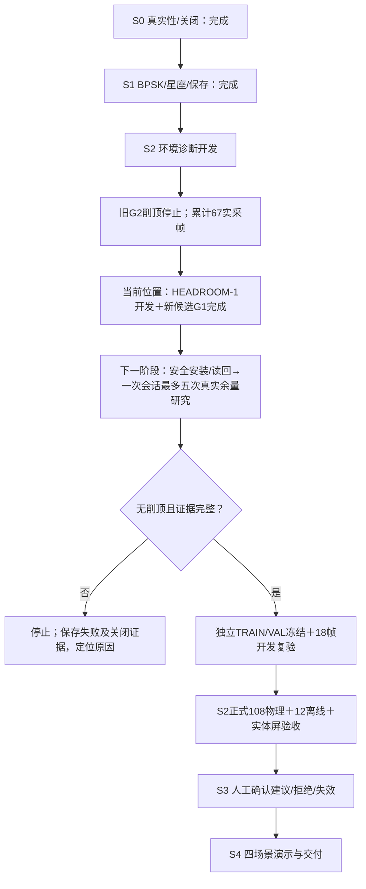

# HEADROOM-1 开发与独立G1资格完成

2026-10-11：**本开发大阶段完成**。独立46dB研究合同贯穿原生预算、客户端、控制器、后台、界面和证据保存；新候选 `b67a8aaab0c5904822580c0647b96fd0` 经独立G1假硬件/离线资格通过。daemon 1.0.4 / protocol 1.6，冻结58项原生输入、46项软件输入。新候选未安装，真实HEADROOM未执行。

Claude最新主会话停于19:45:07的中断，方向正确，Python及资格封存未完成。Codex接续修复关键控制/证据缺口，完成候选及ARM验证。历史审计保留于 `2026-10-11-claude-python-progress-review.md`；旧1949项测试及20项变异不批准最新软件。

## 本次交付与关键修复

- 一次初始化、五次尝试：OFF前→正常→窄带→脉冲→OFF后；实际双TX衰减46000mdB读回、完整载荷/声明摘要及同帧身份。旧40000mdB教学合同保持独立。
- 研究独占同一连接及I/O；严格实时预检、显式确认、异步取消，无断连重试/补采。变异遗留死锁已恢复为后台线程。
- 原始回复及已接收IQ先落盘，再验证、分析及接受。无IQ错误、错误ID、截断及超时收到的数据均保留；即使字节收齐，超时仍拒绝。
- 完成必须有原生最终ACK及实际关闭证据。分析异常保留失败尝试、abort/close ACK，界面和落盘收据一致。OFF有任何同步、点或BER均停止。
- 保存完整BPSK、星座及环境重放；46dB仍被40dB基线拒绝为 `INVALID/RF_DOMAIN_MISMATCH`，没有更改模型、标签、阈值或基线资格。
- 新合同继承环境合同并增加两个研究模块。历史准备器保持1.0.3严格绑定，其测试使用准确冻结输入，并验证当前树仍被拒绝。

## 验证与资源

| 项目 | 结果 |
|---|---|
| 完整Python回归（批量优化前冻结版） | 2313 passed / 4 skipped；1条后台测试线程警告保留 |
| 最终异常/关闭/传输关键回归 | 160 passed |
| 优化及BPSK/研究/环境相关回归 | 256 passed；独立检查193 passed |
| ARM原生构建/假硬件 | 退出0；HEADROOM148/0、owned关闭10/0；真实daemon仅编译 |
| 原生有效变异 | 8/8被有效断言捕获，绑定58项输入 |
| Host/ARM完整流程 | 8案例、各96份证据，含全五次、取消、OFF误检、削顶、能力缺失、错误ID、缺失/截断IQ |
| 四窗完整分析及流程判等 | Host/ARM差异均为空 |
| ARM 100次热完整计算 | P95 **270.793ms ≤300ms**；RSS **31524KiB ≤65536KiB**；原生CNN启用 |
| 关键审查 | APPROVED；绑定当前软件、harness和资格器；预算修复仅审查数学增量 |
| 安全只读检查 | 原发布adfac、未布防、TX/RX关闭；双服务active/running、NRestarts=0 |

首次候选 `ebad0de…` 的ARM P95 **314.963ms** 未通过，失败证据完整保留。定位后仅把BPSK的127次逐相位参考平均改为一次127×63批量整数计算，全部相位及63位窗不变。127种子标量参考逐项相等，四个保存窗口的完整五类分析严格相等（仅规范发布ID）。新候选重新资格通过；未提高预算或重复运行取优。此数字是保存IQ的计算时间，不是触摸或实采时延。

全量回归的一条警告来自遗留后台测试worker触达后续测试的socket禁止守卫，连接被阻止；日志保留，不声称无警告。后续测试维护可清理该生命周期。

## 当前位置及下一阶段

下一大阶段验证接收余量，沿用批准的有限研究设计。先经过新候选安装门禁、安全预检及声明冻结；最多一次初始化和五次尝试，削顶、错误、OFF异常、取消或关闭不确定立即停止，不重试补齐。当前G1不能替代安装/实采门禁。

真实46dB研究不能套用40dB基线得出CLEAR或收益结论。链路证据支持稳定后，再进入独立TRAIN/VAL、开发复验及正式验收。S2正式和S3/S4仍有实质工作，不把软件阶段完成等同作品完成。

本阶段新增真实RF帧0、真实初始化0，开发物理总数仍67。安装/真实HEADROOM/S2正式及真人均NOT_RUN，S3 NOT_IMPLEMENTED。封存入口 `evidence/rf-teaching/s2/headroom-contract-2026-10-11/stage-checkpoint.json`；最终候选 `candidate-budget/releases/b67a8aaab0c5904822580c0647b96fd0`；通过资格 `arm-runtime-budget/receipt.json`；失败资格 `arm-runtime-final/receipt.json`。
