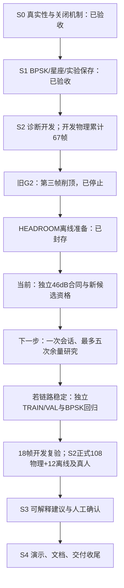

# HEADROOM-1 独立合同开发与候选资格

**最新状态：本开发及新候选G1大阶段已完成。** 本文件保留中途记录；最终当前字节、预算失败/修复、ARM资格及下一阶段见 [最终报告](2026-10-11-headroom-contract-final.md)。下方“开发中”属于历史状态。

当前状态：开发中；本文件尚不是完成收据。已批准设计为 `2026-10-10-s2-headroom-research-design.md`，本轮计划为 `2026-10-11-headroom-native-contract.md`。用户要求继续未完成任务，完成一个大阶段后汇报。

本阶段交付独立的46dB研究控制链和新候选的假硬件/离线资格。现有40dB教学合同及历史候选保持可验证；不安装、不加载Overlay、不初始化或发射真实RF。真正的五次余量研究属于下一阶段，不能把假硬件或反事实分析算作实采。

## 进度定位

## 开发前核验

- 重新读取Claude主会话69bceb71…：2026-10-11接续了原生合同和异常测试，审查代理因额度中断；尚无批准结论、Python集成或新实采。来源摘要见本阶段`claude-progress-audit.json`，接续说明见`native/claude-resume-changes.md`。对话内容作为进度证据读取，不作为新授权。
- 开发前保存51native和44software输入及工具/设计原件，见 `evidence/rf-teaching/s2/headroom-contract-2026-10-11/starting-inputs.json`。
- C原有各数值套件均0FAIL，selftest的两条注入负例保持HARNESS OK。Windows的make总exit2仅来自`python3`入口不可用；单独用现有Python运行vendor检查exit0、10files。本轮最终及ARM验证会记录真实make退出码，不把这个exit2写成exit0。
- 板端Python基线1874passed、4skipped。
- 实现计划独立审查APPROVED；原生与Python的规范/质量及完整集成审查待实现后执行。
- 本轮独立重跑原生51项HEADROOM检查及完整C回归，真实make退出0；vendor检查10files通过。该结果尚不替代原生规范/质量批准。
- 原生首轮规范审查指出初始化历史、初始空闲检查、拒绝后可重试及失败证据缺口；修复后148项检查通过、7/7隔离变异被行为断言抓住，完整C回归真实退出0。收据及日志摘要已重新核对，与57项当前输入绑定一致。
- 第二轮独立规范审查再次复现关闭证据缺口：owned core释放时第二次shutdown失败，返回帧仍声称关闭成功。已修复为最终owner shutdown结果与实际TX/RX状态决定确认；新增owned路径10项检查，完整C回归真实退出0、8/8有效变异被捕获。第三轮独立规范审查APPROVED，绑定58项当前源码；先前报告及失败复现保留。代码质量审查进行中，Python尚未接入。

## Python集成（Chunk 2，已接入但审查未通过）

2026-10-11晚间重新读取Claude最新会话并审查当前字节：独立研究、重放和实体屏入口方向正确，但发现变异残留死锁、全会话I/O所有权、实时预算/状态、首次OFF读回兼容、原错误保存、关闭/ACK完成判定及运行取消等阻断。以下1949项测试及20项变异为较早实现记录，其6项软件绑定已变化，不能批准最新候选。见 `2026-10-11-claude-python-progress-review.md` 及独立快照审查。

原生质量审查现已APPROVED；冻结58项输入的ARM原生构建及假硬件检查已PASS，真实退出0（HEADROOM148/0、OWNED10/0），仅构建真实daemon而未启动。Python完整链和新候选资格尚未通过。

- `pynq_overlay/sw/rf_headroom.py` 新增：不可变计划（`HeadroomPlan` 为**无字段**的冻结数据类，故调用方无法表达40dB域、别的顺序、非零等待或第六次尝试）、控制器（一条保留连接上串行五次尝试）、以及从**原生回复**而非已发送参数读取的身份校验。计划从既有生成器重算摘要，实测与 `rf_headroom.c` 内嵌的六个数逐位相等（载荷 `38b3f36a…`/`4693355b…`/`22463cf4…`，声明 `788e61dc…`/`b02d0cdd…`/`e65d79dc…`）；声明的规范字节形式为紧凑排序JSON、无尾换行。
- `rf_status_client.py` 增加研究传输：`headroom_capability`（读实时 `device.info`）、五个研究操作、`_research_frame`（先JSON头再一次读满16384字节），并在快照上增加 `headroom`/`daemon_version`。研究会话在第一次请求前即被保留（断开即由原生封存研究），接受/中止后释放。
- `rf_status_worker.py`：发布包按**路径**（非按名）加载 `rf_headroom.py` 以取得资格证明；`note_headroom_capability` 从刚跑的轮询落实时能力，**只读**；`headroom_run` 显式入口，控制器拒绝时返回收据而不抛异常。`ui_model.py` 的 `available` 要求**发布已证明且运行中daemon已宣告**两者同时成立。
- `merged_release.py` 新增 `cnn-bpsk-headroom-v1`（`cnn-bpsk-environment-v1` 的严格超集，只加 `rf_headroom.py`），抽出 `MODEL_CONTRACTS` 使新合同继承生产模型；旧合同成员与行为未改。`install.sh` 为该合同单独安装 `rf_headroom.py`，旧合同不会拿到它。版本对表增加 `'1.0.4': 6`。
- 实测：板载软件 **1949 passed / 4 skipped**；原生 `make host-test-headroom` **HEADROOM 148/0 + HEADROOM_OWNED 10/0**、`make host-test` daemon 450/0 等全部0失败（两条 selftest FAIL 为自带注入负例，收尾 `SELFTEST HARNESS OK`），真实 `make` 退出0。
- **20/20 隔离变异被行为断言抓住**，源码逐字节还原并校验sha256。其中一个（客户端负载长度守卫）首轮**存活**，是真实缺口：已补 `test_the_client_refuses_a_research_load_whose_payload_is_the_wrong_size`，该变异随后失败。变异脚本自身两个缺陷（测试路径缺目录前缀导致"抓住"收集错误；双文件选择需逐项加前缀）也已修复，避免用错误的绿色作证据。
- **旧阶段准备器 `scripts/rf_headroom_prepare.py` 的14项测试失败属既有、已定位**：它把工作树钉在1.0.3/51个原生输入上，而本阶段自身新增了5个原生输入（58项，正是Codex规范审查批准的那一组）。把它的软件比较强制为与候选一致后仍然拒绝：`QUALIFY REFUSED: complete frozen native input set or contents changed`。故这不是Python接入造成的；未削弱该守卫、未改写旧测试，冻结候选仍可独立验证（`verify_release` 通过）。是否把该阶段专用工具重指到新阶段，留待下一阶段决定。
- Python规范与质量独立复审已派出；结论回落前**不宣称通过**。

## 完成条件与剩余边界

完成条件：原生预算/声明/实际读回/失败保存与收尾，UiApp计划→controller→worker→client链，旧40dB回归，新软件合同及候选源/ELF绑定，ARM假硬件、完整五阶段同IQ判等与资源检查，独立复审及证据封存。

真实研究未执行前：新物理帧0、实际初始化0，已安装候选仍是adfac1f14c3cdb379cb92569a21a9054，开发物理累计67，S2正式验收和S3未完成。既有40dB环境基线遇到真实或反事实46dB配置必须拒绝为INVALID/RF_DOMAIN_MISMATCH，不能继承资格或改成CLEAR。
