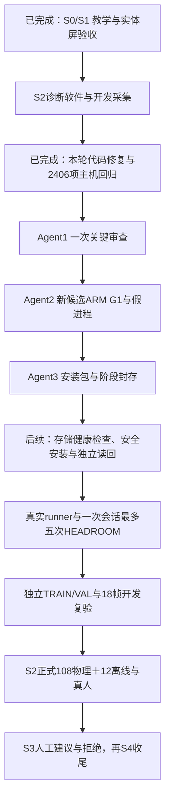

# HEADROOM 阶段进度与 agent 执行单

截至本次交接，代码修复、新候选和主机验证已完成；整个大阶段尚未完成。独立关键审查因 agent 使用额度限制未执行成功，不存在 APPROVED 记录；ARM G1、最终安全读回和安装包封存仍待执行。本次没有访问板卡、安装或新增真实 RF 帧。

## 执行结果（2026-10-12 追加，三个串行任务已全部完成）

下方“当前事实”表与 Agent 1/2/3 三节是本交接**执行前**的记录，保留原样作为历史。以下是按它们逐条执行后的实际结果：

| 项目 | 结果 |
|---|---|
| Agent 1 独立合并关键审查 | **APPROVED**。由未参与任何实现/测试/证据生成的独立 agent 完成；`python/critical-review.md` 首行字面量 `APPROVED`（sha256 `88d7445938407e3235862503feacc24c71535e09d2964956e810503be8434004`），`critical-review.json` 绑定候选 `b82b141e355b4cb1833969383a409c79`、46 项 `software_digests`、harness/qualifier/runtime-runner/supervisor-qualifier 摘要与 6 项 `REVIEW_TOOLS` 摘要，`native_lease_regression_passed=true`；Lead 已用 `qualify-runtime.check_chain_reviews` 实测放行 |
| 审查的真实性证据 | 审查者在 `%TEMP%` 自行重建原生桥，三个原生产物 sha256 与归档逐字节相同；对生产 C 施加两处变异（`rf_state_detach` 不保留租约、acquire 不置 `session.lease_held`）后回归断言分别失败 → 该原生回归不可伪造 |
| Agent 2 隔离 ARM G1 | **PASS**。完整计算：四窗 Host/ARM `parity_mismatches=[]`，100 次完整计算 **P95=278.835 ms**、RSS **31704 KiB**、`native_cnn=true`、exit 0；研究链：8 场景/96 份证据 `chain_parity_mismatches=[]`，两次运行均 `simulation=true`/`hardware_touched=false`/`new_rf_frames=0` |
| Agent 2 ARM 假 supervisor | **PASS**。`simulation=true`、`actual_install=false`、`systemd_touched=false`；success(exit 0) 与 installer-failure(exit 7) 两例均满足发起进程退出后存活、观察者超时后存活、重复 run/dispatch 被拒、异常 boot 判 UNKNOWN——补上主机跳过的那条真实 Linux 进程用例 |
| Agent 2 最终只读安全检查 | **PASS**。仍 `b67a8aaab0c5904822580c0647b96fd0`；`safe=true`、双服务 unit 与发布相符、root `rw`、本次启动存储错误 `[]`、只读零写入 |
| Agent 3 安装包与封存 | **DONE**。`install-bundle/`（`candidate.tgz` 99 成员 + `install.sh` + `install_state.py` + `job.py` + `bundle-receipt.json`，4 项 payload 摘要）以 b67 为父版本并绑定 `board-recovery-2026-10-12/recovery-checkpoint.json`；`development-checkpoint.json`、`stage-checkpoint.json` 已生成，`seal-stage.py --verify` 通过 |
| 板卡接触范围 | 仅隔离 `/tmp/rf-headroom-offline-<uuid>`（候选+保存 IQ，离线计算）、`/tmp/rf-headroom-fake-job-<uuid>`（假安装进程，不触 systemd）、`/tmp/rf-headroom-readonly-<uuid>`（只读安全检查）。**未真实安装、未换 Overlay、未布防、未发射、未物理采集**；新增物理帧 0、真实研究初始化 0，开发物理累计仍 67 |
| 仍然未完成 | 真实安装与独立读回、真实 HEADROOM 研究（runner 仅有设计文档 `docs/superpowers/plans/2026-10-12-real-headroom-research-runner-design.md`，未编写未运行）、S2 正式 108+12/真人、S3、S4；原 b67 安装 UNKNOWN 保留未改写；MMC/SDHCI 根因 `NOT_ESTABLISHED`，完整文件系统检查/修复 `NOT_RUN` |
| 阶段收据 | `evidence/rf-teaching/s2/executable-candidate-2026-10-12/stage-checkpoint.json`（`installed=false`、`physical_headroom=NOT_RUN`、`new_rf_frames=0`、`production_systemd_dispatch=NOT_RUN`）。`handoff-progress.json` 是执行前 17:26 的主机进度快照，**不是**最终状态 |

**不要重复派发** Agent 1/2/3：三者已完成并封存。下一步是新的开发阶段——存储健康确认 → 用本次 `install-bundle/` 做单次安全安装与独立读回 → 实现真实 runner 并经人工接线确认与一次性 token 执行一次会话最多五尝试。

## 当前事实（交接时快照，保留为历史）

| 项目 | 状态与证据 |
|---|---|
| 当前板卡发布 | 最近核验为 b67a8aaab0c5904822580c0647b96fd0；本轮未重新联系板卡 |
| 新候选 | b82b141e355b4cb1833969383a409c79；candidate-final，未安装 |
| 租约修复 | 实际原生 serve 回复验证；严格 true 租约、线程/代次/socket、关闭无 pending；155 专项通过 |
| 部署修复 | 严格完整预检、独立 systemd 任务、持久记录、单次执行、失联后新连接观察；52 专项通过、1 待 ARM |
| 合并主机回归 | 2406 PASS、5 SKIP；combined-tests.xml/log |
| 原生构建 | 58 项输入未变，复用已合格 ARM ELF；未重建硬件/模型 |
| 新候选模拟链路 | 8 场景、96 证据 PASS；仍明确 simulation |
| 新旧离线分析 | 4 窗除 release_id 外完全一致；prior-new-offline-parity-normalized.json |
| 本轮独立审查 | NOT_COMPLETED_USAGE_LIMIT；禁止继承旧 Python APPROVED |
| 新候选 ARM G1 | NOT_RUN；禁止继承旧 b67 的 270.793ms |
| 安装包/阶段封存 | 尚未生成 |
| 真实研究/正式验收 | HEADROOM NOT_RUN；物理累计67；S2正式/S3/S4待完成 |

5 个跳过项中，1 个为 Linux 假安装独立进程测试，交给 ARM selftest 补测；4 个为专用 Torch 环境的既有模型判等测试。模型未改变，不将这些跳过声称为新通过。

证据根目录：`<LOCAL_PATH>`。进度机器收据为 `handoff-progress.json`；它仅证明当前主机开发状态，不替代最终阶段 checkpoint。

## 统一给所有 agent 的要求

```text
工作目录 <LOCAL_PATH>。
先读 AGENTS.md、CLAUDE.md 和 docs/superpowers/plans/2026-10-12-headroom-executable-candidate.md。
此 checkout 有多人未提交成果，不 reset/stash/清理，不覆盖其他人的修改，不整树提交。
代码发现先用 codebase-memory-mcp；工具不可用时使用范围明确的 rg。
遵守分配的文件所有权；不要自行再派审查，完成一次合并关键审查即可。
冻结依据 source-freeze.json：46 software、58 native、22 工具/测试/脚本。
不修改原生独占规则、一次初始化/五尝试预算、300ms/64MiB预算、40dB基线和诊断阈值。
保留 b67 原安装 UNKNOWN、旧候选/失败/历史审查。不得把模拟/离线数据当物理采集。
连板只用 ac820-pynq 的 Paramiko helper，不使用 ssh/scp，不开第二 Overlay。
本阶段禁止真实安装、布防、发射、物理采集、文件系统修复和生产服务变更。
所有成功结论必须绑定实际命令结果和摘要；失败保留并报告，不伪造 APPROVED/PASS。
```

## Agent 1：一次关键审查（首先执行，只读源码）— 已执行，结果 APPROVED（见上方执行结果）

可直接发送：

```text
接续 HEADROOM executable candidate 的一次合并规范/质量审查。
仅负责 evidence/rf-teaching/s2/executable-candidate-2026-10-12/python/critical-review.md 和 .json。
你没有实现这些修复；请独立检查。不要访问板卡或改生产源码，不重复跑2406项全回归。
对比 starting-inputs 快照、source-freeze.json、candidate-final/releases/b82b141e355b4cb1833969383a409c79。
检查 lease/receipt.json、deployment-implementation-receipt.json、combined-tests.xml/log。
重点：实际原生 lease=true 与线程/代次/socket所有权、关闭拒绝pending矛盾、第二客户端拒绝；
预检缺字段/非零/子命令失败/完整dmesg/父版本/服务/root rw均fail closed；
独立单次任务在SSH退出后存活、日志/退出持久化、重复拒绝、重启执行UNKNOWN、观察与安全状态绑定；
新b67父版本恢复证明、原UNKNOWN不变；资格器上传仅候选/保存IQ/假进程，不能触碰生产。
检查 root 的 qualify-runtime.py、qualify-supervisor.py、check-runtime.py、fake-chain、final-safety.py、seal-stage.py。
有关键问题则REJECTED并给出准确文件/触发场景，交回实现者定点修复；不写虚假批准。
通过时 md 以 APPROVED 开头，json 绑定下列字段，ARM结果仍写NOT_RUN。
```

审批 JSON 必须包含：

| 字段 | 内容 |
|---|---|
| verdict | APPROVED |
| candidate_release_id | b82b141e355b4cb1833969383a409c79 |
| source_sha256 | 当前 R.software_digests(ROOT, 'cnn-bpsk-headroom-v1') 的精确46项映射 |
| report_sha256 | critical-review.md 摘要 |
| harness_sha256 | python/headroom-fake-chain.py 摘要 |
| qualifier_sha256 | qualify-runtime.py 摘要 |
| runtime_runner_sha256 | check-runtime.py 摘要 |
| tools_sha256 | qualify-runtime.REVIEW_TOOLS 精确键值映射 |
| native_lease_regression_passed | true，仅在核验原生证据后填写 |
| supervisor_qualifier_sha256 | qualify-supervisor.py 摘要 |

不得由实现者自己补 APPROVED 来绕过此项。审查失败后的修复必须重新冻结、运行对应回归并由同一审查者核验必要增量。若改46项软件，重建候选并重新资格，不能继续使用旧摘要。

## Agent 2：新候选隔离 ARM G1（依赖 Agent 1 通过）— 已执行，G1 与假进程均 PASS（见上方执行结果）

可直接发送：

```text
负责新候选b82b141e的隔离ARM G1，依赖当前代码/工具摘要的独立critical APPROVED。
所有权仅新证据目录 arm-runtime、arm-supervisor、final-safety；不改冻结源码/资格器/审查。
用户已有明确授权：向AC820 192.0.2.10的/tmp上传候选与保存IQ做G1假硬件/离线分析；
上传现有rf_teaching_install_state.py并sudo只读安全检查。
本任务不包含真实安装/Overlay/布防/发射/RF采集，也不包含真实systemd部署提交。
顺序执行下列命令：完整计算及流程判等、独立假安装进程、最终只读安全检查。
核验100次完整计算P95<=300ms、RSS<=65536KiB、native CNN、Host/ARM parity为空、8场景/96份证据；
ARM fake supervisor必须simulation=true、actual_install=false、systemd_touched=false：
成功/失败退出、发起进程退出后存活、观察进程超时后存活、重复执行拒绝、不同boot UNKNOWN。
安全检查必须仍b67、未布防/TX/RX关闭、PL io_ok、双服务正常、unit与发布相符、root rw、完整日志无存储错误。
失败保留原始证据并报告，不改变预算，不重复采集，不重提真实安装。
```

在 PowerShell 执行（目录均为绝对路径，依赖审批文件；每条检查退出码为0后再执行下一条）：

```powershell
$project = '<LOCAL_PATH>'
$stage = Join-Path $project 'evidence\rf-teaching\s2\executable-candidate-2026-10-12'
$python = '<LOCAL_PATH>'
$env:PYTHONDONTWRITEBYTECODE = '1'
$env:PYTHONIOENCODING = 'utf-8'
Set-Location -LiteralPath $project
$chain = Join-Path $stage 'python\headroom-fake-chain.py'
$chainSha = (Get-FileHash -LiteralPath $chain -Algorithm SHA256).Hash.ToLowerInvariant()
& $python -B (Join-Path $stage 'qualify-runtime.py') `
  --candidate (Join-Path $stage 'candidate-final\releases\b82b141e355b4cb1833969383a409c79') `
  --output (Join-Path $stage 'arm-runtime') --chain-sha256 $chainSha
if ($LASTEXITCODE -ne 0) { throw 'G1 failed; preserve evidence and stop dependent steps' }
& $python -B (Join-Path $stage 'qualify-supervisor.py')
if ($LASTEXITCODE -ne 0) { throw 'Fake supervisor failed; preserve evidence' }
& $python -B (Join-Path $stage 'final-safety.py')
if ($LASTEXITCODE -ne 0) { throw 'Final read-only check failed; do not install' }
```

目录必须新建，不能删除失败证据来重跑。若网络沙箱阻止连接，按既有用户授权申请工具升级执行；遇自动审批拒绝，记录具体动作与理由，不绕过。假进程测试不调用生产 systemd；真实 systemd 部署路径仍只能记 NOT_RUN。

## Agent 3：资格闭合、打包、阶段封存（依赖 Agent 2 全部通过）— 已执行，install-bundle 与 stage-checkpoint 已封存（见上方执行结果）

可直接发送：

```text
负责把已独立审查且ARM G1通过的b82b141e封存为可安装包；本任务只做主机打包，不执行install子命令。
检查源码冻结仍匹配、所有新收据passed、100次/300ms/64MiB和同帧分析判等、假进程及最终b67安全状态。
先执行seal-stage.py --development，再用rf_headroom_deploy.py prepare绑定真实b67候选和board-recovery恢复证明。
核验bundle-receipt和verify_bundle通过，包含候选/安装器/只读检查器/job supervisor及准确摘要。
更新阶段报告、CLAUDE.md、总体roadmap与本交接的实际状态，然后seal-stage.py、--verify。
只在验证成功后称“开发＋G1＋安装包阶段完成”；真实安装/真实HEADROOM/S2正式/S3仍未完成。
不覆盖旧UNKNOWN，物理累计67、新RF0，MMC根因和完整文件系统修复仍未知/未做。
```

沿用上一步 PowerShell 变量：

```powershell
& $python -B (Join-Path $stage 'seal-stage.py') --development
if ($LASTEXITCODE -ne 0) { throw 'Development gates incomplete' }
& $python -B (Join-Path $project 'scripts\rf_headroom_deploy.py') prepare `
  --candidate (Join-Path $stage 'candidate-final\releases\b82b141e355b4cb1833969383a409c79') `
  --arm (Join-Path $stage 'arm-runtime\receipt.json') `
  --parent-candidate (Join-Path $project 'evidence\rf-teaching\s2\headroom-contract-2026-10-11\candidate-budget\releases\b67a8aaab0c5904822580c0647b96fd0') `
  --parent-install (Join-Path $project 'evidence\rf-teaching\s2\board-recovery-2026-10-12\recovery-checkpoint.json') `
  --checkpoint (Join-Path $stage 'development-checkpoint.json') `
  --output (Join-Path $stage 'install-bundle')
if ($LASTEXITCODE -ne 0) { throw 'Bundle gate failed' }
# 更新报告/CLAUDE/roadmap和计划勾选后，封存并验证。
& $python -B (Join-Path $stage 'seal-stage.py')
if ($LASTEXITCODE -ne 0) { throw 'Stage seal failed' }
& $python -B (Join-Path $stage 'seal-stage.py') --verify
if ($LASTEXITCODE -ne 0) { throw 'Stage verification failed' }
```

seal-stage.py 是新编排工具，Agent 1 需审查其检查范围；不能因为有脚本就假设它已经运行成功。封存后不要再修改其绑定文档；新进展另写收据，保留本阶段历史。

## 后续开发任务与总路线



前三个 agent 串行依赖，不建议同时修改同一资格/封存文件。可独立安排一名 agent 只写“真实研究 runner 设计与模拟测试方案”，不得连接板卡执行：必须复用 RfStatusWorker/HeadroomController/RfStatusClient 的唯一链，人工接线确认和显式 token，一次初始化/最多五尝试、OFF负控/触边立即停、完整原始IQ与ACK、最终独立安全读回；设计审核后另立开发阶段。不得让其直接加脚本绕过控制合同或抢先实采。

目前接近结束的是“可执行候选与可靠部署开发阶段”，并非整个项目。剩余量主要在真实链路稳定、独立数据与正式验收；不以软件测试数量换算整体完成百分比，也不承诺未经实采验证的收尾日期。
