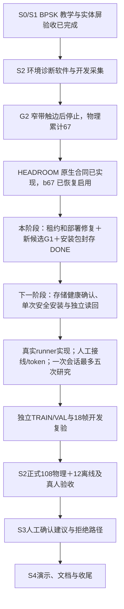

# HEADROOM 可执行候选与持久部署阶段

本阶段范围为修复租约、严格部署预检、独立持久任务、重新生成候选、完成隔离 G1 并生成可安装包。实际安装、真实 RF 研究、文件系统修复均不在本阶段范围。**截至本次更新，本阶段的三个串行任务已全部执行完毕**：独立合并关键审查 APPROVED、新候选隔离 ARM G1 与假进程通过、安装包生成并封存（`--verify` 通过）。真实安装、真实 HEADROOM 研究、S2 正式验收仍未开始。

## 已实现的行为

- 原生守护进程在连接建立时取得独占租约，因此能力检查与关闭读回要求当前连接的 `lease_held=true`。客户端同时检查线程、连接代次和原始 socket，拒绝连接替换或矛盾的 pending 状态；研究解除后仍持有连接租约，断开时才释放。
- 原生联动测试直接运行实际 `rf_daemon_serve`，验证第二客户端 BUSY、解除后租约保留、断开后释放。新增桥位于测试目录，已核验的 58 项原生构建输入未变。
- 部署预检保留所有子命令状态，读取完整 dmesg，遇到缺字段、读取失败、错误父版本、异常服务、只读根分区或存储故障时，在上传前停止。
- 部署使用独立 systemd 任务和 `/var/lib/rf-headroom-deploy/<attempt>` 持久记录；SSH 仅提交和观察。独占尝试及运行锁拒绝重复执行，观察超时不能终止或重提安装。重启后的执行结果仍为 UNKNOWN，独立安全读回才能说明实际当前状态。
- 新候选以已恢复并核验的 b67 为父版本，旧 adfac 证明及原安装 UNKNOWN 保留。硬件、模型与 ARM ELF 复用；没有重训模型或调整诊断阈值。

## 本次执行结果（2026-10-12）

| 任务 | 结果与绑定 |
|---|---|
| 独立合并关键审查 | **APPROVED**（非实现者的独立 agent）。报告 `python/critical-review.md`，首行字面量 `APPROVED`，sha256 `88d7445938407e3235862503feacc24c71535e09d2964956e810503be8434004`；绑定 JSON 的 10 个字段与候选、46 项 software、harness/qualifier/runtime-runner/supervisor-qualifier、6 项 `REVIEW_TOOLS` 逐一相符 |
| 审查独立性证据 | `native_lease_regression_passed=true`：审查者自行在 `%TEMP%` 重建原生桥，产物 sha256 与归档**逐字节相同**，并对生产 C 施加两处变异（`rf_state_detach` 不保留租约、acquire 不置 `session.lease_held`），回归断言分别失败 → 该回归不可被伪造 |
| 隔离 ARM G1（完整计算） | PASS。同帧 4 窗完整分析 Host/ARM 判等 `parity_mismatches=[]`；100 次完整计算 **P95=278.835 ms**（≤300ms）、RSS **31704 KiB**（≤64MiB）、`native_cnn=true`；exit 0、guard 0；候选与保存 IQ 仅上传到 `/tmp/rf-headroom-offline-<uuid>` |
| 隔离 ARM G1（研究链） | PASS。8 场景（`full-five`/`cancel`/`off-false-positive`/`rails`/`missing-capability`/`wrong-id`/`no-iq`/`partial-iq`）、96 份证据 Host/ARM 判等 `chain_parity_mismatches=[]`；两次运行均 `simulation=true`、`hardware_touched=false`、`new_rf_frames=0` |
| ARM 假 supervisor（假安装进程） | PASS。`simulation=true`、`actual_install=false`、`systemd_touched=false`、`new_rf_frames=0`；success(exit 0) 与 installer-failure(exit 7) 两例均满足发起进程退出后任务存活、观察者超时后存活、重复执行/重复派发被拒、异常 boot 判 UNKNOWN；仅使用 `/tmp/rf-headroom-fake-job-<uuid>`，不触碰生产 systemd。此项补上主机上跳过的真实 Linux 进程用例 |
| 最终只读安全检查 | PASS。仍为 `b67a8aaab0c5904822580c0647b96fd0`；`safe=true`、双服务 unit 与发布相符、root `rw`、本次启动存储错误 `[]`（只读抓取，零写入） |
| 安装包 | `install-bundle/`：`candidate.tgz`(99 members) + `install.sh` + `install_state.py` + `job.py` + `bundle-receipt.json`；父版本 b67、绑定 `board-recovery-2026-10-12/recovery-checkpoint.json`；`verify_bundle` 通过；**未安装** |
| 阶段封存 | `development-checkpoint.json` 与 `stage-checkpoint.json` 已生成，`seal-stage.py --verify` 通过；`installed=false`、`physical_headroom=NOT_RUN`、`new_rf_frames=0`、`production_systemd_dispatch=NOT_RUN` |

## 候选与证据

最终候选：`b82b141e355b4cb1833969383a409c79`，daemon 1.0.4 / protocol 1.6。候选路径为 `evidence/rf-teaching/s2/executable-candidate-2026-10-12/candidate-final/releases/`；早期打包记录保留，正式资格只绑定 candidate-final。

证据入口：`evidence/rf-teaching/s2/executable-candidate-2026-10-12/`。`source-freeze.json` 绑定软件、原生映射和关键工具/测试；`lease/receipt.json` 记录原生回归；`python/critical-review.{md,json}` 为独立审查；`arm-runtime/`、`arm-supervisor/`、`final-safety/` 分别保存计算资格、假安装进程及最终只读安全检查；`install-bundle/` 与 `stage-checkpoint.json` 为封存产物。`handoff-progress.json`（17:26）是执行前的主机进度快照，**不是**最终状态；最终状态以 `stage-checkpoint.json` 为准。

| 验证项 | 当前状态 |
|---|---|
| 租约专项 | 155 PASS；原生实际回复与关闭路径已验证（并由审查者变异反证） |
| 部署专项 | 52 PASS；原 1 项 Linux 进程项已由 ARM 假 supervisor 两例补测 |
| 新候选主机完整模拟链路 | 8 场景、96 份证据 PASS |
| 合并回归 | 2406 PASS、5 SKIP；冻结摘要重新核验通过 |
| 合并关键审查 | **APPROVED**（报告摘要 `88d74459…`） |
| 新候选 ARM 100 次完整计算与判等 | **PASS**，P95 278.835ms、RSS 31704KiB、native CNN |
| ARM 独立假安装进程 | **PASS**（simulation / 未安装 / 未触 systemd） |
| 最终只读安全检查 | **PASS**（仍 b67、safe、unit 相符、root rw、0 存储错误） |
| 安装包/封存 | **DONE**，`install-bundle/` + `stage-checkpoint.json`（`--verify` 通过） |
| 真实安装 / 真实 HEADROOM / S2 正式 / S3 / S4 | NOT_RUN |

## 本阶段明确未做的事

- 未真实安装、未加载第二个 Overlay、未布防、未发射、未做任何物理采集；本阶段新增物理帧 0，开发物理累计仍为 67。
- 真实研究 runner 只有设计文档 `docs/superpowers/plans/2026-10-12-real-headroom-research-runner-design.md`，未编写、未运行、未实采；其红/绿测试与变异均为设计。
- 原 b67 安装 UNKNOWN 收据保持原样（摘要与冻结值相符），未被改写为成功或回滚。
- MMC/SDHCI 根因仍 `NOT_ESTABLISHED`；完整文件系统检查/修复仍 NOT_RUN；`/boot` FAT 的“未正常卸载”仍按既有结论理解为粘滞挂载状态位。
- 40dB 生产诊断基线继续拒绝 46dB 数据（`RF_DOMAIN_MISMATCH`/INVALID）；不得把离线、模拟或假硬件结果当作物理观察。

## 当前阶段与下一阶段

下一阶段先确认存储健康与当前 b67，再用本阶段封存的 `install-bundle/` 执行**单次**安全安装和独立读回；安装验收通过后才实现并运行真实研究 runner，把接线确认、一次性 token、一次初始化/最多五尝试、OFF 负控、触边立即停、完整原始 IQ 与 ACK、最终独立安全读回接到唯一控制链上。在安装与读回完成前，不进行任何真实研究。

MMC/SDHCI 根因仍为 NOT_ESTABLISHED，完整文件系统检查/修复仍 NOT_RUN。开发物理累计 67，本阶段新增物理帧与真实研究初始化均为 0；S2 正式、S3、S4 尚未完成。无需补专门的触摸计时。
