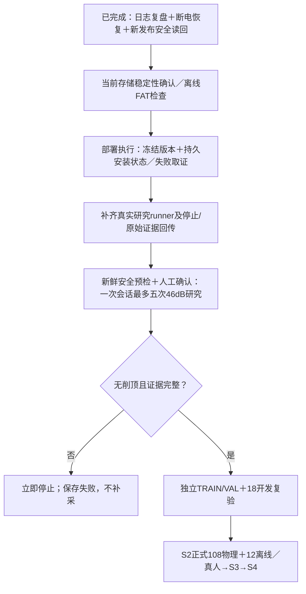

# 日志复盘、板卡恢复与下一阶段安排

**结论：开发方向基本正确，板卡运行已恢复；存储长期稳定性及完整FAT检查尚未完成。** 这次日志中的主问题落在部署和存储I/O。新候选b67a8aaab0c5904822580c0647b96fd0已实际启用，原安装超时记录保留为UNKNOWN，另以本次恢复后的独立读回确认现状。没有重复安装或进行RF测试。

日志来源：`dsh-session-session-5c2d2874-a454-4d7b-8f99-3dcce233a45f.zip`，SHA256 `e437e9aface2350ab05fbf37e8b36b2d2b9041b12ac5131bef381ce038032dd3`。主会话660条事件、一个审查子会话，主会话最后因用户中止结束。附件里的操作指令作为审查材料，未作为本次执行授权。本文日期和时间使用北京时间；旧目录名2026-10-11不代表此次安装发生于10月11日。

## 日志中遇到的问题及方向判断

| 问题 | 已确认事实 | 判断 |
|---|---|---|
| 安装门禁案例名过期 | 要求旧案例名，实际冻结证据为full-five等八类 | 修正案例名正确，不需要推翻已完成G1 |
| Host/ARM强制字节相同 | 96份中3份JSON有浮点末位差异；独立审查最大差约4.44e-15，完整记录判等通过 | 去掉字节相同要求正确；必须保留各平台摘要绑定及判等 |
| 初版修复只检查形状 | 审查复现任意摘要/八个伪路径也能通过 | 初版削弱门禁；后来绑定已冻结chain结果的证据清单、案例状态及模拟范围，修复方向正确 |
| 临时目录前缀不同 | deploy生成rf-headroom-install，安装器仅接受rf-teaching-install | 首次exit2；后续只读确认仍adfac且安全，正确修复调用端前缀 |
| 审查与安装并行 | 11:05:26宣布审查未回就开始安装；审查时源码继续变化；11:08:40第二次安装进入执行 | 关键执行版本应冻结，拿到一次关键结论后再部署，避免边改边安装 |
| 安装超时与恢复推测 | 240秒后host超时；日志已写“Installed …b67…; services remain stopped.”；没有成功post-state | 只能记UNKNOWN；不能据此断言未安装、安装器已被杀或已经回滚 |
| 长时间SSH等待 | TCP/HTTP仍响应、SSH认证或开session卡住 | 只证明部分系统仍响应，不能证明systemd/logind就是根因；应尽早查串口内核日志 |
| 进度报告过期 | 报告仍8测试/NOT_RUN，实际已15测试及两次安装尝试 | 保留历史报告，以本报告及新恢复收据覆盖当前状态 |

本次复查当前 `scripts/tests/test_rf_headroom_deploy.py`：**15 passed**。日志中的scripts全量288 passed与磁盘日志相符。没有重复审查全部接收算法，也没有改动冻结候选、模型、阈值、基线或原生源码。

两个重要时间点：11:06:35首次拒绝后的安全状态已确认；11:12:43第二次安装超时，之后状态未确认。后来修改门禁不能改变这次已经提交到板卡的安装包。原安装日志只有写入完成提示，不能证明完整启动及后验检查成功。

## 本次诊断及恢复

1. 有界SSH检查复现认证超时，没有重装或重启服务。
2. COM11读取到内核 `mmc0: Timeout waiting for hardware interrupt`、SDHCI寄存器转储及 `ADMA Err: 0x00000001`。这是存储控制器/I/O故障的直接证据，足以解释读取程序和新SSH会话阻塞；故障触发原因仍未证明。
3. 提示操作者断电等待10秒后恢复供电；随后通过uptime及新的启动日志确认板卡确已重新启动，SSH恢复。不把“可以”选择或等待时间当作操作已完成的证据。
4. 独立读取实际current、active-release、进程、systemd任务、启动日志和分区信息。实际介质为14.6GiB **SDHC卡**，不能继续笼统归因为“eMMC sync慢”。
5. 已审查的 `rf_teaching_install_state.py` 核验新发布；再核验实际systemd unit摘要与该发布一致，执行最终安全及存储读回。
6. 下载七个启动分区常规文件到电脑，合计6809673字节，含BOOT.BIN、image.ub、boot.py、boot.scr，逐文件大小和SHA保存。没有修改启动分区或根分区。

| 恢复后的项目 | 实际结果 |
|---|---|
| current与active-release | 都为b67a8aaab0c5904822580c0647b96fd0 |
| 候选文件完整性 | verified_release通过，cnn-bpsk-headroom-v1 |
| daemon启动日志 | 1.0.4 / protocol1.6 |
| 服务 | pynq-status、rf-daemon均active/running；本次启动NRestarts=0 |
| 实际unit与发布unit摘要 | 两者均相等 |
| RF安全状态 | 未布防、PL io_ok=true、TX source=false、RX armed=false |
| systemd任务 | No jobs running |
| 根分区 | ext4启动journal recovery complete，当前rw |
| 本次启动存储日志 | 最终uptime约647秒；未见新的MMC interrupt timeout、ADMA或I/O error |
| /boot | FAT提示此前未正常卸载；仍需完整检查 |
| FAT工具 | fsck.fat、fsck.vfat、dosfsck、busybox及缓存dosfstools包均不存在；只读检查命令exit127，**不能记为fsck通过** |

板卡的墙钟仍显示2021年，不能用板端journal日期对齐这次安装时间。上述时序使用主机时间、boot_id及uptime；NRestarts=0仅描述当前启动，不能反推故障启动从未重启。

已确认的是**运行恢复及新发布安全启用**，不是证明SD卡没有硬件问题，也不是完成所有分区的文件系统修复。此次未主动调用Overlay；重新上电后由唯一pynq-status owner正常自动加载。未执行AD9361研究初始化、布防、发射或新采集，开发物理总数仍67。

## 下一步执行建议

**第一优先级是存储。** 先用有FAT检查工具的维护环境对启动分区做离线检查，保持启动文件备份；不要在已挂载的根分区上执行修复。复现MMC超时后立即停下写卡/安装，记录串口及存储状态，再判断供电、SD卡/卡座、控制器或软件触发原因。当前无证据支持重训模型或修改RF参数来解决该故障。

**第二优先级是部署恢复机制。** 本次新版本已运行，不再次执行同一安装。后续部署需固定candidate/bundle/脚本摘要，关键审查只针对最终版本一次。将执行作业与SSH观察连接分离，保留持久attempt ID、阶段、退出结果及服务/内核错误；观察超时表示需要读回确认，不是重新安装许可。单纯将240秒改成900秒无法解决本次MMC故障。

**第三优先级才是真实研究。** 沿用现有生产UI→worker→controller→client→daemon链，不再增开硬件owner；补齐有界真实runner、原始证据下载及取消/关闭回执，再按批准顺序一次初始化、最多五次尝试。任何削顶、OFF异常、身份/传输错误或关闭不确定立即停止，不补采。46dB研究仍不能使用40dB基线宣布CLEAR或收益。

收据入口：`evidence/rf-teaching/s2/board-recovery-2026-10-12/recovery-checkpoint.json`。直接证据包括`serial-console.log`、`final-os-observation.json`、`final-safe-state.json`、`verified-new-release-receipt.json`、`boot-backup-final-receipt.json`、`deploy-review-tests.log`。原安装UNKNOWN、零字节状态及原审查失败记录保留，不改写为成功。S2正式、真人、S3/S4仍未由本次恢复完成。
