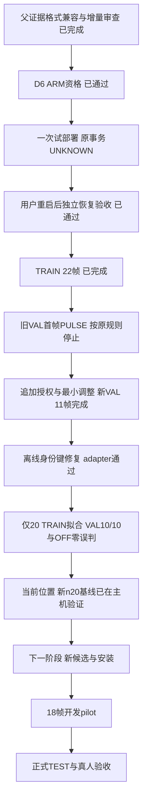

# S2 46 dB 接续完成报告与下一阶段

日期：2026-10-18（Asia/Shanghai）。执行者：Codex。用户已停止原 DSH 子代理并将剩余工作交接；本报告以实际板端、原始帧和收据为依据。离线日志中的旧建议不自动扩展本次授权。

## 1. 当前结论

**本次工作包完成：D6 候选已在板端运行，33 帧物理 TRAIN/VAL 数据完成，TRAIN-only 基线拟合及独立 VAL/负控检查通过。** 当前停在“新开发基线已在主机验证、待生成下一候选并安装”的位置。

| 项目 | 实际结果 |
|---|---|
| 父证据兼容与一次增量审查 | APPROVED；真实父材料正控通过 |
| D6 ARM 资格 | PASS；P95 262.741 ms，RSS 31372 KiB，native CNN=true，host/ARM parity 无差异 |
| 板端发布 | `1c0894bfe7751be2e1afa4e8bac564b8`；51 个发布文件与候选一致 |
| 原试部署事务 | **UNKNOWN**：MMC/SDHCI 故障及重启使原完成收据缺失 |
| 重启后恢复验收 | 独立读回新版本，另存 6/6 PASS；没有再次安装，没有补签原事务 |
| 最终数据集 | TRAIN seed1/37：22 帧复用；新 VAL seed73：11 帧；共 33 帧 |
| 正式拟合输入 | 仅 20 帧 TRAIN normal；VAL/OFF 不参与拟合 |
| 独立验证 | **VAL normal 10/10 CLEAR；3 个 OFF 零误判 CLEAR；normal 无 INVALID** |
| 基线加载 | `load-check --require-formal` 通过；基线自身仍标记 `development` |
| 最终板卡读回 | 19:50:54，17/17 PASS；RF 关闭，两服务正常，NRestarts=0 |
| 未运行 | 新基线安装、18 帧 pilot、正式 TEST、真人验收 |

`--require-formal` 是加载接口检查通过，不等于正式 TEST 或产品发布完成。不要把本阶段通过转换为整个项目 100% 完成。

## 2. 这次解决的阻碍

### 2.1 父证明的新格式

接续原 DSH 的兼容改动，绑定真实父 `1a30f4b7b9aebe27965fcdd6dcf7634e`，使用新格式的 56 个父证据文件正控。复用既有 330 项旧格式回归和 4 个已捕获变异，本次新鲜运行 59 项新格式回归通过；准备的试部署包 95 个成员校验通过。

一次独立增量审查同时覆盖父证明、候选身份、试部署入口、验收及回退绑定。未对已经批准且未变的 C/RTL/模型重启审查或构建。

### 2.2 板卡存储故障与未知事务

原试部署 SSH 超时后，COM11 只读串口日志显示 `mmc0: Timeout waiting for hardware interrupt` 和 SDHCI `ADMA Err: 0x1`。没有将 SSH 超时视作成功，也没有自动重装。用户随后确认“已重启”。

恢复后读取到新 boot_id `9672af66-21ff-4ceb-8f91-f112ad444651`，`current`、`active_release` 与发布文件均为 D6 新版本。原 trial 的最终状态/收据缺失，所以原事务继续保留 UNKNOWN；另存恢复验收 6/6 PASS，状态为 `RECOVERED_VERIFIED_ACTIVE_RELEASE`。

19:50:54 最终读回仍为同一 boot_id，`pynq-status` PID551、`rf-daemon` PID603，均 active/running，重启计数为 0；`armed/core/rx_armed/tx_source_selected=false`，PL I/O 正常，部署锁空闲，本次临时目录已清理。

本次启动没有新的 MMC/SDHCI 故障记录。`/boot` 仍有上次非正常卸载的 FAT dirty 警告；本次没有执行 fsck，也没有证据证明 SD 卡故障根因已消除。后续若真实存储超时复现，应先恢复存储，保留未知事务，不继续安装或初始化。

### 2.3 标定前的稀疏 PULSE 与新增 VAL

campaign4 的 TRAIN seed1/37 各完成 10 normal+1 OFF。首次 VAL 首帧在安装的 n=1 开发基线下出现 `PULSE/SPARSE_AMPLITUDE_OUTLIERS`，按照原批准停止条件终止并关闭 RF；没有消耗“剩余帧”继续运行。

用户明确追加授权“最小调整和新的11帧VAL”。最小改动仅允许 `calibration_collection` 下、全部身份/域/版本/场景/读回/无削顶/同步/BER/有效比特门通过的 VAL normal 保留该原标签；`standard_acceptance` 仍要求 CLEAR，最终拟合后的 VAL/OFF 标准不变。先红后绿及 158 项相关回归通过，一次增量审查 APPROVED。

campaign5 从 campaign4 逐字节复用 22 帧 TRAIN，另执行一次初始化和 11 帧新 VAL；新会话完整通过，关闭及 disarm 确认成立。旧失败 VAL 未进入最终数据集，原件保留。每会话先核实板端与主机字节摘要一致，再删除其精确临时路径。

本次接续累计实际落地 **34 帧、4 次初始化**：原授权内 23 帧/3 次，追加授权内 11 帧/1 次；最终有效集 33 帧，另 1 帧为保留的失败 VAL。没有把两次授权合并成无上限补采。

### 2.4 跨连接 capture_id 的错误去重

适配器首次离线执行报 `DUPLICATE_FRAME_IDENTITY`，原因是新客户端连接会将本地采集编号重新从 1 开始；三个会话的 11 个本地编号各重复三次。这不是同一物理帧重复使用。

按已有身份契约，将跨会话去重键改为完整五元组：

`(capture_id, release_id, connection_generation, config_revision, completed_at_monotonic)`。

没有改写原始 ID、时间、标签或 IQ。完整身份重复仍拒绝，IQ SHA-256 仍独立去重；跨 TRAIN/VAL 泄漏检查保留。先红 1 fail/3 pass，修复后 adapter/calibration 74 项通过。独立审查确认真实数据有 33 个不同完整身份及 33 个不同 IQ 摘要，并 APPROVED。

这个键用于当前同 boot 来源的数据集聚合，不宣称跨重启通用 UUID。旧注释中“所有 PULSE 都停止”的描述已按 §K 修正，另以去除文档字符串后的 AST 相等证明无行为变化，不追加行为复审。

## 3. 基线与验证证据

新基线：

- 文件：[baseline.json](../../evidence/rf-teaching/codex-s2-takeover-2026-10-18/campaign5-val-followup/fit/baseline.json)
- canonical SHA-256：`dd794f0c71bf5f3bb2cda189e84f74c4dfb220b8f466fb7cd1f8c0248a799de2`
- 文件 SHA-256：`351c52c510ff3f52c1524c20677769abd677a02ad78553330737be67befaefcb`
- 环境 `rf-window-environment-v4`，算法 `bpsk-rect-snapshot-v2`，声明衰减 46000 mdB。
- `sources` 正好 20 条，全部 `split=train`；3 个 OFF 和 10 个 VAL 均没有进入拟合来源。
- 该数据路径未读取衰减寄存器，原始记录为 `attenuation_readback=null`；不能据此声称独立仪器测得模拟衰减或模拟余量。

**新基线尚未安装。** 板端仍使用 D6 发布携带的 n=1 development 基线，canonical 为 `6b697e0e63f7ab4fd1cd06da324128ebb625dbc81c4acf29048014c83549d6bf`。不要用新基线的离线 VAL 结果冒充板端已经切换后的结果。

证据入口（均位于 `evidence/rf-teaching/codex-s2-takeover-2026-10-18/`）：

| 文件 | 证明范围 |
|---|---|
| `review/REVIEW.md`、`review/checks.json` | 父格式/实际候选/试部署绑定的一次批准 |
| `arm-run/receipt.json` | 本次 D6 的真实 ARM 测量 |
| `serial-readonly.log`、`deployment-recovery.json` | 故障原件及恢复结果，原事务仍 UNKNOWN |
| `recovery/acceptance-report.json` | 恢复后的 6 项机器验收 |
| `campaign4/summary.json`、`campaign4/NEXT-VAL-PLAN.md` | 第一次停止事实及后续最小方案 |
| `review/pulse-REVIEW.md`、`pulse-green.txt` | 新授权调整及 158 项回归 |
| `campaign5-val-followup/declaration.json`、`*-byte-comparison.json` | 22 帧复用、11 帧新采集与下载字节绑定 |
| `review/identity-REVIEW.md`、`identity-green.txt` | 身份去重修复及 74 项回归 |
| `campaign5-val-followup/adapted/adapter-receipt.json` | 33 帧输入集合及来源绑定 |
| `campaign5-val-followup/fit/calibration-receipt.json` | TRAIN-only 来源、VAL 与 OFF 实际判定 |
| `campaign5-val-followup/load-check.json` | 新基线加载检查 |
| `readback/campaign-closeout-preflight.json` | 19:50:54 的最终 17 项板卡读回 |
| `completion.json`、`artifact-sha256.json` | 完成状态和关键本地原件摘要索引 |

部分通用 fit/host 收据模板的 `not_run` 仍写“physical TRAIN/VAL sessions: NOT_RUN”或“本轮未执行”，表示**该离线工具本身没有执行物理采集**；不是本次物理阶段未发生。物理执行结果以各 session 的 `board.result.passed`、11 帧原件、关闭确认和板端/主机摘要比对为准。本报告不改写这些历史收据文字。

## 4. 下一阶段可执行方案

下一阶段从现有 n=20 基线继续，不重采 TRAIN/VAL，不重编未变 C/RTL，不回到父格式全审。

1. **离线形成新基线候选。** 从已核验的 D6 `1c0894bf` 构建仅更新 baseline 及相应 manifest/发布身份的新候选；不得直接覆盖当前 release 下的文件。保留当前 D6 作为回退目标。
2. **仅审新差分一次。** 核对新候选 baseline 与本报告 canonical 一致、20 个来源均为 TRAIN、VAL 10/10、OFF 零误判、继承的 daemon/RTL/模型字节不变。父证明、D6、标定模式和身份键的既有批准继续复用。
3. **满足现有安装工具的必要资格后试部署一次。** 只运行工具实际要求的新候选 ARM/导入检查，不追加相同计算路径的长时性能战役；先做新鲜只读版本/存储/RF 状态检查。板端验收须确认新发布和 n=20 baseline 摘要，失败按同次批准计划回到 D6 并独立读回。失联或重启导致 UNKNOWN 时先读取现状，不重装。
4. **另获明确预算后运行 18 帧开发 pilot。** 使用新候选的正常验收模式及既有 pilot 计划，保留真实各场景结果和拒绝理由；不得用本次 calibration_collection 的放行替代 pilot 判定。
5. pilot 通过后进入正式 TEST/真人验收所需计划；这些步骤的未测状态不改成通过。

本次物理授权及新增 VAL 会话已用完。下一阶段安装/pilot 需单独明确范围与预算；接线确认若仍真实未改变且在 2026-10-18 21:52:39 前，可按现行规则引用，超过窗口由操作者重新确认，不能用 agent 当前时间代替。

### 可直接交给下一 agent 的指令

> 接续 `docs/reports/2026-10-18-codex-s2-takeover-completion.md`。先核验 `completion.json` 与 `artifact-sha256.json`，读取 fit 收据和 load-check。当前板端为 D6 `1c0894bf`，原 trial 因 MMC 故障保持 UNKNOWN，重启后已有独立恢复验收；不要重装 D6。33 帧 TRAIN/VAL 已完成，n=20 新基线 canonical 为 `dd794f0c71bf5f3bb2cda189e84f74c4dfb220b8f466fb7cd1f8c0248a799de2`，仅使用 20 TRAIN 拟合，VAL10/10、OFF零误判。现在先离线准备仅更换基线的新候选和一次试部署/回退及18帧pilot的具体工作包，复用未变模块的批准，不重采、不全仓复审、不重编未变C/RTL。当前消息只要求准备；实际新安装或RF pilot按操作者随后给定的明确授权执行。
