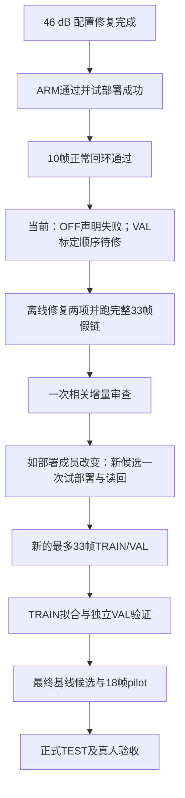

# DSH 当前进度、实时板卡核验与下一步

核验日期：2026-10-18，北京时间。离线导出覆盖至 16:06:19；实时板卡检查约 16:16:40。日志内的历史授权、命令和助手建议均按待核实材料处理。

## 1. 结论

有实质推进：46 dB 的 C/Python 配置冲突已修复；新候选已通过 ARM 资格、试部署并保留；首次完成 10 帧正常有线回环采集。项目目前停在 **S2 的 TRAIN/VAL 标定数据采集阶段**，尚未完成有效数据集、最终基线、18 帧开发 pilot、正式 TEST 和真人验收。

当前应修复 OFF 场景转换与标定采集顺序。板卡本次只读核验正常，无需通过重启或重装当前版本排障。

## 2. 已完成与未完成

| 项目 | 核实结果 |
|---|---|
| 新发布 | `1a30f4b7b9aebe27965fcdd6dcf7634e` |
| daemon | `8d5aaf055a121f5d0650fda967c8c8d9a9599de2aafbdff090751d604d790984`；46000 门已上板 |
| ARM 资格 | PASS，P95 **261.241 ms ≤300 ms**；parity=[]，native_cnn=true。保留原并发抢占时 413.601 ms 的失败 |
| 增量审查 | 四组变更 APPROVED；此前批准仅覆盖其实际差分 |
| 部署 | 一次 `TRIAL_ACCEPTED`，保留新发布；父 `e4dae554…` 为已有回退目标 |
| campaign3 | train-01 派发一次、初始化一次；11 帧落盘，10 normal 通过逐帧门，第 11 帧 OFF 被拒 |
| 有效数据集 | **0/33 可交付帧**：未写 session manifest/receipt。原始 10 帧正常数据有诊断价值，不能冒充完整会话 |
| 后续 | train-02、val-01、adapter、fit、load-check、18 帧 pilot、正式 TEST、真人均未执行 |
| Azure | DSH 已验证离线测试与 ARM 交叉编译/QEMU；当前 jammy 产物有高于板端 GLIBC 的依赖，尚不能直接作为板端安装件 |

“安全闭合”与“可交付会话完整”不同：本次 `session_closed=true`、`disarm_ack=true`，但因帧检查失败未生成完整数据集。

## 3. 本次实时板卡状态

使用现有 Paramiko 帮助器，只读检查；未加载 Overlay、重启服务、初始化、布防或采集。

| 检查 | 实测 |
|---|---|
| current / active-release | 均指向 `1a30f4b7…` |
| 发布验证 / 安全态 | `verified=true`、`safe=true` |
| 服务 | pynq-status PID 3989、rf-daemon PID 3996；均 active/running、NRestarts=0 |
| RF/PL | armed=false、TX source_selected=false、RX armed=false、io_ok=true |
| 在飞任务 | 未发现部署单元、构建/测试/采集进程；systemd job 为空 |
| boot_id | `f4015100-cd95-4fc0-a384-1b33205fb9fe`，与 campaign3 一致 |
| 存储 | `/` 与 `/boot` 为 rw；精确存储故障关键词无命中；根分区 58%，剩余约 5.7 GB |

原始证据：`evidence/rf-teaching/codex-progress-check-2026-10-18/161640/{board-os.json,board-state.json,check-meta.json}`。

首次沙箱网络连接因 WinError10013 未成功；获准的只读重连成功。第一版进程探针把自身 sudo 父进程误计为在飞任务，修正为排除自身祖先进程后再执行；旧观测保留于 `161603/`。

## 4. 两个需要一起处理的问题

### A. OFF 帧声明未转换：已确认的直接失败原因

`scripts/rf_environment_trainval_board_session.py:674` 只加载一次 normal，之后直接采集 off 槽位。`evaluate_frame` 在 437–441 行要求声明 truth 与槽位一致，真实 off-01 却携带 `truth=normal`，因此拒绝为 `FRAME_SCENARIO_MISMATCH`。

此外 `EnvironmentSession.scene`、`ui_model.set_environment_scene` 与环境场景按钮仅支持四个场景；底层 `rf_experiment_scenarios` 已支持 off。单加 `scene('off')` 仍会失败。

建议通过真实产品场景加载路径支持 OFF，并在槽位转换时加载一次正确场景；保持加载确认、源未选中、纯 RX OFF 采集与声明绑定。不应事后改写 JSON、删除场景一致性门，或把 normal 声明直接解释成 off。UI 是否需要新增可见按钮取决于现有公开控制入口，避免无关界面扩展。

### B. VAL 在拟合前要求旧临时基线 CLEAR：采集与标定顺序矛盾

真实 normal-01 crest_ratio=2.193，而旧 n=1 临时基线 pulse_crest=1.537；10 帧 normal 均被判 `UNKNOWN/AMPLITUDE_OUTSIDE_RULE_SUPPORT`，但全部参考同步、BER=0、138 比较位且无削顶。不能简单归因为幅度 RMS 超标。

采集器 495–498 行在 VAL 采集时强制 CLEAR；标定器 `rf_environment_calibration.py:618–727` 的设计却是先用 TRAIN 拟合，再以拟合后的基线验证 VAL 与 OFF。若只修 A，下一轮仍可能在旧基线的 VAL 门提前停止。

建议明确区分“标定数据采集质量”与“拟合后的分类验收”：标定模式对可靠、零误码、无削顶且身份/域正确的 normal，允许记录由临时基线产生的上述特定 UNKNOWN，并保留原标签；最终仍必须 TRAIN-only 拟合、独立 VAL 10/10 CLEAR、OFF false-CLEAR=0。NARROWBAND/PULSE、其他不可靠结果继续按既定规则停止。此行为调整须在规格、runner、adapter、相关测试中一致声明；正式验收标准保持。

### 本次额外离线诊断

使用实际候选的软件与 campaign3 原始 IQ，8 帧 TRAIN 做诊断拟合、2 帧同会话留出，不手工指定阈值：

- 原基线：10 normal 全 UNKNOWN。
- 诊断拟合后：8 个拟合帧及 2 个留出帧均 CLEAR。
- OFF 负控为 PULSE，仍非 CLEAR。

这支持临时基线支持域不适配及修正流程顺序的方向；同会话留出不代表独立 VAL，停止会话也不是正式标定输入。本次未输出可接受基线、未改板端基线。

复现脚本及机器结果：`evidence/rf-teaching/codex-progress-check-2026-10-18/{replay_baseline_diagnostic.py,replay-diagnostic.json}`。

## 5. 推荐执行顺序与审查量

必要测试覆盖：normal→off 真场景转换、旧 normal 声明仍被拒、OFF 无 TX；标定模式特定 UNKNOWN 的记录、拟合后 VAL 非 CLEAR 必败、VAL/TEST 不进入 sources；完整三会话经过采集/adapter/fit 的离线假链。使用隔离副本测试，复用未变 C/RTL/构建路径的已有结论。

涉及产品部署成员才需要部署新版本；仅主机 runner 改动不自动要求重编 daemon/bitstream。计算路径不变时按现有政策复用性能证据；安装工具若仍要求候选绑定的 ARM 收据，就真实满足一次。

DSH 对已失败会话停止并保留证据是合理的。修复方案无需重开全仓审查、再次回退演练，或把所有后续流程拆成逐步审批。旧接线确认 09:52:39、有效至 21:52:39；只有实际接线未改变且执行时仍在有效窗口内才可复用。已消耗的 campaign 预算不能重置，新物理采集用新标识和新授权范围。

下一轮下载后先比对板端/主机字节，再清理专属暂存；campaign3 的板端暂存已删除，本轮不能补称独立字节同一性已验证。

可复制任务指令：`evidence/rf-teaching/codex-progress-check-2026-10-18/DSH-NEXT-COMMAND.txt`。本次未向 DSH 自动发消息或派发新的 RF 操作。
