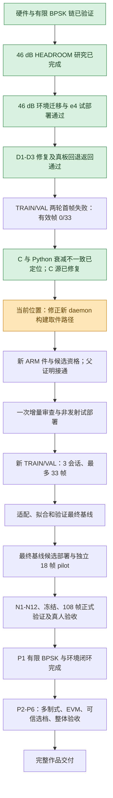

# DSH 最新进度、开发完成度与 daemon 构建修复

检查日期：2026-10-18，Asia/Shanghai。检查来源为本机离线会话 ZIP、Git、原始执行收据、当前工作树及本机无板验证。本次没有连接板卡，也没有部署或派发 RF。

## 1. 本次读取的数据

- ZIP 更新时间：2026-10-18 14:09:39；73,768,218 字节；SHA-256 `bfb3b08a76a2a8e5ef58d31012b6c88d7c25f2f088602b63ff88232c801ccd59`。
- 主会话：7,640 行，最后消息 14:06:40，回合结束约 14:06:41。ZIP 路径为 `<LOCAL_PATH>
- 上次检查停在 10:11。本次最近提交 `c0e0ac28`（14:06:03），C 侧衰减迁移已经入库。
- 工作树中 `rf_headroom_deploy.py`、`rf_environment_deploy.py` 正被 DSH 修改；ARM 构建任务也在进行。本报告不把未完成任务写成通过，不覆盖这些任务的文件。
- 主会话第 7595 行为用户“批准”，DSH 随后已安排新 daemon、候选、ARM、试部署与新采集工作包。下一指令可以继续已有授权，不应把每个命令重新拆成审批。

## 2. 相比上午的实际推进

| 工作 | 当前证据 |
|---|---|
| D1 预检 fail-open、D2 目录缺失、D3 错误原因被覆盖 | 已修复并入库 `c8f14cb8`；非发射入口演练 24/24 通过 |
| 存储日志误报与回退 | v3 判据通过聚焦复核；真板 `ROLLED_BACK_AFTER_ACCEPT`，随后 `ACTIVATION_ACCEPTED` 返回 e4dae554，独立读回通过；`3011b927` |
| 第二轮 TRAIN/VAL | train-01 派发一次且初始化一次，首帧被 daemon 拒绝；0 有效帧，后续会话未执行；`89ece48a` |
| 首帧真正根因 | Python 46000，已安装 daemon 的精确相等门仍为 40000；`53506c6a` |
| C 源码修复 | `RF_PHYSICAL_LOOPBACK_ATTENUATION_MDB=46000`；拒绝文本由同一宏生成；C/Python 一致性测试已补；`c0e0ac28` |
| 新 ARM daemon / 候选 / 资格 | 正在进行，没有本次完成收据可据以宣布成功 |
| 当前父版本的证明支持 | 新函数能用真实 TRIAL_ACCEPTED 证据通过；部署器接线正在进行，尚需完整 prepare/verify_bundle 验证 |
| 正式 46 dB TRAIN/VAL | **0/33 有效帧**；不能用旧研究帧或夹具替代 |
| 最终基线、C 候选、18 帧 pilot、正式 108 帧及真人 | 仍待前序通过 |

板态只按日志表述：最近采集收尾为 current=active-release=`e4dae554182e8c9f5f963c1d5040913a`、双服务 active、NRestarts=0、RF 关闭、boot_id=`f4015100-cd95-4fc0-a384-1b33205fb9fe`。这是历史读回；本次没有新测实时板态。

### 已被更正的错误推断

campaign2 早期把 `pl_status.tx.length_words=0` 解读成“tx.load 没完成”。后续诊断已推翻：`tx.load` 写 BRAM，而 SMP_LEN 在 TX 路径提交时才写；采集失败后的 client 还会清掉会话标志。衰减门在 tx_count 检查之前拒绝请求。因此继续改 tx.load、加等待或多做一次初始化没有根据。

## 3. 本次新发现：隔离构建会下载错误路径

位置：`evidence/rf-teaching/s2-46db-arm-check-new-2026-10-18/work/run_isolated_arm_build.py`。

包装器只更新：

```python
build.REMOTE_SRC = remote_root + '/build_script_src'
build.REMOTE_TGZ = remote_root + '/build_script_src.tgz'
```

但被导入的 `scripts/rf_build_daemon.py` 在模块加载时已经计算：

```python
REMOTE_OUT = REMOTE_SRC + '/rf_daemon'
```

后续更改 REMOTE_SRC 不会重新计算 REMOTE_OUT。生产构建器最终执行 `board_get(args.host, REMOTE_OUT, out_path)`；因此 /tmp 内编译的新文件没有被下载，反而会读取 `/home/xilinx/rfbuild/build_script_src/rf_daemon`。若那里有旧文件，会取回旧 daemon，再生成包含本次源码摘要的构建记录；若不存在则下载失败。本次尚未确认在飞任务的实际下载结果，不能断言它已经产生错误候选。

最小修复：

```python
build.REMOTE_OUT = build.REMOTE_SRC + '/rf_daemon'
```

同时在包装器结果中记录 `remote_out`。补丁只准备在独立目录，未写入 DSH 正在运行的包装器：

- `evidence/rf-teaching/codex-build-path-review-2026-10-18/isolated-build-remote-out.patch`
- `evidence/rf-teaching/codex-build-path-review-2026-10-18/run_isolated_arm_build.fixed.py`
- `evidence/rf-teaching/codex-build-path-review-2026-10-18/verify_isolated_build_paths.py`

本机无网络验证：运行真实包装器，将其 build.main 在传输边界替换为路径观察器；原件 exit 1，修复副本 exit 0。结果 `original-result.txt`、`fixed_copy-result.txt`、`summary.json`。该验证只证明路径修复，不证明新 ELF、ARM 执行或 RF 成功。

### 在飞任务的处理

1. 先确认现有唯一构建实例的状态，不另起一份并行构建。
2. 保留日志及已下载文件。若已经从旧路径下载，不拿它做新候选；旧构建记录如实标记无效，不改历史摘要。
3. 若隔离目录中本次编译已经成功且完整来源可核，直接从该目录下载实际新 ELF，不必重编；校验远端/本地 SHA、armv7l ELF、实际 46000 要求及其 58 项来源绑定，另出更正记录。
4. 如果新 ELF 或来源证明不可取得，修正包装器后单次重新编译。失败的是构建工具，不能由“减少审查”推导为允许使用旧二进制。
5. 更正（同日耗时分析复核）：默认命令虽未单列 `host-test-daemon`，但 Makefile 的 `host-test` 已将其列为依赖，会传递执行；不应因此再追加一次相同测试。核对本次实际构建日志已覆盖 state/daemon 即可。

## 4. 另外三个需要收口的点

### 父证明要接到实际部署入口

本次执行 `s2-46db-parent-trial-proof-2026-10-18/work/probe_route.py` 成功，证明新函数可以核对 e4dae554 的真实 TRIAL_ACCEPTED 证据，返回 44 项、21 份绑定材料。

原有 activation 路径只接受 46 项 HEADROOM；直接传入 e4dae554（44 项环境合同）仍被拒，不能靠换路径解决。检查期间 `rf_environment_deploy.prepare/verify_gates` 已出现 `parent_trial_acceptance` 参数；这仍需要 CLI → prepare → receipt → verify_bundle 的完整连接，以及实际新候选的一次成功打包验证。不要把旧试部署收据改名为 INSTALLED_VERIFIED，也不要为证明格式重装父版本。

该扩展需放在同次增量审查，覆盖身份/缺件/实际摘要不一致等相关反例即可；本地个人项目无需新增签名或认证体系。

### B10 锁探针需改成真实 flock 判定

日志中 B10 把锁文件存在当作锁被占用；这是误报。诊断建议的 fuser/打开 fd 扫描也不等价于持有 flock，而且工具缺失、权限不足可能被当作“没有持有者”。

建议在相同特权下对现有锁文件尝试非阻塞排他 `flock(LOCK_EX|LOCK_NB)`；成功后立即解锁并关闭。文件不存在可记录 FREE；持有记录 HELD；其他读取/权限异常记录 UNKNOWN。保留安装器在真正写入时的原子加锁。不要删除锁文件，不把一次预检当成永久持锁证明。使用新探针版本，旧原始日志保持原样。

### 两个旧原生收据测试不能冒充逻辑回归或全部通过

C 修改后，两项测试继续把 2026-10-11 的原生收据对比当前源码，触发 `native artifact source changed`，拒绝本身正确。新 ARM 件完成后，当前候选构建测试应明确使用新的 artifact/receipt；历史旧收据保留作漂移拒绝负例。不要覆写旧收据，也不要删除漂移检查。仅复跑受影响范围，不追加全仓库变异。

## 5. 百分制进度估计

这是依据能力覆盖与剩余验收工作的主观工程估算，非测试通过率，也非剩余日历时间。原需求追踪表在部分历史条目上已经过期，本表用本次实际收据更新有限 BPSK/S2 部分，其他大范围功能仍按实现计划判断。

| 完整作品计分项 | 权重 | 估计已完成分 |
|---|---:|---:|
| 硬件、PL/PS、控制与基础发布设施 | 25 | 23 |
| 有限 BPSK 教学、显示与重放链 | 20 | 17 |
| S2 环境域、标定和真实验收 | 20 | 11 |
| 多制式 TX/RX、RRC、EVM | 20 | 3 |
| 可信选档、作品整体验收与交付 | 15 | 1 |
| **合计** | **100** | **约 55** |

- **当前有限 BPSK/S2 工作包：约 75/100（约 70–80）**。基础链和恢复机制已有真板证据，剩余工作集中于新 daemon 部署、独立标定与正式验证。
- **按完整多制式作品简介：约 55/100（约 45–65）**。QPSK/QAM 接收、RRC/EVM、可信选档与整体验收仍占较多工作，不能因修完 46 dB 阻塞就报 90% 以上。
- 本轮比上午推进的是恢复能力、诊断质量和根因修复；新的正式 TRAIN/VAL 数据仍为 0/33。此前成功的 5 帧 HEADROOM 研究保留其历史价值，不转作独立标定数据。

## 6. 流程图



## 7. 本次验证范围与下一步

- 无板路径复现：原包装器失败、修复副本通过。
- `test_rf_state_loopback_attenuation_pin.py` 与 `test_rf_environment_trainval_loopback_attenuation.py`：**16 passed，6.80 秒**。
- 新父证明函数的真实历史证据正控：通过。
- 本次未证明新 daemon 已构建正确、已安装，或任何新的采集已成功。

下一步可直接采用配套的 `evidence/rf-teaching/codex-build-path-review-2026-10-18/DSH-NEXT-COMMAND.txt`。既有回退演练及未变化的软件证据继续复用；新行为只做一次适用增量审查，物理运行按新 campaign 明确预算执行。
