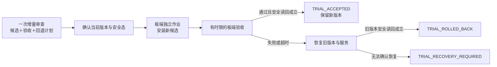

# 一次审查、试部署与回滚

适用：个人离线板卡开发。入口为 `scripts/rf_teaching_trial_install.sh`。本文件定义可执行操作；它本身不授权新的板卡动作。



## 1. 一次审查需要确认的内容

- 实际候选身份、差分与相关测试结果；同一差分已有 APPROVED 可复用。
- 安装前实际在装的父版本/回退目标；其发布文件和旧 systemd unit 可恢复。这里的“已知可用”指已证明的基本运行和安全范围，不代表父版本没有本次待修复缺陷。
- 一条板端验收命令、明确的成功条件、1–300 秒的执行预算。默认先做不发射的功能冒烟；需要真实 RF 时，将已有研究 runner、接线条件和一次性次数一并纳入工作包。
- 用户授权同时包含本次安装、指定验收、失败后的旧版本恢复和独立读回。只有这些条件变化才扩展审查/询问范围。

验收脚本必须按通过/失败返回准确退出码，并自行遵守已有控制/收尾协议；不能用 `exit 0` 替代未完成的测试。真实研究负结果是否要求回滚，需预先声明。

## 2. 准备阶段（尚未安装）

1. 按现有 `rf_headroom_deploy.prepare`/`verify_bundle` 核验基础安装包及候选/ARM 输入。
2. 将基础包里的 **原始** `install.sh`、`install_state.py`、`candidate.tgz` 放入本次独立暂存目录；不要用 trial 脚本覆盖基础 `install.sh`。
3. 另放 `rf_teaching_trial_install.sh`（可重命名为 `trial-install.sh`）及本次受审的 `acceptance.py`/数据文件；核对上传前后 SHA-256，记录候选、检查脚本和回退目标。
4. 使用已配置的 `pynq_ssh.py`/paramiko 连接；不再另起 ssh/scp 凭据流程。
5. 确认当前发布/服务/存储/RF 安全态、boot_id，与本次父版本一致；板卡操作串行。

建议将全部暂存文件保存在 `/var/lib/rf-deployment-trials/<trial_id>/stage/`，以
`/tmp/rf-teaching-install-trial-<trial_id>` 作为指向它的符号链接。现有安装器接受该 `/tmp/rf-teaching-install-` 前缀，旧版本/unit 备份和读回件实际留在持久目录；不修改旧台账。

新入口会在安装前拒绝缺验收命令、无效预算、不兼容 timeout 和已存在的 trial 输出。仍需遵守基础安装器对新发布目录及父版本的检查。

## 3. 单次派发（板端命令模板）

以下变量由已审查工作包填写；不是可以原样粘贴的实际授权或候选值。`stage` 指上述新建的暂存链接。

```sh
sudo systemd-run --unit="rf-trial-$trial_id" \
  --property=Type=exec --property=UMask=0077 --property=StandardInput=null \
  /bin/sh "$stage/trial-install.sh" \
  "$stage" "$release" "$parent" "$archive_sha" 60 \
  python3 -B "$stage/acceptance.py" "$release"
```

该命令只执行一次；systemd 接受作业不表示验收完成。检查命令在基础安装成功后执行；预算到期先终止该命令，2 秒后升级终止，再进行回退。基础安装本身仍沿用已有执行策略。

**选择新入口后，不再额外执行 `rf_headroom_deploy.py install`。** 旧主机 install 命令不会自动采用试部署入口；不要把两条路径串起来重复安装。这个可选入口复用基础包的核验与安装代码，但有自己的 trial 终态。

## 4. 观察、结论和回滚

```sh
sudo systemctl show "rf-trial-$trial_id" \
  -p ActiveState -p SubState -p ExecMainCode -p ExecMainStatus
sudo journalctl -u "rf-trial-$trial_id" --no-pager
```

另开只读连接核对实际发布、服务、RF 安全态、boot_id、存储状况，并下载本次目录的原始日志和状态文件。

| 情况 | 结论和动作 |
|---|---|
| 验收命令 exit 0，末次新版本状态检查通过，有 `TRIAL_ACCEPTED` | 核对 `trial-state.json` 和独立读回后保留新版本 |
| 验收命令失败/超时，或最后安全态检查失败 | 同一作业调用已有 rollback，恢复旧发布指针和旧 unit，再重新读回 |
| 有 `TRIAL_ROLLED_BACK`，`trial-rollback-state.json` 及独立读回都证明旧版本安全 | 本次试部署失败、回滚成功；保留失败记录，不重试研究 |
| 有 `TRIAL_RECOVERY_REQUIRED`，或回退后状态不符 | 恢复未证明，停止写入并报告；不标回滚成功 |
| 基础安装阶段本身失败 | 沿用基础安装器回滚与 `rollback-state.json`；独立读回定案，不运行验收命令 |
| SSH 超时/断线，作业仍在运行 | 只观察同一 unit，不重派、不并行回滚 |
| 重启/断电/进程强杀或真实存储故障 | UNKNOWN/待恢复；自动回滚不能保证，恢复后只读核对再决定下一步 |

日志中的 `INSTALL_ACCEPTED` 只表示基础激活已完成。若后续验收失败，它不能作为最终成功依据。

## 5. 实现与验证范围

新脚本在同一个 shell 中加载基础 `install.sh`，复用其旧版本、unit 备份与 rollback 函数；基础安装完成后延长 EXIT 回滚保护至板端验收和末次状态检查结束。回退后通过另一个状态检查进程建立新连接，不能仅凭切换命令退出码宣称恢复。

离线测试执行真实 trial 包装脚本，用沙箱安装器将板卡写操作替换为本地发布标记；覆盖成功、验收失败、超时、最终不安全、回退失败、基础安装失败及前置拒绝。它们验证 shell 控制流，不代替真实 systemd、服务重启、PL 重载与 RF 回滚演练。

本机制首次用于板卡时，先采用不发射的短时冒烟验收，并在同一授权工作包内安排一次可控失败回退演练。

**2026-10-17 真板验证已完成**：e66197ed 新候选四项非发射验收通过后，注入退出42，自动恢复 aba80e92；独立读回确认服务与 RF 安全态、boot_id 和存储正常。详见[板端收尾报告](../reports/2026-10-17-trial-rollback-board-closeout.md)。该具体试部署/回退范围可记 BOARD_VERIFIED；断电、存储故障和真实 RF 研究不在本次证明范围。

## 6. 验收后回退（rollback-after-accept）

**什么时候用**：§4 的结论是 `TRIAL_ACCEPTED`（新发布保留）之后，操作者又决定必须恢复旧版——例如验收之后才发现新发布有缺陷、要撤下新发布、或研究/教学条件变化。它与 §4 表里的回退**不是同一条路径**：那里是安装事务内的 `TRIAL_ROLLED_BACK`（由同一个 trial 作业执行），这里是**验收完成之后**发起的独立作业。作业仍在运行时不要用本节；也不要为了"回到旧版"去重跑安装器（`scripts/rf_teaching_install.sh:12/14` 的前置在验收后必然不成立，见 §5）。

**触发条件（全部成立才派发）**

1. 试部署作业已经结束，且独立读回确认 `current` 指向试部署的新发布；
2. 父发布目录仍在 `/home/xilinx/overlays/awg_merged/releases/<parent>`，是**真实目录**（不是符号链接），且其 `merged_release.py --require-software --check-panel` 自检通过；
3. 两个 unit 的恢复字节可得：优先用 trial 暂存里的 `<unit>.before`（安装前的字节，`rf_teaching_install.sh:22` 保存），否则用父发布自带的 `pynq-status.service`/`rf-daemon.service`（父发布清单已证明其摘要）；
4. `/var/lock/rf-deployment-trial.lock` 没有被其它部署作业持有；
5. 操作者授权包含"恢复旧版 + 独立读回"，并且已经取得 `install_state.py` 的 SHA-256 期望值。

**逐字命令**（`$trial_id`、`$trial_release`、`$parent_release` 由本次工作包填写；不是可原样粘贴的授权）

```sh
# 1) 派发前只读确认（不写入）
readlink -f /home/xilinx/overlays/awg_merged/current
ls -ld /home/xilinx/overlays/awg_merged/releases/$trial_release \
       /home/xilinx/overlays/awg_merged/releases/$parent_release
cat /run/pynq-status/active-release
sudo systemctl show pynq-status rf-daemon --property=ActiveState,SubState,MainPID,NRestarts
readlink -f /proc/sys/kernel/random/boot_id

# 2) 建回退暂存。trial 的 /tmp 暂存可能已被清理（2026-10-17 的收尾就删过），
#    所以这里必须重新建一个：持久目录放文件，/tmp 只放指向它的符号链接。
sudo mkdir -p /var/lib/rf-deployment-trials/$trial_id/rollback-stage
sudo cp <reviewed rollback package>/rf_teaching_trial_rollback_after_accept.sh \
        /var/lib/rf-deployment-trials/$trial_id/rollback-stage/
sudo cp <reviewed run bundle>/install_state.py \
        /var/lib/rf-deployment-trials/$trial_id/rollback-stage/
sudo chown -R root:root /var/lib/rf-deployment-trials/$trial_id/rollback-stage
sudo chmod -R go-rwx  /var/lib/rf-deployment-trials/$trial_id/rollback-stage
sudo ln -sfn /var/lib/rf-deployment-trials/$trial_id/rollback-stage \
             /tmp/rf-rollback-after-accept-$trial_id
sudo sha256sum /tmp/rf-rollback-after-accept-$trial_id/install_state.py   # 记下这个摘要

# 3) 单次派发（只执行一次；EXPECT_STATE_SHA256 必填，缺了脚本会拒绝）
sudo systemd-run --unit="rf-rollback-$trial_id" \
  --property=Type=exec --property=UMask=0077 --property=StandardInput=null \
  --setenv=EXPECT_STATE_SHA256=<第 2 步的摘要> \
  /bin/sh "/tmp/rf-rollback-after-accept-$trial_id/rf_teaching_trial_rollback_after_accept.sh" \
  "/tmp/rf-rollback-after-accept-$trial_id" "$trial_release" "$parent_release"

# 4) 观察（只看同一个 unit，不重派、不并行）
sudo systemctl show "rf-rollback-$trial_id" \
  -p ActiveState -p SubState -p ExecMainCode -p ExecMainStatus
sudo journalctl -u "rf-rollback-$trial_id" --no-pager
```

该脚本对板卡的写入**只有**：`current` 符号链接（唯一临时链接 + `sync` + `mv -Tf` 原子发布）、两个 `/etc/systemd/system/<unit>.service`（临时文件 + `cmp` 证明 + `mv -f`）、两个 unit 的 `stop`/`daemon-reload`/`start`、暂存目录内的文件（journal、precheck/state JSON、dmesg 摘录）、部署锁文件。不改 release 目录、不布防、不选 TX 源、不采集、不加载 Overlay、不做 MMIO/SPI。

**判据**：作业输出里**恰好一行**终态标记。

| 标记 | 含义 | 退出码 |
|---|---|---|
| `ROLLED_BACK_AFTER_ACCEPT current=<parent> parent=<parent> steps_ok=1 state_check=0 dmesg_hits=0` | 父发布已发布、两服务 active/running 且 `NRestarts=0`、`active-release` 等于父发布、两个 unit 文件字节等于恢复源、`install_state.py` 读回通过、`boot_id` 未变、dmesg 无存储错误 | 0（正常）；130/143 表示运行被打断，但状态已由读回证明 |
| `RECOVERY_REQUIRED ...` | 上述任一条不成立：前置拒绝、切换/启动/读回失败、被打断而未完成 | 2（前置拒绝，未写入）/ 3（回退或读回未证明）/ 130、143（被打断） |

标记只由**读回**决定，绝不由切换命令的退出码决定。作业结束时以下文件留在暂存目录：`rollback-after-accept.jsonl`（逐阶段 fsync 的 journal）、`rollback-after-accept-state.json`（`install_state.py` 的读回）、`rollback-after-accept-precheck.json`、`rollback-after-accept-dmesg.txt`。**幂等**：如果 `current` 已经是父发布（例如上一次被强杀之后重跑），脚本只做读回验证、不写任何东西，成立时同样给 `ROLLED_BACK_AFTER_ACCEPT`。

**失败处置**

- 只看到 `RECOVERY_REQUIRED` 或根本没有标记（作业被 SIGKILL/断电/存储故障）：**停止一切写入**；不盲重装、不重跑安装器、不手工删除 release 目录、不改 unit 文件；先只读取证。
- 只读确认清单（与 §4 相同口径）：`readlink -f .../current`、`cat /run/pynq-status/active-release`、`systemctl show` 两个 unit 的 `ActiveState/SubState/MainPID/NRestarts`、侧车 status（未布防、未选 TX 源、RX 未武装、`io_ok`）、`readlink -f /proc/sys/kernel/random/boot_id`、`dmesg` 里的 mmc/sdhci/adma/ext4 错误、以及暂存目录里的 journal 与 state JSON。
- 按 journal 定位：`phase=restore_begin` 之后没有 `parent_published` ⇒ 切换没完成（`current` 仍是新发布，此时新发布本身还是完好的）；`parent_published` 之后没有 `units_started` ⇒ 服务没起来；有 `readback` 但后面是 `recovery_required` ⇒ 看该行里具名失败的字段（`state_check`、`units`、`unit_digests`、`boot_id`、`dmesg_hits`）。
- `boot_id` 变了（板卡重启过）或 dmesg 命中存储错误 ⇒ 先按既有存储检查流程处理存储，再决定是否重跑本命令；不要用重装来"绕过"存储问题。
- 需要重跑时，**重跑同一条第 3 步命令**（幂等），不要发明新命令、不要手工 `ln -s`。
- 只有独立只读读回证明旧版安全（`current`/`active-release` 都是父发布、双服务 active/running、RF 关闭、存储正常）之后，才可以把这次回退记为成功。

**离线沙箱范围（本节机制的实际验证见证据包）**：`evidence/rf-teaching/s2-46db-trial-closure-2026-10-17/NOTES.md` 记录了 23 个场景（正常回退、切换失败、服务启动失败、读回不符、`install_state` 非零、SIGTERM/SIGKILL 中断、前置拒绝、幂等重跑）与 5 个变异体（全部被抓、逐字节还原）的沙箱结果。这些只验证 shell 控制流与合成 fate，**不代替**真实 systemd、真实服务重启、真实 PL 和真实存储；真板首次使用前仍按 §5 安排一次可控演练。

