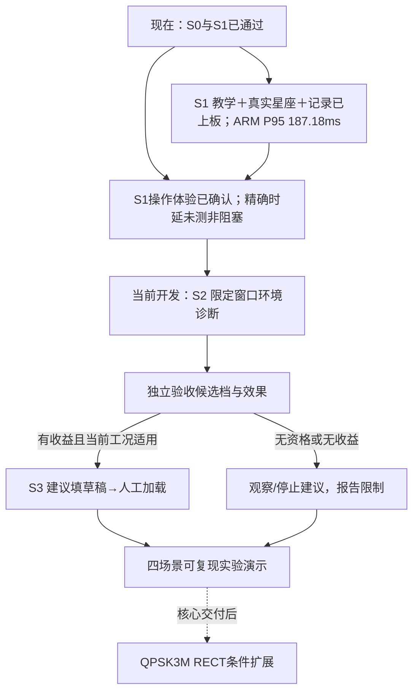

# 通信教学与环境诊断总体Plan

**2026-10-12最新：三个串行任务已全部执行完毕（关键审查APPROVED→隔离ARM G1通过→安装包与阶段封存DONE），整个大阶段仍未结束。** 独立合并关键审查APPROVED（绑定候选b82b141e的46项software与工具/资格器摘要，`native_lease_regression_passed=true`由生产C变异反证）；新候选隔离ARM G1通过：同帧4窗与8场景/96证据Host/ARM判等均为空、100次完整计算P95=278.835ms/RSS31704KiB/native CNN，ARM假supervisor两例（success/installer-failure）未触systemd，最终只读安全检查PASS（仍b67、safe、unit相符、root rw、0存储错误）；`install-bundle/`已按b67父版本与board-recovery恢复证明打包，`stage-checkpoint.json`封存且`--verify`通过。本阶段零真实安装/零RF/零新物理帧（累计67）。**真正未完成**：单次安全安装与独立读回、真实runner实现与一次会话最多五尝试研究、独立TRAIN/VAL与18帧复验、正式108+12/真人、S3/S4；原UNKNOWN保留，MMC根因与完整FS修复未结案。证据`evidence/rf-teaching/s2/executable-candidate-2026-10-12/`；真实runner目前仅为设计文档`docs/superpowers/plans/2026-10-12-real-headroom-research-runner-design.md`。下方为历史。

**2026-10-12当前：部署超时后板卡恢复，新b67a8aaa已实际安全启用。** 串口确认mmc0/SDHCI I/O故障，重新上电后独立verify及实际unit绑定/未布防/TX/RX关闭/双active通过；本次启动无新MMC错，原UNKNOWN不改写。启动文件已备份，/boot完整FAT检查因工具缺失尚未做；暂不重复安装或RF研究。先存储稳定/离线维护及部署状态恢复，再补真实runner执行一次会话五尝试；后续18开发复验、正式108+12/真人、S3/S4不变。新增物理0，总67。复盘及流程 `docs/reports/2026-10-12-session-review-and-board-recovery.md`；新收据 `evidence/rf-teaching/s2/board-recovery-2026-10-12/recovery-checkpoint.json`。历史阶段文档已有更新，旧G1收据不重写，源码/候选绑定保持；下方当前均为历史。

**2026-10-11当前：HEADROOM-1开发及新候选G1完成。** 候选b67a8aaa、原生58/软件46、ARM假硬件及完整保存IQ/流程判等通过；P95270.793ms/RSS31524KiB。314.963ms失败保留，等价批量计算修复，预算未变。未安装/未真实研究，物理累计67；下一顺序安全安装/读回→一次会话五尝试余量研究→独立TRAIN/VAL＋18开发复验→正式108＋12/真人→S3→S4。关键部分合并审查，避免重复全审。阶段报告与流程图 `docs/reports/2026-10-11-headroom-contract-final.md`；封存 `evidence/rf-teaching/s2/headroom-contract-2026-10-11/stage-checkpoint.json`。以下当前均属历史。

**2026-10-10 HEADROOM/Claude接续当前：** Claude20:07中断后，prepared/28测试已有但两代码审查与checkpoint缺失；本轮补3项覆盖、最终30测试/三有效变异及规范/质量均通过，准备包已封存。当前精确40dB合同不能合法采46dB；必须独立研究合同及新候选资格，不改生产门禁、不伪造确认。下一顺序：HEADROOM合同实现/资格→一次会话五尝试余量研究→独立TRAIN/VAL+BPSK回归+18开发复验→正式108物理+12离线/真人→S3人工建议→S4收尾。G1旧候选PASS、G2削顶停止、开发累计67未增，正式/真人未测；既有授权安全只读确认adfac、TX/RX关闭/未布防/双服务正常，本次续审零新增板联系。报告含流程图 `docs/reports/2026-10-10-headroom-contract-preparation.md`；详细合同规范/计划 `2026-10-10-s2-headroom-research-design.md` / `2026-10-10-s2-headroom-contract-preparation.md`。链路稳定前提未满足，不承诺收尾日期。

**2026-10-10 G2接续当前：** G1 PASS；候选adfac1f1已安装，回退69290425。一次有限G2在3尝试/1会话后窄带零等待触边停止：正常0/1000us各0/138BER无rail，实际等待1106.709us；窄带0us4 rail、无点/BER。等待对照证据不足，未通过，不重试或补齐8帧。3原IQ完整重放一致、解除ACK与独立最终safe=true/未布防/TX/RX关闭/双active均通过；开发累计67。下一项为新的单变量接收余量调查准备，拟只改TX衰减40→46dB、另立最多1会话5尝试声明，当前未实施/未实采；详情 `docs/superpowers/plans/2026-10-10-s2-receive-headroom-investigation.md`。开发域稳定→独立TRAIN/VAL及18帧复验→正式108＋12/真人→S3→S4的顺序不变；此前5–8日估计的链路稳定前提尚未满足。报告与流程图 `docs/reports/2026-10-10-g2-wait-comparison.md`。下方当前/最新均为此前历史。

**2026-10-10当前：** S0/S1已关闭；S2诊断软件/ARM能力已实现，G1经Claude补测、本轮判等修复与新ARM离线补证、独立双范围复审已PASS。候选adfac1f1仍未安装；G2准备包已绑定当前69290425及真实父安装收据。最终live PL安全检查已授权但自动审批额度耗尽、未执行；G2安装与RF NOT_RUN，本轮新增物理帧0，开发累计64。固定接续：新鲜安全预检→G2最多8尝试/2会话→18帧开发稳定与独立冻结→S2正式108物理＋12离线及真人→S3人工建议/拒绝→S4展示与文档。缺第二档/收益资格只观察或提示停止，QPSK条件扩展不阻塞本轮。核心预计剩5–8有效工作日（有线链路稳定前提），详细证据、流程图与工作包见 `docs/reports/2026-10-10-claude-progress-and-closeout.md`。下方“当前/最新”为历史。

**2026-10-07当前：** S1已验收；S2时序调查版本69290425已安装，两会话4新帧无rail、3帧BPSK同步、末帧窄带失步无点/BER；原失败保留，同IQ重放一致，最终安全解除。1845软件测试通过/4跳过。下一项准备单变量有限稳定等待对照，当前未修改等待/gain/AGC；正式冻结/108＋12/真人未开始，S3未开始。固定流程与阶段总结见`docs/reports/2026-10-07-s2-capture-timing-progress.md`。下方“当前/最新”为历史。

**2026-10-06当前，覆盖下文历史：** S1已关闭，S2 v3及保守复合候选7be30345已安装，1668软件测试通过4跳过，ARM292.52ms。开发实采仍有CLIPPED，当前先做RX增益原码只读观测与稳定性定位（2026-10-06-s2-receive-observation.md），正式freeze/90＋18＋12/真人未开始，S3未开始。原始失败和安全ACK保留；最终只读确认未布防/TX/RX关闭/双active。阶段流程见docs/reports/2026-10-05-s2-window-environment-progress.md；无需专门触摸计时。

**2026-10-05 最新进度：** S2软件/离线/ARM预算通过、候选427dfa8ac7ad6b7b58edc6b59a873897已安全安装，当前开发实采pilot；正式90＋18＋12及实体屏尚未验收。流程图与证据边界见 `docs/reports/2026-10-05-s2-window-environment-progress.md`。S1无需补触摸计时。

**最新：** 用户确认每次捕获体验不卡顿，并明确无需专门计时、开始下一阶段。S1已关闭；精确时延仍NOT_MEASURED、非阻塞。S2详细规格/计划为 `2026-10-04-s2-window-environment-design.md` / `2026-10-04-s2-window-environment.md`，正在开发。下文待计时状态为此修订前历史，旧收据不改。

> **For agentic workers:** REQUIRED: 使用executing-plans按阶段执行；有明确技能授权的独立文档/代码审阅可委派。步骤采用复选框记录。保留现有dirty tree和回退发布，不混合提交无关改动。

**Goal:** 交付“BPSK教学实验＋可解释窗口异常诊断＋人工确认建议”的便携式平台，停止以全面调制接收和自动认知收发作为本轮目标。

**Architecture:** 固定BPSK实验域，复用唯一daemon、不可变IQ帧、后台worker和现有触摸控制。新增真实接收星座、诊断和记录均为同帧分析；建议只能填TX草稿，加载及发射由人工独立执行。

**Tech Stack:** 现有Zynq/AD9361/PL有限采集、Python3.8/numpy1.17.4、800×480触摸UI、pytest、不可变release、规定Paramiko板端工具。

规格：`docs/superpowers/specs/2026-10-04-teaching-environment-scope-design.md`。旧M5a多速率RECT→RRC→抗扰→QPSK路线保留为历史。最新：S0五项核心真人确认完成，S1 c3bf915c已安装，新33帧物理/重放及ARM资源门禁通过；11张照片＋文字确认闭合真人功能，20次触摸计时明确未测；S2/S3未实现。阶段报告：docs/reports/2026-10-04-s1-board-validation.md。

## Chunk 0：S0 当前可用版本收尾

依赖：当前M4已安装，自动实板PASS；2026-10-04用户补充确认五项剩余核心真人测试均通过且TX1→RX1仍在位。S0部署门禁关闭，单独切设备/采集中短时取消未另报告，继续保持未报告。

- [x] 按照片报告收集修改/清除、31秒、取消、停止解除和OFF的真人文字结果；五项PASS，另两个未报告子项明确保留。
- [x] 当前五项无FAIL；未报告子项不冒充通过，停止/关闭据用户明确确认。
- [x] 保存S0收据，绑定发布、旧自动证据与真人结果；收据evidence/rx-bpsk/m4/s0-human-closure-2026-10-04.json，已满足S1部署门禁。

产物：`evidence/rx-bpsk/m4/`新增真人闭合收据。门禁：核心停止/解除/失效/OFF通过；捕获太快未点到取消仍明确标记未触发，并保留软件取消回归。

## Chunk 1：S1 教学观察与实验复现（机器/真人功能及体验通过，已关闭）

详细实施：`docs/superpowers/plans/2026-10-04-bpsk-teaching-observation.md`。

- [x] 教学入口固定BPSK3M RECT及已验证RF配置；高级工具保留独立入口，接收域外配置明确未支持。
- [x] 新真实接收星座，只展示同帧同步后符号；理想发射图明确标为示意。
- [x] 保存原始IQ、metadata、配置、同步/BER、归一化星座和版本，提供本地实验记录读取。
- [x] 保持取消/停止/过期/错配失效；新完整软件合同与旧发布隔离/回退、800×480离屏预览通过。
- [x] 新发布五寸实体屏功能/显示验收：11张实体照片与用户明确文字确认，不以离屏预览代替。短时采集中取消未另报告。
- [x] 操作体验用户明确不卡顿；专门20次计时经用户明确取消为阻塞项，实际精确时延保留NOT_MEASURED，不记实测通过。
- [x] 新三组30ON+3OFF、33帧同输入回放、100次完整后台计算P95=187.18ms≤300ms；真人观察/停止验证由上一独立实体屏条目跟踪。

门禁：旧BPSK结果逐字段一致；星座来自真实同帧、无参考可显示同步符号但无BER、失步无伪点；导出IQ哈希与原始帧一致。S1只增加观察与复现，不开始环境决策。

## Chunk 2：S2 可解释窗口环境诊断（当前开发）

Files：Create `pynq_overlay/sw/rf_environment.py`、`pynq_overlay/sw/rf_experiment_scenarios.py`及各自tests；Modify worker/model/view/merged_release/install；Create `scripts/rf_environment_dataset.py`和`scripts/rf_environment_verify.py`。

- [ ] 冻结独立S2输入/结果规格：BPSK3M RECT固定RF条件；未检出/窄带/脉冲/无法判断/无效，允许复合异常拒绝，不使用TX真值当预测。
- [ ] 写场景生成红例：正常PRBS、已知频偏窄带叠加、已知宽度脉冲叠加；同seed可复现、超码值拒绝、标签只在声明层。
- [ ] 写分析红例：正常PRBS固有谱线不得判干扰、窗口无事件不能声称全时正常、OFF/低能量/削顶/域外拒绝；保留特征与依据。
- [ ] 在TRAIN/VAL定阈值与严重度范围，会话分割并冻结hash；先规则，现有CNN调制识别不充当环境模型。
- [ ] 执行预先声明的90已知有线帧＋18安全有线负控＋12冻结离线拒绝输入：有线负控OFF/复合/域外各6；离线削顶/低能量各6，不人为推动硬件过载。每已知类至少27/30正确，正常误报警≤3/30，负控误判正常0；已知类拒绝计错。不同源/派生IQ按场景会话分组，种子周期偏移不当独立序列。
- [ ] 主机/ARM同输入、100次完整后台资源、UI失效/停止及真人三场景验收，输出混淆矩阵和覆盖范围。

门禁：三个受控窗口场景诊断达标、无法判断路径可靠，结果解释可追溯。测试不达标保留实验能力，不扩展样本后挑出好看的子集。脉冲注入是有线复合IQ实验，不宣称外部空口脉冲监测。

## Chunk 3：S3 有限档位与人工建议

Files：Create `pynq_overlay/sw/rf_environment_policy.py`、`pynq_overlay/sw/tests/test_rf_environment_policy.py`、候选档资格JSON和`scripts/rf_profile_pair_acceptance.py`；Modify UI与release合同。沿用记录模块，不创建第二控制出口。

- [ ] 冻结P0峰值码60/P1峰值码40，其余3M RECT/LO/Fs/BW/40dB/tap29一致；标为候选码值档，不称校准射频功率。
- [ ] 每档分别做3会话30ON+3OFF正常BER/同步/安全验收；没有第二档资格时禁止出现档位切换建议。
- [ ] 对诊断支持的异常工况预先声明成对收益实验：`x=A*s+j`，A仅改变单独归一化的BPSK分量，异常j码值/位置/seed保持不变，叠加后不整体归一化，12位越界拒绝。交错候选顺序，每档30帧；统计误码、分母、失步率、采集成功率与削顶，不删失步帧美化BER。效果仅限有线复合IQ工况。
- [ ] 只有收益可复现且当前工况在资格范围内才可建议；否则观察或提示停止。资格JSON绑定发布、算法、RF配置、诊断阈值与证据hash，升级后不能继承旧资格。
- [ ] 红例证明policy不发IO、过期/错配/无效拒绝、人工点击只填TX草稿、原加载凭据失效；再次加载/确认来自独立人工动作。
- [ ] 真人验证建议→草稿→检查→手动加载→回环；取消/异常仍可停止解除。低可信度不自动套档，自动发射永久关闭。

核心门禁：建议/拒绝与人工安全流程可验收，缺资格/收益时只观察或提示停止、不填调整草稿。通过此拒绝流程即可关闭核心S3。条件门禁：至少一组适用工况有可复现收益才可展示档位优化，其余必须拒绝；无收益则该优化演示记未验收，不伪造“自适应效果”。

## Chunk 4：S4 演示与条件扩展

- [ ] 核心演示脚本固定四场景：正常、窄带、脉冲、无法判断/过期；各留IQ、配置、诊断依据和操作结果。
- [ ] 可选性能说明：精确触摸时延未测，按用户最新指示不要求专门计时；如后续自愿测量则保留逐次记录，不套用纯计算P95。
- [ ] 核心S0–S3通过后才立QPSK3M RECT单工况计划，独立解决90度歧义/映射/参考/分母；QPSK不阻塞作品核心交付。
- [ ] 多速率/RRC/QAM接收、EVM、持续接收与空口迁移留长期待办，不进入本轮完成率或演示承诺。

核心完成：教学观察可用、三个限定异常场景可解释、人工建议/拒绝可复现、停止解除可靠、记录可回放。未来扩展不以“已有TX按钮/CNN类别”代替接收验收。

## 开发位置与决策门禁

2026-10-04最新接续：S0五项通过，S1 c3bf915c安装、新33帧及ARM门禁已通过；11张实体照片＋用户文字确认闭合真人功能，20次触摸计时明确未测。详情docs/reports/2026-10-04-s1-board-validation.md及2026-10-04-s1-human-photo-review.md。先前离线验收工具报告保持历史。

先把功能收敛落到入口、数据与验收，后续按门禁推进；不同时投入新调制、新成形、新采样率、空口和自动控制。每阶段结束保存源/数据/参数hash与收据，并更新当前进度；旧证据只作历史或开发诊断。
