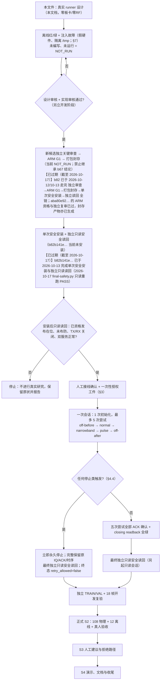

# HEADROOM-1 真实研究 runner 设计与模拟测试方案

**文档性质：设计文档（design only）。本文件不授权也不包含任何实采。**

本轮**零板卡联系、零 SSH/上传、零安装、零布防、零发射、零采集**；**未创建任何脚本或代码文件**；**未运行任何测试**。文中所有"应/必须/将"均为**设计意图**，不是已核实事实；凡引用实测数据处均标注来源与"已核实"。凡标注 **NOT_RUN / 不可验证** 的项目，本阶段一律不得被表述为已完成或已通过。

| 项目 | 本阶段状态 |
|---|---|
| 真实 46dB 研究 | **不可能执行**（当前已安装候选的语义缺陷；见 §1.2）【**已过期**｜截至 2026-10-17 的实际状态：b82 修复 `lease_held` 语义后已于 2026-10-13 安装，“不可能执行”已不成立——研究已于 2026-10-15 真实派发两次（第二次进入 1 初始化/1 尝试/1 原始帧，终态 `RUN_STOPPED_EVIDENCE:1`）；但**仍无被接受的帧**】 |
| 真实 runner | **不存在**（`scripts/rf_headroom_research_run.py` 实测不存在，仅有 `rf_headroom_deploy.py` / `rf_headroom_job.py` / `rf_headroom_prepare.py`）【**已过期**｜截至 2026-10-17 的实际状态：`scripts/rf_headroom_research_run.py` 已存在（runner 1.0.0/1.0.1/1.0.2，RUNNER_VERSION `1.0.2`），并已真实执行过两次派发】 |
| 新候选 `b82b141e355b4cb1833969383a409c79` | **未安装**（已核实：候选目录存在；安装状态 NOT_RUN）【**已过期**｜截至 2026-10-17 的实际状态：b82 自 2026-10-13 已安装并核验；2026-10-15 曾短暂切到 399b300e…，同日经授权切回 b82；10-16/10-17 只读读回均为 `current=active-release=b82b141e…`】 |
| 本轮新增物理帧 / 真实初始化 | **0 / 0**（设计阶段本身不产生） |
| 本设计的离线测试 | **未编写、未运行**（属"设计核准后另立开发阶段"） |
| S2 正式 108+12 / 真人 / S3 / S4 | NOT_RUN |

---

## 1. 目标与范围

### 1.1 目标

交付一个真实 46dB HEADROOM 研究 runner 的**设计与模拟测试方案**：该 runner 在（未来）新候选完成独立资格并安全安装后，能够**唯一一次**地在真板上执行 `off-before → normal → narrowband → pulse → off-after` 五次尝试、一次初始化，产出可独立复核的原始证据，并在任何异常上**永久停止**而不是重试。

### 1.2 当前阻塞的正确表述（本设计的存在理由）

**已核实的 2026-10-11 发现**（来源：`docs/reports/2026-10-11-headroom-install-gate-and-preflight.md` §四；本轮重新只读核对源码一致）：

- `rf_overlay/sw/board_app/rf_daemon.c` 的 `rf_daemon_serve()` 在**整条客户端连接期间**持有单客户端租约：`rf_daemon_lease_acquire()` 在 `:2494`（已核实），`rf_daemon_lease_release()` 在 `:2530`（已核实，且在断线规则之后）。
- 租约与状态字段同置：`daemon->lease` 与 `daemon->session.lease_held` 在 `rf_daemon.c:244-259` 一起置位/清除（已核实），`device.info` 把它打印为 `lease_held`（`rf_daemon.c:492-496`，已核实）。
- 因此**唯一能读到能力宣告的客户端，正是持有该租约的那个客户端**，它看到的 `lease_held` 必然是 `true`。
- 旧候选（已安装的 `b67a8aaab0c5904822580c0647b96fd0`）的 `rf_headroom.capability_available` 却要求 **`lease_held == false`**（历史行号 `:151-152`），而 `HeadroomController.run` **在 `client.headroom_lease()` 之内**才读能力并判定（历史行号 `:540-542`）。 【**已过期**：截至 2026-10-17 的实际状态，板上已安装发布是 b82（daemon 1.0.4 / protocol minor 6），不是 b67；b67 仅保留“候选构建父/历史恢复父”含义】
- 结论：真实研究**每次都被拒**（`HeadroomStopped: live research capability or idle preflight refused`，`headroom_run` 回报 `stopped_at='CAPABILITY'`，**不消耗尝试**）。这是**纯硬件路径缺陷**——全部假硬件用例注入的 peer 都报 `lease_held=false`，所以**任何主机测试都看不见它**，这正是"假硬件资格完成、真实研究 NOT_RUN"之间的那道缝。

**新候选的修复（已核实为源码事实，但未安装）**：本 checkout 中 `pynq_overlay/sw/rf_headroom.py:154` 现为 `value.get('lease_held') is True`，即能力谓词改为要求"当前连接持有租约"；该文件 SHA256 `2dff835187fd2ba9f86b49f7edc22734817ff39f64694a338c2a6019258c3526` 与 `source-freeze.json` 的软件冻结项**逐字节相符**（已核实）。候选 `b82b141e355b4cb1833969383a409c79`（daemon 1.0.4 / protocol minor 6 / `cnn-bpsk-headroom-v1`）**尚未安装**，且其 ARM G1、独立关键审查、安装包封存均为 NOT_RUN。 【**已过期**：截至 2026-10-17 的实际状态——b82 的 ARM G1、独立关键审查（APPROVED）与 `install-bundle` 封存已于 2026-10-12 完成、2026-10-13 安装；当前候选 `aba80e92…` 的 ARM 资格（G2，P95 272.785 ms / RSS 31728 KiB）与独立关键复审（G1 重出）已通过，且封存三件产物现已存在（`install-bundle` candidate.tgz `5399bfb4…`、`development-checkpoint` `4f53f342…`、`stage-checkpoint` `b4bca398…`）】

**因此本阶段 runner 无法被真实执行**：装上的是旧语义发布，跑的是新语义设计。runner 只能完成**离线模拟**；真实路径保持 NOT_RUN，直到"新候选通过独立审查 → ARM G1 → 打包封存 → 单次安全安装 → 独立读回"全部完成（见 §9 流程图）。 【**已过期**：截至 2026-10-17 的实际状态——板上是 b82（新语义），只读读回已实测 `capability_available=true`；“独立审查 → ARM G1 → 打包封存 → 单次安全安装 → 独立读回”整条链对 b82 均已完成，真实研究也已执行到证据检查（终态 `RUN_STOPPED_EVIDENCE:1`，仍无被接受帧）】

### 1.3 范围

**范围内（本设计的交付物）**：真实 runner 的控制链接线、门与人类前置条件、预算纪律、证据模型、失败终态映射、离线红/绿与注入故障测试方案。

**范围外（本设计不做）**：不写脚本；不连板；不安装；不采集；不做正式 S2 108+12；不做真人验收；不做文件系统检查或修复；不改动任何生产源码或已审查安全面。

---

## 2. 唯一控制链

### 2.1 原则

runner **必须是生产链的一个新的调用者，而不是一个新的实现**。它不解析协议、不开 socket、不构造研究参数、不判定能力、不判定轨道/终态——这些全部由已审查的生产对象负责。runner 只做四件事：**校验门（§3）→ 调用 `RfStatusWorker.headroom_run` → 落盘与回传证据 → 独立只读安全读回**。

```text
runner（新文件，位于 46 项冻结软件之外）
  └─ RfStatusWorker(release_directory=<已安装发布目录>)     ← 发布模块按其自身路径 attest
       └─ HeadroomController.run(session_id, cable_confirmed=True, token=…)
            └─ RfStatusClient.headroom_lease()               ← 一条保留连接，禁止重连
                 ├─ client.headroom_capability()
                 ├─ rf_headroom.capability_available(...)     ← 唯一能力判定
                 ├─ client.headroom_arm(token)
                 └─ client.headroom_{begin,load,capture,accept,abort}()
                      └─ 生产 daemon（rf_daemon.c 单一客户端 + 租约 + 预算）
```

### 2.2 runner 调用的既有入口（全部为已存在对象；不得复制其逻辑）

| 入口 | 所在文件（已核实存在） | runner 的用法 |
|---|---|---|
| `RfStatusWorker(release_directory=…, experiment_root=…)` | `pynq_overlay/sw/rf_status_worker.py:113` | 以**已安装发布目录**作为 `release_directory`，令 worker 从发布自身 attest `rf_headroom` / `rf_headroom_replay`（`_ensure_headroom`，`:205`） |
| `RfStatusWorker.headroom_status()` | 同上 `:200` | 只读发布 attestation（`available` / `reason` / `release_id` / `module_sha256`），**零 I/O** |
| `RfStatusWorker.headroom_run(session_id, cable_confirmed, cancelled, evidence_root, token_path)` | 同上 `:259` | **唯一的执行入口**；同步调用，单进程内一次 |
| `read_control_token(path)` | 同上 `:54` | 读操作者提供的 token；**无内置值、无默认路径**，缺失即 fail-closed |
| `HeadroomController.run` | `pynq_overlay/sw/rf_headroom.py:527` | 由 worker 内部构造，runner 不直接实例化（避免出现第二份控制器） |
| `HeadroomPlan`（无参数合同） | 同上 `:168` | runner **不传任何实验参数**——参数由 plan 的字面量决定 |
| `RfStatusClient.headroom_lease / _capability / _arm / _begin / _load / _capture / _accept / _abort / _closing_readback` | `pynq_overlay/sw/rf_status_client.py:498-741` | 由 controller 调用，runner 不直接调用 |
| `HeadroomRecorder` | `rf_headroom.py:826` | 由 worker 以 `evidence_root` + `session_id` 构造；`receipt.json` 是提交标记 |
| `rf_headroom_replay.replay / off_violation / rf_config_from_readback` | `pynq_overlay/sw/rf_headroom_replay.py:117,144,184` | 由 worker 的 `_replayer` / `_off_guard` 调用；**runner 不得自行重放或自行判定 OFF** |
| `merged_release.verify_release(dir, require_software=True)` | 发布内 | runner 用它做安装发布 attestation（与 worker 同一把尺子） |
| `rf_teaching_install_state.inspect_state / verified_state / safe_state` | `scripts/rf_teaching_install_state.py:10,18,39` | **最终独立只读安全读回**（§4.6），在**另一条只读会话**中执行 |

### 2.3 明令禁止（任一条出现即为设计违规，测试必须抓住）

1. **禁止直接写 socket**：runner 及其任何辅助模块不得 `socket.create_connection` 到 `127.0.0.1:5000`，不得自行拼 JSON 行、自行读二进制帧。
2. **禁止自定义协议客户端**：不得复制/派生 `RfStatusClient` 的收发逻辑，不得引入第二个 client 类。
3. **禁止绕过 controller**：不得直接调用 `client.headroom_begin/load/capture/accept/abort`（它们只允许被 `HeadroomController` 调用），不得把五次尝试拆成命令式脚本。
4. **禁止新增 daemon 命令**：不得新增 `headroom.*` 之外的 op，不得放宽/新增原生门禁，不得改动已审查的安全面（改谓词/合同/原生规则都意味着**新候选 + 新资格 + 新安装**）。
5. **禁止 scripts-only 旁路**：不得用"主机脚本自己判定已安全"替代 daemon 的 `capability_available`、`accept` ACK、`closing_readback`；不得用假硬件/离线数据冒充物理帧。
6. **禁止修改 46 项冻结软件**：runner 必须是发布软件映射之外的**新文件**。若把 runner 放进发布（`software_digests`），release id 改变，需重新资格——本设计明确**不这样做**。
7. **禁止复用安装器前缀**：runner 的板端暂存目录**不得**使用 `/tmp/rf-teaching-install-*`（那是已审查安装器的守卫前缀，复用等于伪装成安装器）；必须使用自己的前缀，例如 `/tmp/rf-headroom-research-<attempt_id>`（设计意图，具体字符串在实现阶段与测试一起固定）。
8. **禁止重连**：断线后不得重连、不得重放、不得"补一次"。`RfStatusClient._connection` 在 `_research_generation` 非空时已直接拒绝重连（已核实 `rf_status_client.py:467-468`）。
9. **禁止触碰生产记录目录**：研究证据必须落在**独立根**（worker 默认 `experiment_root.parent/'headroom'`，已核实 `rf_status_worker.py:170`），不得写进教学 `rf_experiment_record` 的记录目录。

### 2.4 物理动作之前的能力核验（顺序即门禁）

**在 `headroom.begin` 之前，不得发生任何硬件动作**（不 `control.arm`、不 `rf.init`、不 `rf.configure`、不写 PL、不开 Overlay）。核验顺序（设计意图；每一步失败即 `RUN_NOT_STARTED_*` / `RUN_REFUSED_CAPABILITY`，零尝试、板卡零写入）：

| # | 步骤 | 判据（全部来自生产对象，runner 不自造） |
|---|---|---|
| G0 | 授权与人工门 | §3 全部工件齐备、未过期、未重放、释放身份相符 |
| G1 | 板端存储预检 | 内核存储输出**完整**读取，无 MMC/SDHCI/ADMA/I-O/ext4 故障；**读取失败 ≠ 无错误**（沿用 `rf_headroom_deploy.storage_faults` 的同一判据，已核实 `scripts/rf_headroom_deploy.py:297`） |
| G2 | 安装发布 attestation | `merged_release.verify_release(installed_dir, require_software=True)`；`software_contract == 'cnn-bpsk-headroom-v1'`；`rf_headroom.py` / `rf_headroom_replay.py` 摘要 == 冻结值（`2dff8351…` / `c446262b…`） |
| G3 | 发布身份 | `device.info.release_id == 授权工件.expected_release == 已安装已资格发布`；`daemon_version == '1.0.4'`；`protocol_major/minor == 1/6` |
| G4 | 发布侧自述 | `worker.headroom_status()`：`available is True`（worker 已从发布路径加载模块） |
| G5 | 进入研究租约 | `with client.headroom_lease():` —— 一条保留连接，`_research_owner` / `_research_generation` / `_research_socket` 三重绑定 |
| G6 | 实时能力判定 | `rf_headroom.capability_available(client.headroom_capability())` **必须为 True**：`study=HEADROOM-1`、`protocol_minor=6`、`daemon_version=1.0.4`、`operations == 五项精确列表`、`hello/announced == 1/6`、`initialization_budget=1`、`attempt_budget=5`、`state='OFFLINE'`、`pending_op is None`、`used/active/armed/pending/tx_active/rx_busy` 全 `False`、`io_ok is True`、**`lease_held is True`**（新语义；旧语义 `is False` 是本设计要消灭的那个缺陷） |
| G7 | 布防 | `client.headroom_arm(token)`：先读 `device.info` 要求 `armed is False` 且 `control.arm` 在 `control_ops` 内 → `control.arm` → 再读 `device.info` 要求 `armed is True` 且**五项研究操作全部被公布**（已核实 `rf_status_client.py:524-541`） |
| G8 | **第一个物理动作** | `headroom.begin` → 原生执行 `rf_core_init(46000…)` + `rf_core_configure(46000…)` + `rf_core_get_headroom_readback`，并回复 `initializations:1` / `attempt_budget:5` / `actual_rf` |

`headroom.begin` 的 ACK 必须同时满足：`study/session_id` 相符、`initializations == 1`、`attempt_budget == 5`，且 `actual_rf` 经 `_fixed_rf_error` 判定为固定研究域——**两路** `rx_lo_hz`/`tx_lo_hz`==80MHz、`rx/tx_sample_rate_hz`==60MHz、`rx/tx_bandwidth_hz`==30MHz、`attenuation_mdB`==46000、**`tx1_attenuation_mdB` 与 `tx2_attenuation_mdB` 均为 46000**、`phy_mode_1r1t==0`、`hardware_verified is True`、`tx_fir_enabled==1`、`*_fir_config_verified is True`、`pl.phy_mode==0`、`pl.idelay_en==127`、`pl.idelay_tap==29`、`pl.src_cfg`/`pl.cap_cfg` 的**具名位**判据（见下方 2026-10-16 澄清与 `docs/superpowers/specs/2026-10-10-s2-headroom-research-design.md` §固定 RF 读回的寄存器位语义）：`SRC_SEL`/`CAP_ARM` 必须为 0，**commit epoch 位（bit2）允许 0 或 1**，**`src_cfg` 的 `SMP_WRAP`(bit1) 亦允许 0 或 1**（2026-10-17 澄清，见下），`cap_cfg` 的 `CAP_CONT` 与未定义位必须为 0（已核实原生判据 `rf_daemon.c:1992-2006`；Python 谓词见 `rf_headroom.py:337-395`）。任一不满足 → 停止，不进入第五次预算观察。

> **2026-10-16 正式澄清（取代上文“整字必须为 0”的读法）**：`pl.src_cfg`/`pl.cap_cfg` 是具名位字，不是整字零。固定域要求 `SRC_SEL`(src bit0)=0 且 `CAP_ARM`(cap bit0)=0；**commit epoch 位（bit2，`SMP_COMMIT`/`CAP_COMMIT`）允许 0 或 1**，因为提交是边沿语义，每次成功配置都会把该位留成 1（`rf_core.c:452-470`、`:1782`、`:1834`），而释放只清 `SRC_SEL`/`CAP_ARM`（`rf_core.c:1507-1516`）；`CAP_DONE` 位于另一只只读寄存器 `RF_REG_CAP_STATUS`（`platform_rf.h:56`）。`CAP_CONT`(cap bit1) 与 bit3 及以上未定义位仍必须为 0，bit0 高仍 fail-closed。本澄清只修正读回谓词，**不**改变 runner 的 `FROZEN_RESEARCH_MODULES` 引脚、**不**改变已安装发布、**不**授权任何新派发。
>
> **2026-10-17 修正（上段关于 `SMP_WRAP` 的半个断言）**：上段把 `SMP_WRAP`(src bit1) 与 `CAP_CONT`(cap bit1) 并列要求为 0，事实与代码都不支持对前者这么做。HEADROOM 的每个发射尝试都请求 `wrap=true`（`rf_daemon.c:2079`），该路径无条件写这一位（`rf_core.c:1780`），释放只清 bit0（`rf_core.c:1562`），所以 release 之后 `src_cfg=6` 是**研究自己那笔配置的忠实残值**；而 `cap_cfg` 的 bit1 是连续采集（`rf_daemon.c:2083` 传 `continuous=false`），读到 1 就说明这一帧不是固定交易，必须继续拒绝。第三次派发的 `RUN_STOPPED_EVIDENCE:2` 正是这一条造成的（`evidence/rf-teaching/s2-headroom-research-attempt3-2026-10-17/`，读回 `src_cfg=6`/`cap_cfg=0`）。规则因此改成 `src_cfg & ~0x6 == 0` 且 `cap_cfg & ~0x4 == 0`，bit1 按寄存器分别对待，并以 256 值穷举真值表与变异测试固定。**这次修正改的是 46 项软件里的 `rf_headroom.py`，因此必然产生新候选、新 `FROZEN_RESEARCH_MODULES` 引脚、新 release id、新 ARM 资格与新安装**，不能靠已安装的 `aba80e92…` 继续。

---

## 3. 门与人类前置条件

两个前置条件**都必须作为 runner 的必需输入**，且都必须**写入收据**。任一缺失、过期、重放、身份不符 → **fail closed**（板卡零写入，零尝试）。

### 3.1 人工接线确认（wiring confirmation）

- **语义**：由**人**确认 TX1→RX1 的物理同轴/衰减路径已按固定配置接好。runner **不得**自行推断、不得用上一次会话的确认、不得由软件"假定已接"。
- **传递路径**：确认结果以 `cable_confirmed=True` 传入 `HeadroomController.run`；原生 `rf_headroom_begin` 会**再次**要求 `cable_confirmed == true`（已核实 `rf_headroom.c:12`），缺失即拒。因此这是一条**双层**门：主机拒绝 + 原生拒绝。
- **必须记录的字段**（写入授权工件并被 runner 抄进研究收据）：`confirmed_by`（非空字符串）、`confirmed_at`（UTC ISO8601）、`statement`（固定枚举，例如 `TX1->RX1 physical path present`）、`method`（人如何确认的简短描述）、`artifact_digest`。
- **新鲜度**：设计意图为"确认时刻距会话开始 ≤ 12 小时"，具体窗口值在实现阶段与测试一起固定；**过期即拒**。窗口不得由 runner 的命令行放宽（无 `--ignore-wiring-age` 之类开关）。

### 3.2 一次性授权工件（one-shot authorization artifact）

**它不替代、也不削弱**已审查的控制合同；它只在合同之上**追加**要求。工件是一个 JSON 文件（由人/维护者在主机侧生成），字段（设计意图）：

| 字段 | 含义 | 失败关闭条件 |
|---|---|---|
| `authorization_id` | 唯一标识（UUID/hex32） | 缺失或格式不符 |
| `nonce` | 一次性随机数 | 已在本地**追加式消费账本**中出现 |
| `session_id` | 32 位小写 hex，绑定本次研究会话（与 `new_session_id()` 同形） | 格式不符，或与运行时会话号不符 |
| `expected_release` | 必须是**已安装且已资格**的发布 id（新候选安装后为 `b82b141e355b4cb1833969383a409c79`） | 与 `device.info.release_id` 或已安装发布不符 |
| `software_contract` | 必须为 `cnn-bpsk-headroom-v1` | 不符 |
| `daemon_version` / `protocol_minor` | `1.0.4` / `6` | 不符 |
| `issued_at` / `expires_at` | 有效期 | 当前时间不在窗口内（**过期即拒**） |
| `single_use` | 必须为 `true` | 非 true |
| `wiring` | §3.1 的确认记录 | 见 §3.1 |
| `token_ref` | **指向**操作者 token 的路径/引用；**不含 token 值本身** | token 不可读/为空 → `read_control_token` 返回拒绝理由 |
| `authorized_attempts` | 必须恰为 `5` | 其他值（含 0、6）|

**一次性（防重放）如何成立**（设计意图）：runner 在**板卡接触之前**把 `nonce` + `authorization_id` 追加进一个**追加式消费账本**（每行 `fsync`，撕裂尾行先截断——沿用 `rf_headroom_deploy.attempt.jsonl` 的既有做法，已核实 `rf_headroom_deploy.py:55`）。已出现过的 nonce 直接拒绝。**注意**：账本是**主机侧**的登记，不改变原生预算；原生一次性由 daemon 自身保证（见 §4.1）。二者是"双保险"，不是"替代"。

**token 处理纪律**：token 只经 `read_control_token(token_path)` → `client.headroom_arm(token)` 这一条路进入系统；`read_control_token` 本身不存储 token（已核实 `rf_status_worker.py:54-73`）。runner **不得**把 token 值或其摘要写入研究目录；证据里只记录 `authorization_id`、`nonce`、`token_present: true`、`token_consumed_at`。

### 3.3 收据必须绑定的门字段

研究收据（`receipt.json` 的 runner 层附加文档，设计意图为一个并列的 `run-gate.json`，**不修改** `HeadroomRecorder` 的既有 schema）至少包含：`authorization_id`、`nonce`、`artifact_digest`、`wiring{confirmed_by, confirmed_at, statement, method}`、`expected_release`、`installed_release_readback`、`preflight_storage_clean: true`、`ledger_append_digest`、`runner_sha256`、`runner_version`、以及 §5 的逐次证据索引。

---

## 4. 预算纪律

### 4.1 一次初始化、最多五次尝试

- **原生一次初始化**：`rf_headroom_t.used` 一次即锁（已核实 `rf_headroom.c:12,15`：`if(h->used …) return -1;`），且 `op_headroom_begin` 在调用 `rf_core_init` **之前**就把 `used` 消费掉，并把 `d->initialization_seen` 置真（已核实 `rf_daemon.c:2025-2035`）；`d->initialization_seen` 是**进程生命周期**的（`rf_daemon.c:90` 注释，已核实）。因此第二次 `headroom.begin` 必被拒（`"HEADROOM refuses a prior initialization attempt"`）。
- **最多五次**：`ATTEMPT_BUDGET = 5`（`rf_headroom.py:32`），固定顺序 `off-before, normal, narrowband, pulse, off-after`（`:33`），仅 2/3/4 为发射（`:34`）。原生侧 `hr_next` 要求 `attempt == 之前+1` 且 `a <= 5`（已核实 `rf_daemon.c:2044-2050`）；`d->headroom.attempt` 在**硬件动作之前**消费（已核实 `rf_daemon.c:2075`）。
- **进程内一次**：`RfStatusWorker.submit_headroom_study` 以 `_headroom_running` / `_headroom_used` 拒绝第二份研究（已核实 `:361-374`），且只有"未真正到达 daemon"的结局（`UNAVAILABLE`/`CAPABILITY`/`STOPPED`）才不置 `_headroom_used`（已核实 `:386,407`）。**设计意图**：runner 用**专用的单用途进程**执行 `headroom_run`，让"一进程一次会话"成为结构性事实，而不是运行期约定。
- **重启不等于新预算**：板卡重启会清掉进程级 `initialization_seen`，使"再来一次初始化"在原生层面重新变得可能。**这正是 runner 必须有自己的持久账本的原因**：重启后 runner **绝不允许**自动继续或重新开始；必须由人重新走 §3（新 nonce、新接线确认、新 `authorization_id`）。禁止把重启解释为"预算刷新"。

### 4.2 固定参数（无变参）

runner **不提供**任何实验参数开关。全部固定于 `HeadroomPlan` 与 `FIXED_RF`（已核实 `rf_headroom.py:51-54`）：LO 80MHz、Fs 60MHz、RX/TX BW 30MHz、**衰减 46000 mdB**、`phy_mode_1r1t=0`、`idelay_en=1`、`idelay_tap=29`；捕获 4096 点、`ratio=0`、**`settle_wait_us=0`**；载荷与声明摘要硬绑定于 `NATIVE_PAYLOAD_SHA` / `NATIVE_DECLARATION_SHA`（`:64-73`）。`HeadroomPlan` 无数据字段（`plan_field_names()` 为空，已核实 `:982`），因此**结构上不存在**"跑 40dB""改一次等待""跑第六次"的入口。载荷/声明摘要不匹配时 `load_args` 直接抛错（`:230-233`），在到达 BRAM **之前**失败。

### 4.3 OFF 负控

attempt 1（`off-before`）与 attempt 5（`off-after`）是**普通 RX 捕获**，TX 源关闭；**不得**把零波形物理发射称作 OFF（spec 明言）。判据不是"发送了什么"，而是**保存下来的字节**：worker 的 `_off_guard` 对同 IQ 重放结果调用 `rf_headroom_replay.off_violation(summary)`（已核实 `rf_status_worker.py:330-346`），一旦违规，controller 以 `OFF_EVIDENCE` 立即停止（已核实 `rf_headroom.py:724-730`）。**设计意图**：OFF 失败 = 研究失败，不得挑子集、不得只保留"正常"的 OFF。

### 4.4 停止类（exact set）与保留义务

**（a）原生逐帧终态**（`TERMINALS`，已核实 `rf_headroom.py:59`）：`AWAIT_ACCEPT`（唯一可接受）、`CLIPPED`、`ERROR`。
`CLIPPED` 与轨道**不是两个独立判据**：`check_research_frame` 从**字节**重新数轨道（值 ∈ {-2048, 2047}），并要求 `(terminal == 'CLIPPED') is (rails > 0)`（已核实 `:435-443`）。
**关于"edge touch"**：本设计中"触边"**就是**上述同一实测事实（任一样点到达 −2048/2047）。runner **不得**引入新的"近轨"数值阈值来放宽或收紧已审查判据；runner 只**额外记录观测字段**（首个触边样点位置、触边计数、I/Q 分别计数）用于诊断，**停止条件仍由已审查判据给出**（有轨 ⇒ `CLIPPED` ⇒ 立即停止）。

**（b）controller 停止点**（`stopped_at`，已核实 `rf_headroom.py` 全文）：`CANCELLED`、`headroom.begin`、`headroom.load:N`、`headroom.capture:N`、`EVIDENCE:N`、`CLIPPED`、`ERROR`、`OFF_EVIDENCE`、`headroom.accept:N`、`CLOSE_UNCONFIRMED`、`CRASHED`；以及**未消耗尝试的启动前拒绝**：`UNAVAILABLE`、`CAPABILITY`、`STOPPED`。

**（c）runner 层终态**（设计意图，**只做标签与编排，不新增 daemon 状态**）：`RUN_NOT_STARTED_PREFLIGHT`、`RUN_REFUSED_CAPABILITY`、`RUN_STOPPED_<controller stopped_at>`、`RUN_COMPLETED`、`RUN_INTERRUPTED_MID_ATTEMPT`、`RUN_UNKNOWN_DISCONNECT`、`RUN_UNKNOWN_REBOOT`、`RUN_ABORTED_STORAGE_FAULT`、`RUN_UNKNOWN_READBACK_INCOMPLETE`、`RUN_EVIDENCE_WRITE_FAILED`。所有终态 `retry_allowed=false`。

**（d）停止类 → 必须保留的内容**（下表为设计意图；"保留"指**先落盘再判定**，即 controller 已有的 `frame()` 先于分析、`receipt.json` 为提交标记的次序，已核实 `rf_headroom.py:703-711,874-925`）：

| 停止类 | 触发 | 立即停止 | 必须保留 |
|---|---|---|---|
| `CAPABILITY` / `UNAVAILABLE` | 能力判定 false / 发布模块不可用 | 是（未消耗尝试） | 能力逐字段原文、`headroom_status()` reason、发布 attestation、零尝试声明 |
| `CLIPPED` | 任一样点触边 | 是（**立即**） | 该次**完整原始 IQ**、逐字段 header、`rail_count`（声明 vs 实测）、触边观测、`actual_rf_before/after`、timing 八括号 |
| `ERROR` | 帧自带 `terminal='ERROR'` | 是 | 同上 + `native_error` 六个 code + `closure` |
| `EVIDENCE:N` | 帧与自身事务身份不符（含轨道/终态矛盾、摘要不符、时序非单调、重放身份） | 是 | 违规帧**原样**、违规原因、该次 intent |
| `OFF_EVIDENCE` | OFF 同 IQ 重放判定违规 | 是 | OFF 帧原 IQ、replay summary、`off_violation` 理由 |
| `headroom.begin` | begin ACK 或实际 RF 不符合固定域 | 是（预算已消耗，须如实记录） | ACK 原文、`actual_rf`、说明"初始化已消耗" |
| `headroom.load:N` | 载荷/声明门禁或 BRAM 写失败 | 是 | intent 中的声明与摘要、失败原文 |
| `headroom.capture:N` | 捕获未返回原 IQ | 是 | `frame(None)` + `iq_available:false`（**"原始字节缺失"本身就是结果**，已核实 `rf_headroom.py:838-841`） |
| `headroom.accept:N` | ACK 不是 `{'accepted':true}` / 第五次不是 `{'completed':true,'attempts':5,'armed':false}` | 是 | ACK 原文、该次 decision |
| `CLOSE_UNCONFIRMED` | 五次都过但收尾未全绿 | 是 | `closing_readback` 原文（`state`/`pl`/`armed`）、逐字段不符项 |
| `CANCELLED` | 操作者取消 | 是 | 取消时点、已完成次数、abort ACK |
| `CRASHED` | 未建模异常 | 是 | `headroom_receipt` + `write_errors` + `evidence_write_error`（已核实 `:553-568`） |
| `RUN_ABORTED_STORAGE_FAULT` | 存储故障（前置或事后） | 是 | 完整内核存储输出、故障串、`boot_id`、零写入声明 |
| `RUN_UNKNOWN_*` | 断线 / 重启 / 读回不完整 | 是 | 已知到什么程度就记录到什么程度 + `unknown_reason`；**绝不假定已回滚或已成功** |

### 4.5 每次尝试的 ACK 与解除确认

- **每次尝试**：attempt 1–4 的 `headroom.accept` 必须回 `{'accepted': True}`；attempt 5 必须回 `{'completed': True, 'attempts': 5, 'armed': False}`（已核实 `rf_headroom.py:735-741`）。任一次 ACK 不符 → 停止（`headroom.accept:N`），**该次已消耗**。
- **终止解除**：`finally` 中若尚未拿到 completion ACK，则在同一连接上发 `headroom.abort`，要求 ACK 严格等于 `{'aborted': True, 'armed': False}`（已核实 `:604-617`）。**绝不为"救回一个已消耗的会话"而重连**。
- **解除的权威是 daemon 的自述**，不是 `control.disarm` 的 ok：`control_armed()` 读实时 `armed`，只有 `armed is False` 才算解除（已核实 `rf_status_worker.py:774-803` 的 `_confirm_disarmed` 语义）。
- **收尾读回**：`headroom_closing_readback()` 要求 `armed False` + `state=='OFFLINE'` + `pending False` + **`lease_held True`** + `pending_op None` + `io_ok True` + `tx.source_selected False` + `rx.armed False`（已核实 `rf_status_client.py:543-556`），且 `rf_headroom._closing_confirmed` 逐字段复核（已核实 `:751-763`）。
- **运行中的断开也会收尾**：`rf_daemon_serve` 在释放租约**之前**执行 `headroom_close` + `apply_disconnect_rule`（已核实 `rf_daemon.c:2516-2530`），即"把部件停稳是本客户端的最后一件事，而不是下一个客户端的问题"。

### 4.6 最终独立只读安全读回

**必须是独立的一次观测**，与研究会话**分开**（另一条只读会话/另一次进程），并且**不得**复用研究连接的租约或结论：

1. 用**已安装发布自己的** `rf_state_check` 或 `scripts/rf_teaching_install_state.py`（先校验上传摘要再以 root 执行只读检查）读出：`current` / `active-release`、双服务 `ActiveState/SubState/MainPID/NRestarts`、`armed`、PL `io_ok`、`tx.source_selected`、`rx.armed`、`release_id`、`software_contract`、`free_bytes`。
2. 判据用与安装定案**同一把尺子**：`verified_state(state, expected_release)`（已核实 `rf_teaching_install_state.py:39-47`）。
3. 另取一次**只读** `device.info`，记录 `capabilities.headroom.used` / `active` / `operation` 列表——这是"研究究竟有没有开始过"的**板端独立证词**（`used` 与 `active` 由 `rf_daemon.c:1058-1063` 公布，已核实），与主机侧收据相互独立。
4. 若读回无法完成 → `RUN_UNKNOWN_READBACK_INCOMPLETE`；**不得**用研究收据的 `disarmed` 字段替代独立读回。

---

## 5. 证据模型

### 5.1 每次尝试必须记录（沿用 `HeadroomRecorder` 的既有落盘次序，不新增 schema）

| 文件 | 内容 | 次序意义 |
|---|---|---|
| `attempt-N/intent.json` | `sent_args`：将要发送的 `capture` 与（发射次）`load` 参数 | **发出之前**写，使"打算做什么"与"实际回了什么"可分离 |
| `attempt-N/header.json` | 原生回复的完整 header（含 `headroom` 块、`native_error`、`closure`、`transport`）、`request_id`、`received_bytes`、`complete` | **读任何分析之前**写；缺帧时写 `iq_available:false` |
| `attempt-N/frame.iq` | **完整原始 IQ（4096 样点 / 16384 字节）** | 与 header 同一时刻、分析之前 |
| `attempt-N/analysis.json` | `check_research_frame` 的逐项判定结果 | 判定之后 |
| `attempt-N/replay.json` | 同 IQ 重放 summary | 判定之后、decision 之前 |
| `attempt-N/decision.json` | `accepted` + `detail` | **每次被宣布的尝试恰有一个 decision**，否则形状与"半读研究"相同（已核实 `:665-671`） |
| `receipt.json` | 终态收据；**是提交标记**（没有它，目录不是记录，见 `read_study`） | 最后写 |
| （runner 追加）`run-gate.json` | §3.3 的门字段 | runner 层，独立文件 |

**总保留量**：5 次 × 16384 B ≈ **80 KiB** 原始 IQ/会话（另有 JSON）。存储压力不是风险；风险是**介质故障打断写入**，因此以 `receipt.json` 为提交标记 + `.partial` 原子替换（已核实 `:855-867,913-925`）。

### 5.2 请求 vs 实际（requested vs actual）

- **请求**：`intent.json.sent_args`（由 plan 生成，runner 不可改）。
- **实际**：原生回复的 `actual_rf_before` / `actual_rf_after`（vendor 读回 + `hardware_verified`），并经 `_fixed_rf_error` 在**两路**上逐字段核对（§2.4 G8）。**配置返回的外层 args 不是硬件证据**——只认同一帧里的 native 读回。
- 二者不一致 ⇒ `EVIDENCE:N`，帧原样保留。

### 5.3 原始 IQ 与摘要

保留：`frame.iq` 字节；`iq_sha256`（header 声明值 **且** 由字节重算，必须相等，已核实 `:431-433`）；`source_sha256` / `declaration_sha256`（须等于 `NATIVE_PAYLOAD_SHA` / `NATIVE_DECLARATION_SHA`，已核实 `:425-430`）；`rail_count`（声明 vs 由字节重数）；`frame.iq` 的独立 sha256（runner 层再算一次，用于回传后比对）。

### 5.4 时序

`timing_ns` 必须为 8 个**单调不减**括号，顺序为 `source_begin, source_end, rx_arm_begin, rx_arm_end, read_begin, read_end, release_begin, release_end`；`timing_scope` 必须为 `API_MONOTONIC_NOT_SAMPLE_EDGES`；`timestamp_ns` **不得早于**最后一个括号（已核实 `:456-471`）。逐次记录这些原始整数，**不作任何换算或美化**；`settle_wait_us` 必须为 0。这些是 **API 括号，不是样点边沿**——不得用来声称窗口时长或 AGC 轨迹。
帧内层级见 §5.9：`timing_ns` 与 `timing_scope`/`timing_order`、`native_error`/`closure` 一样位于
`headroom` 内，谓词只从该层读取。

### 5.5 环境/诊断结果，以及 46dB 的域外拒绝

- 每次发射帧的同 IQ 重放产出 `replay.json`（跑生产 BPSK/星座/环境拒绝链）。
- **46dB 是新 RF 域**：生产环境分析对 46dB 输入**必须**返回 `INVALID` / `RF_DOMAIN_MISMATCH`（已核实 `rf_headroom_replay.py:16,156` 的既定设计）。**这个拒绝是正确结果，不是 runner 失败，也不得被改写成 CLEAR**；旧 40dB baseline 只用于复现拒绝。
- **干扰帧失步必须保留**：不得挑"正常子集"当作通过。

### 5.6 同 IQ 主机重放 与 新物理观察 的分离

**设计意图**：所有派生产物带显式来源标签 `observation_class ∈ {NEW_PHYSICAL_FRAME, REPLAYED_SAME_IQ, SIMULATED_FAKE_HARDWARE}`。

- `NEW_PHYSICAL_FRAME` 的**唯一**判据是：该帧的 `actual_rf_after.hardware_verified is True`（**且** `require_hardware=True` 下 `check_research_frame` 通过）**并且**该次 `decision.accepted is True`。由**原生回复**给出，不由 runner 声明。
- 主机重放一律用 `require_hardware=False`，其产物记 `SIMULATED`（`check_research_frame` 已把 `simulated = verified is not True` 写进 summary，已核实 `:501`）。**重放永远不增加 `new_physical_frames`。**
- 假硬件链路一律记 `SIMULATED_FAKE_HARDWARE`，与物理观察在同一目录下也**不可能混淆**（不同 `observation_class`）。

### 5.7 "无新物理帧"如何保持可证明

声称 `new_physical_frames == 0` 时，必须同时取得下列**相互独立**的证据（缺一即不可声称）：

1. **主机侧**：目标证据目录**没有** `receipt.json`（未提交的研究不算记录），或存在但 `frames` 为空、且每个 `attempt-N/decision.json` 的 `accepted is false`；
2. **主机侧**：没有任何 `attempt-N/frame.iq` 对应 `header.headroom.actual_rf_after.hardware_verified is True` 且 `accepted is true`；
3. **板端独立证词**：独立只读 `device.info` 的 `capabilities.headroom.used is False` 且 `active is False`（若 `used is True`，说明初始化**确实发生过**，此时"0 帧"必须改述为"N 次尝试、0 次接受"，不得说"什么都没发生"）；
4. **研究收据**：`stopped_at ∈ {UNAVAILABLE, CAPABILITY, STOPPED}` 或未产生收据。

### 5.8 发布身份与连接代次

- **发布身份**：`device.info.release_id` 在**布防前后各读一次**并必须相同；同时绑定 §2.4 G2 的磁盘 attestation（`merged_release.verify_release`）与冻结软件摘要。三者任一不符 ⇒ 不开始。
- **连接代次**：`RfStatusClient` 本地维护 `_connection_generation` 与 `_research_owner/_research_generation/_research_socket`（已核实 `rf_status_client.py:299-301,502-522`）；`_research_owned()` 以**线程身份 + 代次 + socket 同一性**三重拒绝。**设计意图**：runner 在每个关键点前后记录代次，并在收据中声明"整段研究在同一代次、同一 socket 上完成"；**强制**仍由 `_research_owned()` 完成，runner 不实现第二份谓词。
  - 注：读取 `_connection_generation` 是对**既有冻结模块的只读属性访问**（不改源码、不改 release id）。若实现阶段认为不宜依赖下划线属性，替代方案是**记录 client 自身的拒绝行为**，而**不是**给冻结模块加字段——给冻结模块加字段会改 release id，从而需要新候选与新资格（本设计明确避免）。

---

### 5.9 研究帧字段的层级（2026-10-16 缺陷 #2 澄清）

`rf_daemon.c:2130-2142` 用两次 `snprintf` 写一帧：模板字面量以 `]}}` 结尾，随后从偏移 **`n-2`**
追加 `native_error`/`closure`/`timing_scope`/`timing_order`，所以这四键落在 **`headroom` 内**，
而不是帧对象外层。证据谓词 `rf_headroom.check_research_frame` **只从 `headroom`** 读它们；
外层出现同样四个名字即具名拒绝（`the frame carries <key> outside headroom`，fail-closed）。
`attempt-N/header.json` 因此是"外层 10 键 + `headroom` 19 键"的形态，与真实 attempt2 帧一致。
完整依据与"为什么不做两层兼容"见 `docs/superpowers/specs/2026-10-10-s2-headroom-research-design.md`
的"研究帧的 JSON 结构与追加键的层级"节；一致性测试与宿主机夹具已按该形状重写并补落点断言。

本澄清**不**改 `FROZEN_RESEARCH_MODULES` 引脚（`scripts/rf_headroom_research_run.py:97` 仍钉
`2dff8351…`、与已安装 b82 中的 `rf_headroom.py` 摘要一致），**不**改已安装发布，**不**授权任何新派发。

---

## 6. 失败处理：情形 → 终态（绝不假定成功/回滚）

| 情形 | 原生/生产链行为（已核实） | runner 终态 | 明确禁止 |
|---|---|---|---|
| **部分尝试**（帧截断/超时） | `_research_frame` 返回 `transport={'complete':False,…}` 的部分帧；controller 先 `frame()` 落盘再判 `EVIDENCE` | `RUN_STOPPED_EVIDENCE:N` 或 `RUN_STOPPED_headroom.capture:N` | 禁止重采、禁止"补齐第五次"、禁止丢弃部分帧 |
| **尝试中途断线** | 客户端 `_drop_session` 清 `_headroom_session_ready`；`rf_daemon_serve` 断开路径先 `headroom_close` + 断线规则再释放租约 | `RUN_UNKNOWN_DISCONNECT`（板卡状态未知） | 禁止重连（client 已直接拒绝）、禁止假定已停稳、禁止判定"回滚成功" |
| **板卡重启** | 进程级 `initialization_seen` 归零；`/tmp` 暂存消失；未提交的 `.partial` 留在盘上 | `RUN_UNKNOWN_REBOOT`（`boot_id` 变化为触发） | 禁止自动继续、禁止把重启当"预算刷新"、禁止改写原 UNKNOWN 收据 |
| **重启后状态未知** | 只有独立只读读回能定案（与安装路径 `UNKNOWN → 只读读回定案` 同一做法，已核实报告 §三） | 读回成功 → 按 `verified_state` 如实记录；读回失败 → `RUN_UNKNOWN_READBACK_INCOMPLETE` | 禁止从"服务 active"推断"研究未发生"或"已回滚" |
| **存储故障中止** | 沿用部署器的 fail-closed 判据：完整内核存储输出中检出故障，或**预检快照本身不可用** | 事前 → `RUN_ABORTED_STORAGE_FAULT` / `RUN_NOT_STARTED_PREFLIGHT`（不上传、不派发、板卡零写入）；事后 → `RUN_ABORTED_STORAGE_FAULT` 并保留完整日志 | 禁止"读取失败当作无错误"；禁止在故障下继续下一次尝试 |
| **证据写入失败** | recorder 抛错 → controller 把 `evidence_write_error` 附到原异常并保留原崩溃 | `RUN_EVIDENCE_WRITE_FAILED` | 禁止因为"写不进去"而宣告研究完成 |
| **操作者取消** | controller 在检查点读 `cancelled()`；`finally` 走 abort + closing readback | `RUN_STOPPED_CANCELLED` | 禁止把取消当作"未开始" |

**统一纪律**：所有终态 `retry_allowed=false`；UNKNOWN 一律**保留原状**，不重试、不覆盖、不"修复后再报成功"。

---

## 7. 模拟测试方案（仅离线；**本阶段未编写、未运行**）

### 7.1 红/绿测试清单（必须先于任何真实采集存在）

**设计意图**：全部测试离线、无网络、无板卡、无 socket 到真机；假硬件 peer 与隔离 `/tmp`。

| # | 测试 | 期望（绿） |
|---|---|---|
| T1 | **真实租约语义正例**：假 peer 在整条连接期间报 `lease_held=true`，其余字段正确 | `capability_available` 为 **True**，研究可开始 |
| T2 | **历史缺陷反例（关键回归）**：假 peer 报 `lease_held=false`（即旧语义下"看起来正确"的那个） | 必须 **拒绝**，`stopped_at='CAPABILITY'`，**零尝试** |
| T3 | 旧语义谓词变异：把 `lease_held is True` 改回 `is False` | T1 必须 **FAIL**（证明 T1 真的在保护新语义，而不是恒真） |
| T4 | 第二客户端 | `rf_daemon_serve` 第二次 acquire 返回 BUSY、**不改硬件、不抢占**（复用既有原生桥 `pynq_overlay/sw/tests/native_headroom_lease_bridge.c`） |
| T5 | 解除后租约保留 / 断开后释放 | 与 `lease/receipt.json` 的原生回归一致（已核实的 155 专项为其历史；本设计不继承其结论，需在新语义下重跑） |
| T6 | 五项操作链正例（假硬件） | `full-five` 过；八案例（`full-five/cancel/off-false-positive/rails/missing-capability/wrong-id/no-iq/partial-iq`）各有 `passed` 记录 |
| T7 | 能力字段逐个反例 | 缺一项 op / 错 minor / 错 daemon / 错 study / `used|active|armed|pending|tx_active|rx_busy` 任一为真 / `io_ok=false` / `state!=OFFLINE` / `pending_op` 非空 → **全部拒绝** |
| T8 | `begin` ACK 反例 | `initializations!=1`、`attempt_budget!=5`、`study/session_id` 不符、`actual_rf` 任一字段不符（含 `tx1/tx2 != 46000`）、`hardware_verified!=True` → 拒绝 |
| T9 | 帧身份反例 | 轨道与终态矛盾、`rail_count` 声明≠实测、`iq_sha256`≠重算、`source/declaration_sha256` 不符、`settle_wait_us!=0`、时序非单调、`timestamp < 末括号`、`capture_request_id != frame.request_id` → 拒绝 |
| T10 | 重放身份 | 两次尝试的 `request_id` 或 `timestamp_ns` 重复 → `EVIDENCE:N` 拒绝 |
| T11 | 第六次 / 乱序 | 第六次请求被 plan 拒（`_check_attempt`）**且**被原生 `hr_next` 拒；跳过 `normal` 直接 `narrowband` 被拒 |
| T12 | OFF 负控 | 重放显示有源的 OFF 帧 → `OFF_EVIDENCE` 停止；OFF 正常 → 继续 |
| T13 | 人工门缺失 | `cable_confirmed=False` / token 文件缺失 / 空 / 非 ASCII → 拒绝，**零尝试、零目录** |
| T14 | 授权工件门 | 工件缺失 / 过期 / nonce 已消费 / `expected_release` 与安装发布不符 / `single_use!=true` / `authorized_attempts!=5` → **在接触板卡之前**拒绝 |
| T15 | 候选门 | 已安装发布 ≠ 已资格发布（模拟旧 `b67a8aaa` 在位）→ runner **拒绝运行**并说明"需要先安装已资格候选" |
| T16 | 冻结摘要门 | 安装目录中 `rf_headroom.py` 摘要被篡改 → G2 拒绝 |
| T17 | 存储故障门 | 注入 `mmc0: Timeout waiting for hardware interrupt` / SDHCI / ADMA / I-O / ext4 错误串 → `RUN_ABORTED_STORAGE_FAULT`，**不上传、不派发**；预检读取失败 → 同样中止（**读取失败 ≠ 无错误**） |
| T18 | 证据写失败 | 注入 recorder 写入异常 → 终态 `RUN_EVIDENCE_WRITE_FAILED`，原崩溃被保留 |
| T19 | 隔离 `/tmp` | runner 只用自己的暂存前缀；断言**不会**使用 `/tmp/rf-teaching-install-*`，且**不会**调用安装/`systemd-run` 安装路径 |
| T20 | 进程单次性 | 同进程第二次研究被拒（`_headroom_running`/`_headroom_used`）；重启后**不**自动继续（账本 nonce 已消费） |
| T21 | 独立读回 | 研究会话关闭后，另起只读会话取 `verified_state` 与 `headroom.used/active`；断言结论**不**来自研究连接 |
| T22 | "无新物理帧"四项证据 | 造出 §5.7 的四种组合，逐一验证 `new_physical_frames` 的取值与叙述一致 |

### 7.2 必须被抓住的变异（有意义反例，不得只镜像实现断言）

1. 还原旧能力谓词（`lease_held is False`）→ T1/T3 失败。
2. 删掉"`terminal=='CLIPPED'` ⟺ `rails>0`"等价检查 → T9 失败。
3. 把 `rail_count` 改成相信 header 声明 → T9 失败。
4. 去掉 `request_id`/`timestamp_ns` 去重 → T10 失败。
5. 允许 `settle_wait_us != 0` → T9 失败。
6. 允许 `hardware_verified` 为假仍计物理帧 → T22 失败。
7. 允许断线后重连 → T5/T20 失败（client 自身的 `'research connection was lost; no reconnect'`）。
8. 放宽 `attempt <= 5` 或允许乱序 → T11 失败。
9. 授权工件 nonce 不去重 → T14 失败。
10. 预检"读取失败"当作"无错误" → T17 失败。
11. 用 `control.disarm` 的 ok 当解除证据 → T6/T12 失败。
12. 把 OFF 重放判定移除 → T12 失败。
13. 用暂存前缀 `/tmp/rf-teaching-install-*` → T19 失败。
14. 让 runner 直接 import `rf_headroom`（按名字而非发布路径）→ G2/T16 失败。

### 7.3 假硬件与隔离环境的具体做法（设计意图）

- **假硬件链路**：复用已冻结的 `evidence/rf-teaching/s2/executable-candidate-2026-10-12/python/headroom-fake-chain.py`（SHA256 `f5336594…`，已核实存在）作为假 peer；**新增**的 runner 测试只**注入**"整条连接持有租约"的 peer 语义（这是 T1/T2/T3 的关键）。 【**部分过期**：10-12 那份副本仍逐字节为 `f5336594…`（历史件，未改）；但截至 2026-10-17，**当前阶段被 pin 的夹具**是 10-16 阶段 re-home 后的 `6573f25991b89b8b77fceaa46e9abce3f33247b863e678f6908901dfe246f6bb`（`evidence/rf-teaching/s2/executable-candidate-2026-10-16/python/headroom-fake-chain.py`）。按本节直接引用 10-12 路径作为“当前被 pin 夹具”的说法已被取代】
- **隔离 `/tmp`**：所有用例在临时目录（pytest `--basetemp`）下运行，`KERNEL_STORAGE` / `boot_id` / `systemctl` 均为注入替身；断言替身被调用次数与参数，而不是断言"应该不会被调用"。
- **证据根隔离**：用例的 `evidence_root` 指向临时目录，绝不指向 `/home/xilinx/headroom` 或教学记录目录。
- **`/tmp` 与安装器守卫的绑定测试**：以**安装器自己的守卫**为真源，断言 runner 前缀与安装器前缀**不相等**（沿用 D3 修复的做法，已核实 `docs/reports/2026-10-11-headroom-install-gate-and-preflight.md` §二）。
- **不重跑全量回归的说明**：本设计的测试是**新增目标**测试；实现阶段仍须在代码冻结后跑一次合并回归并保存日志（沿用既有做法），但**不得**把本设计当作回归已通过的证据。

### 7.4 runner 如何拒绝非"已安装且已资格"候选

**设计意图**：runner 启动即执行 §2.4 的 G1–G4，其中：

1. 授权工件的 `expected_release` 必须等于**实现阶段固定下来的已资格发布 id**（新候选安装后为 `b82b141e355b4cb1833969383a409c79`）；
2. 磁盘上 `/home/xilinx/overlays/awg_merged/current` 指向的发布 `merged_release.verify_release(dir, require_software=True)` 必须通过，且其 `release_id` 等于 (1)；
3. 该发布的 `rf_headroom.py` / `rf_headroom_replay.py` 摘要必须等于 `source-freeze.json` 的冻结值；
4. 实时 `device.info` 的 `release_id`、`daemon`、`protocol_minor` 必须分别等于 (1)、`1.0.4`、`6`；
5. 任一不符 → **拒绝运行**（`RUN_NOT_STARTED_PREFLIGHT`），并明确输出"当前安装的是 `<readback>`，本 runner 只对 `<expected>` 有效；请先完成新候选的独立审查、ARM G1、打包与安全安装"。
6. **不存在** `--force` / `--allow-unqualified` / `--skip-preflight` 之类开关；测试须断言这些参数**不被接受**（argparse 直接报错）。

### 7.5 不能模拟、保持 NOT_RUN 的部分（不得被模拟结果替代）

1. **真实 46dB 物理帧**：0 帧；无法用假硬件或离线重放替代。
2. **新语义在真板上的实际行为**：新候选**未安装**，因此"`lease_held=true` 时能力判定在真机上确实为真"**TRULY NOT_RUN**——这正是 2026-10-11 那条缝的另一半，只有装上真板才能看见。 【**已过期**：截至 2026-10-17 的实际状态——b82 已安装，只读读回证明 `capability_available=true`，且真实研究已运行到证据检查；“租约语义在真机为真”已被只读读回与真实派发间接验证。**其余 4 帧行为仍未验证**】
3. **真实断线 / 真实重启 / 重启后未知状态**：只有真板能产生；模拟只能证明"runner 会如何响应"，不能证明"真板会如何表现"。
4. **真实存储故障下的中止**：无法安全地"制造"故障；`ABORTED_STORAGE_FAULT` 路径在真板上仍 NOT_RUN。
5. **新候选 ARM G1**（100 次完整计算、P95 ≤ 300ms、RSS ≤ 65536KiB、Host/ARM parity 为空、8 场景/96 证据）：NOT_RUN；**禁止继承旧 b67 的 270.793ms**。 【**已过期**：截至 2026-10-17 的实际状态——b82 的 ARM G1 于 2026-10-12 通过（P95 278.835 ms / RSS 31704 KiB）；当前候选 `aba80e92…` 的隔离 ARM 资格亦已 PASS（P95 272.785 ms / RSS 31728 KiB、parity 空、零物理帧）。“禁止继承 b67 的 270.793ms 结论”这条纪律仍有效】
6. **真实 `systemd` 部署 / 板端原生 systemd 任务**：假进程测试不调用生产 systemd，真实部署路径 NOT_RUN。
7. **最终只读安全读回在真板上执行**：NOT_RUN（旧 b67 的读回不能当作新候选的读回）。 【**已过期**：截至 2026-10-17 的实际状态——已执行：b82 安装后 2026-10-13 的独立只读读回，以及 2026-10-17 `final-safety.py` 只读重跑 PASS（`installed_release=b82b141e…`）。b67 的历史读回确实不能顶替新候选的读回，但“未执行”已不成立】
8. **正式 S2 108 物理 + 12 离线 / 真人验收 / S3 / S4**：NOT_RUN。
9. **MMC/SDHCI 根因**：`NOT_ESTABLISHED`；**文件系统完整检查/修复 NOT_RUN**。

---

## 8. 不在范围 / NOT_RUN（本轮明确不做）

- **无真实采集**：不发射、不接收、不布防、不初始化。新增物理帧 0、真实初始化 0（开发物理累计保持 **67**）。
- **无安装**：不安装、不重装、不加载 Overlay、不改发布、不动生产服务。
- **无正式 S2 108+12**：本设计不构成 S2 正式验收，也不得被引用为其一部分。
- **无真人验收**：不代替实体屏/真人确认；真人 P95 仍未测。
- **无文件系统修复**：不修 FAT、不跑 `fsck`、不做 e2fsck；离线 FAT 结构审计的既有结论（`consistent`）**不等于** `fsck.fat`。
- **无 ARM G1 / 无封存**：新候选的 ARM 资格、独立关键审查、安装包封存均 NOT_RUN。 【**已过期**：截至 2026-10-17 的实际状态——对 b82 而言 ARM G1、独立关键审查与 `install-bundle` 封存均已于 2026-10-12 完成；对当前候选 `aba80e92…`，ARM 资格（G2）与独立关键复审（G1 重出）已通过，封存三件产物亦已存在】
- **无生产源码改动**：46 项冻结软件、58 项原生输入、阈值、预算、默认等待一律不改；本设计**不修改** `CLAUDE.md`、既有报告、既有计划/规范与既有收据。
- **不对"本次不实采"给出时间承诺**。

---

## 9. 阶段序列（设计 → 离线红/绿 → 安装与读回 → 一次会话最多五次 → 独立 TRAIN/VAL 与 18 帧复验 → 正式 S2/S3/S4）



**图中红线**：A→B→C 全在离线；D/E 属于**另外的、单独批准的阶段**；H 是**唯一**会有真实 RF 的一步，且必须发生在 F 与 G 都通过之后。X 与 J 都是合法且**不丢证据**的结局。

---

## 10. runner 命令行接口草图（**仅本文档内的接口示意，本阶段不创建该文件**）

> 以下仅为**接口契约示意**，用于后续实现阶段评审；`scripts/rf_headroom_research_run.py` **当前不存在**（已实测），本设计**不创建**它。

```bash
# 离线模拟（零板卡、零 RF；假硬件 peer + 注入故障）
python scripts/rf_headroom_research_run.py simulate \
  --fake-chain evidence/rf-teaching/s2/executable-candidate-2026-10-12/python/headroom-fake-chain.py \
  --case full-five \
  --evidence-root <临时目录>/headroom-sim \
  --scenario real-lease-semantics          # 或 historical-lease-false（必须被拒）

# 真实会话（未来阶段；需要：已安装已资格候选 + 人工接线 + 一次性授权）
python scripts/rf_headroom_research_run.py run \
  --token /path/from/operator/rf_control_token      # 只读；值不入证据
  --authorization /path/to/one-shot-authorization.json \
  --wiring-confirmed "TX1->RX1 physical path present" \
  --wiring-confirmed-by "<人名>" \
  --expected-release b82b141e355b4cb1833969383a409c79 \
  --attempt-id <hex32> \
  --ledger <主机侧追加式消费账本路径> \
  --evidence-root /home/xilinx/headroom \
  --staging-prefix /tmp/rf-headroom-research-      # 明确不同于安装器前缀
# 不存在 --force / --allow-unqualified / --skip-preflight / --attempts / --attenuation-mdb
```

**接口纪律（设计意图）**：`run` 子命令在**任何**门失败时以非零退出并对板卡零写入；`simulate` 子命令在进程内注入假 peer，**永不**打开到 `127.0.0.1:5000` 的连接（测试须断言 socket factory 调用次数为 0）。两个子命令都**只**通过 `RfStatusWorker.headroom_run` 执行研究。

---

## 11. 设计意图 vs 已核实事实（对照表）

| 结论 | 性质 |
|---|---|
| `rf_daemon_serve` 在整条连接期间持租约（`:2494` acquire / `:2530` release）；租约与 `session.lease_held` 同置；`device.info` 公布 `lease_held` | **已核实**（本轮只读源码） |
| 旧已安装候选要求 `lease_held == false`，故真实研究恒被拒 | **已核实**（2026-10-11 报告 §四 + 本轮源码核对：新语义为 `is True`） |
| 新候选 `b82b141e…` 修复租约语义、**未安装** | **已核实**（源码 + `source-freeze.json` 摘要相符）；安装状态 NOT_RUN；【**已过期**｜截至 2026-10-17：b82 已于 2026-10-13 安装并核验，10-16/10-17 只读读回均为 `b82b141e…`】 |
| 46 项软件 / 58 项原生 / 22 工具冻结摘要 | **已核实**（`source-freeze.json`，本轮抽样 8 个文件摘要全部相符）；【**部分过期**｜截至 2026-10-17：该 22 条属 **10-12 阶段** `source-freeze.json`（历史值，仍是那 22 项）；**当前阶段**（10-16）的冻结条目经 G1 22→23、G4prep 23→24，现为 **24 条**、文件 sha `fdbf6430…`。不要把 22 当作现行冻结规模】 |
| 研究合同为 1 次初始化 / 5 次尝试 / 46000mdB / 0 等待 / 固定顺序 / 无参数 plan | **已核实**（`rf_headroom.py`） |
| 停止类集合与保留次序（先落盘原 IQ 再判定；`receipt.json` 为提交标记） | **已核实**（`rf_headroom.py`） |
| OFF 负控由**保存字节**的 replay 判定 | **已核实**（`rf_status_worker.py` / `rf_headroom_replay.py`） |
| 部署器六类结局、追加式 `attempt.jsonl`、执行/观察分离、存储故障 fail-closed | **已核实**（`rf_headroom_deploy.py` + 报告） |
| `read_control_token` 无内置 token、无默认路径、缺失即失败关闭 | **已核实**（`rf_status_worker.py:54-73`） |
| runner 不存在；`scripts/` 下只有 deploy/job/prepare | **已核实**（文件系统实测）；【**已过期**｜截至 2026-10-17：`scripts/rf_headroom_research_run.py` 已存在（RUNNER_VERSION `1.0.2`），`scripts/` 下现有 deploy/job/prepare/run】 |
| runner 的宿主形态、暂存前缀字符串、授权工件 schema、接线新鲜度窗口（12h）、`observation_class` 字段名、runner 层终态命名、账本格式 | **设计意图**（待实现阶段与测试一起固定） |
| 「读取 `_connection_generation` 记录代次」这一做法 | **设计意图**，须在实现阶段验证；**不得**为此修改冻结模块（会改 release id） |
| 全部离线红/绿与注入故障测试 | **未编写、未运行**（NOT_RUN） |
| 真实 46dB 研究、真实 runner 执行、新候选 ARM G1、正式 S2/真人/S3/S4、MMC 根因、文件系统修复 | **NOT_RUN / NOT_ESTABLISHED**（§7.5、§8）；【**需拆分**｜截至 2026-10-17：真实 runner 已存在并执行过两次派发；新候选 ARM 资格（G2）已 PASS；封存三件产物已生成。**真实 46 dB 研究本体仍未成立**（无被接受帧），正式 S2/真人/S3/S4 仍 NOT_RUN，MMC 根因仍 `NOT_ESTABLISHED`】 |

---

## 12. 与既有文档/证据的绑定（本设计不重写其中任何一份）

| 文档/证据 | 本设计如何使用 |
|---|---|
| `docs/reports/2026-10-12-headroom-agent-handoff.md`（§后续开发任务与总路线） | 本设计即该节所指"可独立安排一名 agent 只写真实研究 runner 设计与模拟测试方案，不得连接板卡执行"的交付物 |
| `docs/reports/2026-10-12-storage-audit-and-deploy-recovery.md` | 采用其 fail-closed 存储判据与六类结局的**语义**（不复制实现） |
| `docs/reports/2026-10-11-headroom-install-gate-and-preflight.md` | 本设计 §1.2 阻塞事实的来源；其 D1–D4 与"安装 UNKNOWN 靠只读读回定案"的做法被沿用为纪律 |
| `docs/superpowers/plans/2026-10-12-headroom-executable-candidate.md` | 本设计服从其边界：不实采、不安装、不改已审查安全面 |
| `docs/superpowers/specs/2026-10-10-s2-headroom-research-design.md`、`docs/superpowers/plans/2026-10-10-s2-headroom-contract-preparation.md` | 固定实验设计与"不得 scripts-only 旁路实测"的规范来源 |
| `evidence/rf-teaching/s2/executable-candidate-2026-10-12/source-freeze.json` | runner 的候选/摘要门（§2.4 G2、§7.4）以此为真源；【**部分过期**｜截至 2026-10-17：10-12 那份是历史阶段真源；**现行**封存真源是 `evidence/rf-teaching/s2/executable-candidate-2026-10-16/source-freeze.json`（24 条、sha `fdbf6430…`、候选 `aba80e92…`），不能再用 10-12 那份作当前门禁依据】 |

**本设计不修改** `CLAUDE.md`、既有报告、既有计划/规范、`evidence/` 下任何文件与任何生产源码；本阶段只新增**本文件**一个文件。
