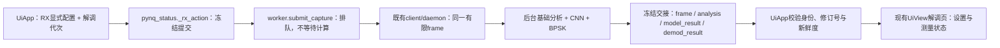

# M4：BPSK接收板屏集成设计

日期：2026-10-03。状态：基于用户“继续开发、先总结和总体plan”的指示形成待执行规格；本轮没有修改功能代码或部署。总体方向见`../plans/2026-10-03-rf-receiver-roadmap.md`。

## 1. 目标与支持域

把已验收的BPSK有限接收器接入生产worker、现有接收页和不可变软件发布，使操作员能明确设置RX模式/符号率/成形/参考，捕获后查看载波、定时、判决与真实BER，并在配置修改、取消、停止、断连或过期时看到结果失效。

M4沿用M3算法v2及SHA `23b9ab9fdc1cc7647c2c40169ae73a23504c262d2270d82ebf8ea65349e16760`：60MHz/D1/4096点、BPSK3MHz RECT。M4不放宽算法门限、不扩展RRC/速率/调制、不把CNN类别当解调配置、不加入CRC/连续接收/AUTO。需要算法变更时先记录原因并重新完成受影响M3验收。

选择在同一后台采集任务中追加纯计算处理，复用同一frame和交接。另开独立控制进程会增加仲裁和会话问题；在绘制线程直接计算会影响触摸；本轮采用既有worker扩展。

## 2. 接收配置和明确参考

现有`UiApp.rx_draft`保留采样参数，解调区增加成形和PRBS参考设置。新功能默认草稿为BPSK/3MHz/RECT，参考默认关闭；默认值只改本地设置，不向RF发送命令。原有QPSK/QAM选择可继续作为预期值保存，但明确显示“本版本解调未支持”，不阻止普通IQ采集。

PRBS参考仅从操作员显式启用及种子1..127形成`BpskConfig.reference_prbs7_seed`；关闭对应None。TX种子、TX草稿、CNN预测和当前发射缓冲不自动填入RX参考。测试脚本可以按冻结声明显式给RX/TX相同参考，生产交互仍是独立RX配置。

所有RX草稿修改统一走model setter，包括模式、符号率、成形、参考、抽取和长度，以及CNN的草稿建议路径。维护独立`rx_demod_revision`，修改一次即递增并清除当前解调结果；修订号与client硬件`config_revision`、现有UI `_rx_config_revision`分开，不比较不同编号空间。

修改RX解调设置不自动改硬件。采样参数修改沿用现有IQ/分析失效规则；只改解调/参考时至少清除解调结果，原IQ可作为明确标注的历史记录保留。M4先要求重新捕获，不实现隐式重新分析或重新发射。

## 3. 后台数据链与冻结交接

拟增加`rf_bpsk_pipeline.py`，负责冻结本次RX配置/解调代次、调用已验收算法、构造解调结果封套和支持状态；纯计算无IO。封套不可变，含`BpskResult`、完整提交配置、`rx_demod_revision`和算法身份。

`submit_capture(args, physical=False, demod_config=None, demod_revision=None)`扩展为向后兼容关键字。采集wire参数仍只有既有samples/ratio与显式物理确认字段；BPSK配置绝不混进daemon请求。旧调用不带解调参数时继续采集/分析/CNN，不启动新计算。

后台使用同一frame。BPSK不支持、无参考、未同步或者单独的算法失败产生绑定本次capture的无BER状态，保留成功的基础分析/CNN；完整采集失败和取消依旧不得交付成功frame。停止在计算前、计算中、交接前都要检查，最终发布仍使用既有锁内取消/连接代次检查。UI不能等待numpy或socket。

UI落地检查四组身份：frame与BpskResult的capture_id/release/connection_generation/client config_revision/采集完成时刻；封套提交配置；提交的rx_demod_revision与当前UI代次；实际算法能力及版本。任何失配只拒绝解调结果，清旧BER并显示原因；不能把其他帧/其他配置的BER拼到当前分析。

## 4. 生命周期和状态表达

| 事件/输入 | 当前解调状态 | BER显示 |
|---|---|---|
| 已接入但未捕获 | 等待当前快照 | 无数据 |
| 本次计算排队/执行 | 处理中，STOP可达 | 清除旧值 |
| 支持域内，无参考 | 载波/定时按实际算法结果显示；比特预览模π | 无参考 |
| 参考对齐通过 | 载波/定时/参考状态各自列出 | errors / compared_bits + BER |
| 无能量/削顶/未同步/域外 | 显示算法原因 | 不可用，不能显示0 |
| RX草稿或生效硬件配置改变 | 配置已变更，当前解调作废 | 已失效 |
| 取消/STOP/断连/FAULT/设备切换/清除 | 当前解调作废，关闭按读回另报 | 已失效 |
| 快照完成后超过30秒 | 历史快照，当前解调作废 | 已过期 |

算法存在是“能力已接入”，不是“当前同步成功”。BER能力支持PRBS比较，也不代表任何帧都有BER；reference_sync与carrier_sync/timing_sync分别显示。π歧义未由参考消除时比特预览必须注明极性未定，不把其当有效载荷。

同一失效入口清除当前解调与数值摘要；若保留历史最多沿用8条限制，并显式标历史。新捕获、失败和参考关闭都不能沿用上帧数值。STOP只在既有关闭读回确认后显示“已停”；关闭未确认仍沿用原错误状态。

## 5. 800×480板屏

复用现有“接收→解调”页，不新建独立入口：左卡片设置模式、符号率、成形、参考启用与种子；右卡片显示支持域提示、当前快照短ID、载波/定时/参考状态、频偏、误码计数和BER。保留现有概览捕获/回环确认入口，短提示指向该入口。

种子在参考关闭时不可编辑或明确未启用。RECT为本轮支持成形，RRC如果保留选项必须显示未支持；不得因为默认变3MHz就改发射配置。BER右侧同时显示`0 / 138`与`0`（零误码时），失败显示具体原因，不用仅百分比掩盖分母。

两卡片容纳不了时优先保留身份/状态/errors/bits/BER，频偏或有限比特预览用紧凑区域或次级详情；800×480预览检查实际字形、溢出、命中和抬起事件，中文字号不得低于项目现有MIN_CJK_SIZE。帧/CRC/EVM仍明确未接入，CNN面板保持原能力。

## 6. 软件发布与兼容

增加版本软件契约`cnn-bpsk-v1`，基于现有`cnn-v1`完整软件集合再加入`rf_bpsk_receiver.py`和`rf_bpsk_pipeline.py`；新模块hash进入receipt、manifest、release_id和安装验证。旧legacy/rx/cnn契约的文件集合不追加新必需项。

保持base RX和CNN可独立使用：worker的新增模块按合同声明加载；在旧合同/无新引擎时，新UI显示未接入，隔离打包仍可导入。加载失败关闭新增解调能力并保留基础RX，不偷偷使用未列入清单的模块。模型资格检查、worker模型加载和installer对`cnn-v1`的单值分支要覆盖新CNN合同；模型权重/评估文件及既有生产状态保持冻结。

canonical verifier在`pynq_overlay/sw/merged_release.py`，`scripts/merged_release.py`只是兼容入口。C daemon是否兼容新软件合同先用已有host兼容测试及新manifest样例证明；通过则复用当前daemon，失败才提出有证据的修改/重建，不默认引入新控制协议或PL变更。

候选发布准备：冻结相关源码hash，完整回归、隔离导入、打包/软件身份校验、旧发布回退预检。安装后核对current、运行进程/合同/模型/引擎版本，先不发射验证启动，再走已授权有限有线测试。任何失败保留候选和失败证据，按既有installer回退并确认关闭。

## 7. M4验收标准

1. 所有新增pipeline/worker/UI/发布测试和相关原有回归通过；M3算法hash保持，修改时另行重新验证。
2. 每帧解调结果只落入同一frame、提交配置及代次；错capture/错release/旧连接/配置修改/延迟交接/超时/取消全部不给当前BER。
3. 支持域内30个ON+3个OFF的实际生产UI回调→worker→daemon→显示链路：至少27/30参考同步，成功对齐帧总错误/总比较位≤1%，OFF无BER；任何削顶/超时/关闭未确认停止后续采集，保留失败。
4. 新实测IQ主机重放与板端同算法状态/判决/偏移/BER分子分母一致，浮点容差1e-6；每帧分母及原始hash可核对。
5. 100次热“基础分析+CNN+BPSK”纯计算流水线P95目标≤300ms；原采集deadline3秒不变。输入回调只提交任务不等待计算，以可控慢计算/取消测试证明持续可操作。
6. 新不可变软件发布、模型与算法身份、真实关闭读回通过；无额外Overlay、自动布防/发射或AUTO开启。
7. 真人按下方清单完成功能验收。纯计算P95、软件事件延迟和真人端到端时延分别报告；真人P95未量化时记未测，只能关闭M4功能/资源验收，不能宣称真人性能已通过。总体进度同步保留该测量项。

## 8. 真人验收清单

1. TX1→RX1接线沿用已确认工况。设置TX BPSK/RECT/3MHz、峰值60、PRBS7种子1；LO80MHz/Fs60MHz/BW30MHz/40dB/PHY0/tap29。布防→初始化→配置→**仅加载**，进入接收页，确认READY且TX关闭。
2. 在接收解调页手工设BPSK/3MHz/RECT/D1/4096，启用PRBS参考并设1。返回概览→回环捕获→确认，重复3次；分别记录新capture_id、载波/定时/参考状态、errors/bits、BER。每次返回解调页查看；切页及停止仍能响应。
3. 关闭RX参考后再捕获，载波/定时可显示实际结果，BER必须“无参考”；参考开启只能手工完成。改RX为2MHz或RRC再捕获，基础IQ仍可用，解调明确未支持，旧BER消失。
4. 恢复配置并成功捕获后，修改RX设置、切设备、清除、停止分别验证旧值失效；静默>31秒验证过期，不自动重捕获或续发射。取消回环确认不能生成新capture。
5. 停止并解除布防后核对TX source/RX ARM关闭；准备新只接收OFF快照时按既有要求恢复arm/init/configure但不load/start，再普通捕获，显示未同步、无BER；最后再次解除布防并确认关闭。

真人无需重复模型训练/算法单测。若需要量化实体端到端P95，用同一版本至少20次有效触摸释放→结果首次显示的本地计时/视频记录，保存测量方法和逐次时长；无需强制上传全部视频。普通“看起来正常”单列为功能确认，不改写成定量P95。
