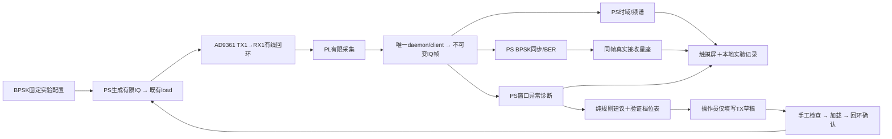

# 通信教学与可解释环境诊断：收敛规格

日期：2026-10-04。用户已选择“教学演示＋环境诊断：BPSK必交、QPSK条件扩展、建议由人工确认”。本文冻结作品交付方向和范围；本轮交付简介与计划，运行功能改动由对应实施阶段执行。

## 1. 定位与作品简介

建议作品名：**基于Zynq与AD9361的便携式通信教学与环境诊断平台**。

面向通信教学与可控射频实验，本作品基于Zynq SoC和AD9361，构建集BPSK信号生成、有限IQ采集、接收分析与环境诊断于一体的便携式平台。系统通过五寸触摸屏配置实验参数，展示时域、频谱、接收星座、同步状态和误码统计，并保存实验数据以便复现。PL负责样点传输与有限采集，PS负责设备控制、快照分析和诊断。平台在已知实验条件下结合时域、频域特征判断窄带干扰与脉冲异常，给出附带依据的处理建议；涉及参数调整时，由操作员确认并通过既有控制流程加载。系统保留停止、解除布防和异常拒绝机制，通过离线回放与TX1→RX1有线回环验证，形成可观测、可解释、可复现的通信实验工具。QPSK作为核心功能验收后的扩展。

这是目标版简介：接收星座、环境诊断、实验报告和环境建议仍是新增项，不能把目标简介当作当前完成状态。对外展示前应按验收完成项改用“已实现”或“拟增加”。

## 2. 方案选择

| 方向 | 收益 | 代价/取舍 |
|---|---|---|
| 教学＋环境诊断（选定） | 复用已验收BPSK，增加观察与解释能力，能形成完整演示 | 首轮限一个通信工况，智能部分先做可解释规则 |
| BPSK/QPSK通信分析仪 | 调制对比鲜明 | QPSK同步、参考映射、BER和资源验证先占主线，环境诊断延后 |
| 全自动认知收发平台 | 自动化展示丰富 | 需多档独立验收、持续观测与决策效果证据，超出当前快照链路 |

## 3. 现状与边界

最近核验发布993ffe21199a311eabec143a50e7e8a2。BPSK3MSym/s RECT、Fs60MSPS、D1、4096点接收已做新自动实板30ON+3OFF；算法/显示同帧、PRBS参考明确、计数0/4140；既有CNN仅用于限定有线工况调制识别。2026-10-04照片确认三不同快照正常显示、参考关闭和域外拒绝，真人整体PARTIAL。

4096/60e6约为68.27微秒：环境结果描述采集窗口，窗口之外的间歇事件可能漏掉。“未见异常”只表示当前窗口未检出，不能叫持续环境正常。纯计算P95约193.94ms是旧已测完整分析+CNN+BPSK预算，不能称当前端到端延迟。

AD9361路径的有限IQ调制/损伤波形主要由PS生成并加载；PL承担样点输出、传输和有限采集。不能把PS上的同步、推理或软件成形写成新增PL实时处理。

## 4. 功能增减

| 能力 | 新范围 | 处置 |
|---|---|---|
| BPSK TX/RX、显式PRBS BER | 固定3M RECT、60MSPS/D1/4096；支持无参考同步但不报BER | 必交、保留 |
| RF控制与五寸触摸 | 配置、加载、有限回环、取消、停止、解除、过期/错误状态 | 必交、沿用 |
| 时域/频谱/码值RMS/dBFS/IQ预览 | 同一真实快照，注明单位/采样率/状态 | 必交、保留 |
| 真实接收星座 | 同帧同步后的归一化符号散点，最多128点；失步不画理想点冒充 | 必交、新增 |
| 环境诊断 | 固定BPSK实验域：窗口内未检出、窄带异常、脉冲异常；另有无法判断/输入无效 | 必交、新增 |
| 实验数据/记录 | IQ、metadata、配置、算法版本、诊断、建议/人工动作和停止结果 | 必交、新增 |
| 建议与拒绝 | 必交观察/停止建议及人工流程；两个候选幅度档独立验收后，才能建议填写TX草稿 | 流程必交；有收益的档位优化是条件演示 |
| 轻量CNN | 保留当前调制识别作为辅助页面，不能代替环境标签、同步或决策依据 | 保留辅助，不重训为必交 |
| QPSK接收 | 固定3M RECT，独立映射/歧义/参考/BER验收 | 条件扩展，不阻塞核心交付 |
| QAM16/64接收、RRC接收 | 退出本轮交付 | 删减承诺；已有TX生成留高级工具 |
| BPSK2/3/5M全面扩展 | 暂停旧M5a主线 | 暂缓，不作为下一任务 |
| EVM、校准SNR/dBm、CRC/协议帧 | 无当前测量与协议基础 | 退出本轮界面指标与简介承诺 |
| 自动选制式/换频/发射、连续DMA、空口自适应 | 无持续观测及已验证动作效果 | 退出本轮交付 |
| 数字/AD9361内部回环 | 与有线物理回环区分，需各自路径证据 | 离线回放＋有线回环是核心；内部回环可选 |

“删减”优先作用于作品简介、教学首页和验收范围。已有QAM/RRC发射、ACM2108工具和可靠回退保留，不删除底层代码或改模型六分类标签。高级能力仍可手动使用，其存在不等于接收或环境验收通过。

## 5. 核心架构

所有新分析均在生产worker后台，按release、capture_id、连接代次、配置修订、完成时间与显式提交配置共同落地。取消/停止/断连/更改配置/过期清除当前诊断及建议；历史数据带历史标识。复用唯一控制入口，绘制及诊断模块不读写硬件。S1新合同名称为`cnn-bpsk-teaching-v1`，覆盖新增profile/constellation/record模块；worker模型/解调加载、canonical资格、installer、daemon manifest和旧合同隔离一并验证，不能只让软件map校验通过。

## 6. 新增模块与契约

- `rf_rx_constellation.py`：纯函数从同帧IQ与已有BpskEnvelope取载波补偿、相位、定时偏移、等长积分及首尾丢弃；返回有界不可变符号点、归一化说明和完整身份。不改变BPSK判决、参考对齐、门限、分母或冻结算法文件。
- `rf_environment.py`：纯函数提取窄带集中度、相对同档基线的谱峰增量、峰均比/异常样点占比和窗口片段；输出特征、规则依据、适用域、无法判断原因。先做可解释规则，CNN不承担新的环境任务。
- `rf_environment_policy.py`：纯函数结合诊断、有效期、运行约束、验收档位表返回OBSERVE/STOP_ADVICE/FILL_PROFILE_DRAFT及理由，不执行任何动作。
- `rf_experiment_record.py`：本地保存原始IQ及冻结metadata/分析/诊断/建议；执行记录追加到同一次实验，未知结果明确为未知。错误返回界面，无网络、自动控制或阻塞绘制。
- 现有worker/model/view/status模块：后台调用与统一失效；新增教学入口在现有页面中组织，不另建一套控制器。

模块范围可在对应子阶段内部细化，依赖方向固定：同帧只读数据→分析/诊断→建议→人工草稿→既有独立控制。计划不是四个子系统同时开工；S1详细实施先完成，后续按门禁串行。

## 7. 环境诊断实验域与验收设计

域为BPSK3M RECT已知信号与固定RF配置下的有线受控注入。窄带、脉冲通过一个有限IQ实验场景生成器注入PS生成波形，形成可复现TX/RX数据；真值标签来自冻结实验声明，绝不能通过发送参数直接填充接收诊断结果。复合、域外、低能量与削顶要能拒绝。

基线内正常PRBS周期谱线不是窄带干扰；训练/校准覆盖不同种子、窗口起点及两个幅度档。不同非零PRBS7种子只是周期偏移覆盖，不是独立序列。阈值只由TRAIN/VAL冻结，按会话分割，禁止同一源IQ跨分组；换种子/窗口/文件名产生的派生IQ继承原场景分组。谱峰判据必须结合已知BPSK基线，不能以单一最大FFT峰判异常。

两个候选档为P0峰值码60和P1峰值码40，其余RF/调制参数一致，40dB内部衰减不变。P0只有既有正常基线证据，不等于所有异常环境适用；P1尚未验收。它们不是功率校准档，不能称60dBm/40dBm，也不能承诺降码值改善低信噪或同频干扰。

复合注入合同固定为`x[n]=A*s[n]+j[n]`：s是单独归一化的BPSK，候选A只作用于目标BPSK分量；j的窄带/脉冲码值、位置和seed在一组成对实验中相同，不按A重新缩放。叠加后禁止整体自动归一化；统一舍入与12位越界拒绝。场景规格须记录每分量幅度、叠加顺序、最终量化和实际回放周期，未声明或改变此合同不得授予收益资格。该比较只适用于有线复合IQ工况，不能声称改善独立外部干扰。

正式诊断测试：三独立会话，每会话正常/窄带/脉冲各10帧，共90新有线帧。负控分开报告：另三会话各6帧安全有线OFF/复合/域外（每种2帧，共18）；另12份冻结离线拒绝输入（削顶/低能量各6），不为造削顶测试而发送越界IQ或推动模拟前端过载。先冻结严重度范围、叠加幅度和宽度/频偏参数。要求各已知类至少27/30识别正确，拒绝计错；正常误报警≤3/30，30份负控误判正常为0，所有无效帧无档位建议。离线12份不能算新物理接收证据。未过门禁保留实验状态，不调测试阈值补分数。

档位资格：每档先按原3会话30ON+3OFF正常同步/BER/安全闭环验收（至少27/30、聚合BER≤1%、3OFF无BER）。异常工况动作收益需独立成对测试，固定同一注入参数与随机种子，每档30帧，交错顺序；误码分子/分母、失步比例、码值削顶分别报告。无法同步不得从平均BER分母中悄悄剔除；全采集成功率另报。没有可复现收益时政策返回观察/停止提示，不填调整档。

## 8. 决策与错误行为

“可信度”先显示规则触发、特征值及适用范围；若提供阈值裕量，标为规则分数，不能冒充校准概率。当前CNN softmax或标签不自动驱动TX。

无效/过期/未关闭确认/发布或配置错配→拒绝建议；明显异常→优先提示停止并检查实验；两候选档均未适用于该工况→保持观察；有通过成对验收且适用于当前工况的候选→填写草稿建议。人工点击只改变草稿，原加载凭据失效，再独立加载与回环确认。停止始终可用。任何“恢复”只恢复UI与可操作状态，不自动恢复发射。

## 9. 完成定义

核心交付要求S0真人剩余项确认、S1真实星座/记录、S2限定环境诊断、S3建议/拒绝与人工安全流程均通过。S3无收益时通过“无候选资格→观察/停止提示、不填调整草稿”的验收即可完成核心；有收益的档位优化演示单列条件验收，不计入必交完成率。QPSK同样不计入核心完成率。新增分析后ARM热完整链路仍要求100次P95≤300ms（同一声明决定CNN是否开启，开启/关闭分开记录），原BPSK计数与旧发布回退回归不变。真人时延独立记录，未量测不能套用计算P95。

最终演示四个场景：正常BPSK→三新帧同步/星座/BER；窄带注入→频谱＋诊断依据；脉冲注入→时域＋异常依据；无法判断/过期→拒绝建议＋人工停止/解除。保存每个场景IQ与报告。用户2026-10-04明确确认每次捕获体验不卡顿、无需专门计时并授权S2：20次实体触摸计时改为可选性能说明，未测保持未测，不阻塞阶段开发或冒充ARM计算时延。
