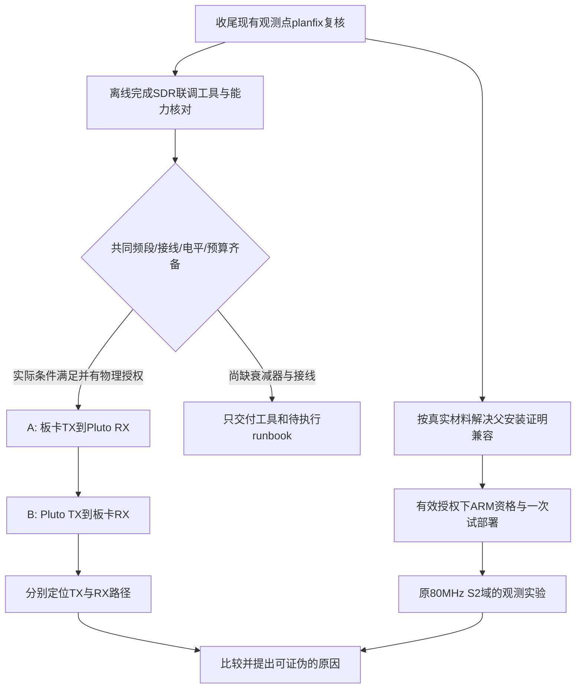

# DSH 当前进度与外接 SDR 联调设计

核对日期：2026-10-19，Asia/Shanghai。只读读取 DSH 本地压缩会话和工程产物；本次未连接板卡、未发射、未中断或向 DSH 发送消息。

## 最新现场约束修订：仅有连接线

用户补充没有外置衰减器。外置衰减器作为优选器材，不再作为所有联调的必需采购项。增加**内部TX硬件衰减受控的同轴直连**方案；该方案尚未执行，不代表现有脚本已被验证适用于直连。

- [ADI CN0534指南的Pluto Loop-Back章节](https://wiki.analog.com/resources/eval/user-guides/circuits-from-the-lab/cn0534)给出了降低发射电平后的TX/RX直接连接示例。它证明低电平直连是可用实验方法，不证明本项目任意启动/复位状态均可直连。
- [ADI对Pluto输入的说明](https://wiki.analog.com/resources/eval/user-guides/circuits-from-the-lab/cn0551)给出+2.5dBm输入上限；AD9361资料约+8dBm满幅CW输出只是特定工作点的参考。以8dBm和46dB硬件衰减估算为-38dBm，仍须核对实际模块、频率、是否有外置PA及启动/校准时序，不能当作测得功率或全频段严格上界。
- 现有板端`rf_core_init()`会在调用vendor初始化前，用请求的`attenuation_mdB`覆盖初始化结构的默认值，然后在初始化后设置并核对实际值。不能看到模板默认0dB就断言运行时必有0dB输出，也不能仅凭初始化结束读回推断全部瞬态。
- 建议先评估**Pluto TX→Pluto RX**的短时自回环，以独立确认参考SDR；Pluto初始TX硬件衰减60dB、幅度≤0.25、RX固定低增益、2秒。先在未连接接收输入时完成启动路径核对、衰减设置/真实读回及停止状态确认，再由操作者按明确端口连接。不能直接照抄既有`loopback`命令冒充直连流程已通过。
- 板卡TX→Pluto RX方向优先沿用46dB硬件衰减；不能因为没有外置件而改原S2衰减门。434MHz独立域的参数/状态门仍先离线核对。反向可从Pluto 60dB衰减开始，使用板卡RX-only。
- 必需检查集中为：指定衰减在可产生RF之前生效并读回；后续Source/Sink创建、滤波、调频不会重置衰减；先最大衰减/关TX初始化，满足条件后才短时输出，最后关TX并独立读回。设备重启、复位、掉线或重新初始化后，先解除直连/禁止再发射，再重新确认启动状态。
- 降低RX增益只改善接收动态范围，不能替代限制输入射频功率。优先只改独立测试工具，不改当前DSH观测补丁、不新增重复审查。

下文外置衰减器路线仍作为可选路线；“当前无外置器件先交付离线工具”的结论现在具体化为：先补齐并验证上述直连启动/读回流程，再给实际换线指令，不等待购买器材。

## 当前进度：已有代码进展，尚未转化为新板端证据

主会话 `session-78ef14b9-d4e9-406a-aba3-e7271bc39b20` 最新回合结束于17:18:08；现有独立复核子任务 `cde6b572-f87e-4687-af86-90101622f978` 从17:17开始，17:50复查时最新事件为17:49:49的作业登记，仍在运行变异复核，未生成最终REVIEW.md。离线ZIP最后更新于10月18日，故本报告使用本地最新session，不把旧ZIP当实时状态。

| 层次 | 本次核实的状态 |
|---|---|
| S2历史基线 | 已部署记录指向03b9b883…，n=20基线；本次没有读取板卡实时current，不能据此保证现在仍相同 |
| 18帧pilot | known_correct=8/9、passed=false保持不变 |
| 12帧遥测 | 执行成功；跨会话normal电平差约8.71dB，帧边界gain=76不能证明窗口内全程不变 |
| 新观测点 | CAP_ARM期间一次RX1 gain index读取，窗口后TX1/TX2真实衰减读回，随帧附加；离线实现已完成 |
| 第一轮审查 | 主要C行为通过；计划、父候选、注释和bracket有修订项 |
| planfix | 父集合显式接受03b9b883、carry-parent-software保留n=20父字节、部署补参数、注释/bracket修复；作者报告8项新测试/94项合并Python测试通过、daemon479/0、core113/0 |
| 当前运行 | 仍为限定复核，重点父安装证据路线；尚未看到该复核最终REVIEW结论 |
| 新候选/ARM/部署 | 主会话明确未执行；本次未发现相应新完成收据 |
| S2分类保证 | normal→CLEAR仍NOT SATISFIED，正式TEST/真人验收未完成 |

本次代码修改未提交，HEAD仍为 `ade6fd76`；不能将HEAD等同于工作树最新实现版本。已有全量Python日志为1458通过/3失败/11跳过，先前审查报告这些失败已独立复现为既有或摘要漂移；这里未重跑，不能将其写成当前全仓全绿。

### 当前真实阻塞与审查效率

复核子任务的 `rev-parent-route-probe.log` 用不同现有验证器试探03b9b883的父安装证明，得到缺`trial.json`、缺`logs/00-candidate-pins.json`或发布身份不匹配的拒绝。它证明**所传路径/布局不满足这些验证器**，尚不能证明历史部署不存在。

原始材料实际包含：

- `evidence/rf-teaching/s2-46db-baseline-deploy-2026-10-18/trial/trial.json`：release_id为03b9b883、parent_release为1c0894bf；
- 同目录 `readback/board-download/acceptance-report.json`、`trial-state.json`、`post-state.json`、`pre-state.json`；
- `readback/post-02-preflight.json`及原始读回；NOTES记录TRIAL_ACCEPTED、保留新版本。

该历史包的prepare曾用`--parent-recovery-acceptance codex-s2-takeover...`证明**当时父1c0894bf**，不能用同一证明直接证明**后来新安装的03b9b883**。因此应对照03b9b883自己的真实安装包设计最小布局适配/证据重建，明确缺的真实字节；不改写历史收据，不重新安装以制造新证明，也不继续无界枚举JSON。

复核已持续约半小时，有重复验证负担：作者已做相关测试/变异，上轮审查已独立覆盖主要C行为，本轮又要求固定变异数量及重跑多套件。应让**现有复核者**就真实差分和具名阻塞收尾，不另开整套审查。候选父证明/基线字节问题确实影响可部署性，应修；固定变异配额不应成为附加门。

## 联调目标与频率选择

外接SDR作为独立观察器/信号源，帮助区分板卡TX路径与RX路径。单个窗口内gain index、稳定TX衰减都不足以独自排除全程增益变化、模拟校准、时序/路径效应；不可把二选一假设写成已证明因果。

当前原S2域是80MHz/60MSPS/46dB，标准Pluto范围325–3800MHz。建议首先在两端共同支持的**433.9MHz LO +100kHz复数单音（RF434MHz）**建立新工程诊断，不修改原S2域、基线、阈值或既有收据。板卡daemon的参数范围/状态机/物理放行门是否允许该工作点，必须先离线核对；底层AD9361能调频不等于当前发布接口已支持。

若当前放行门只允许80MHz，不能直接改冻结常量绕过；应列出独立诊断入口的最小改动及其测试/一次审查。此阶段不要求FPGA重综合，除非实际接口能力证明必须修改PL。

两条准备路径可并行阅读/编写不同文件，但**板卡与Pluto控制各只有一个执行者**。实际阶段顺序由当前DSH授权与设备占用决定，不能在原采集中途改LO、接线或版本。

## 两个方向的最小试验

### A：板卡TX → 衰减器 → Pluto RX（优先）

- Pluto只接收：固定manual gain、RF带宽/Fs/端口，禁止AGC；板卡只开指定TX1、使用已支持的确定性IQ/单音链路。
- 先核对板卡实际支持的单音加载/采样率。不要用任意 `tx.load` 当作已审的有线派发，不绕过状态机或nonce。
- 每会话固定顺序TX_OFF→tone_1→tone_2→TX_OFF；两个不同基带频率用于确认外部谱峰跟随，排除背景。两帧ON可选择+100/+200kHz，必须先确认板端可生成且保留同幅度。
- 固定Pluto本次接收上下文跨板卡会话，记录Pluto RSS、FFT频率、积分窄带功率、噪声、饱和比例及板端实际LO/衰减/增益/波形摘要。不要为了增加重复数而同时反复初始化参考接收机。
- 初始只做一会话四窗口确认链路；通过后，另按已明确预算扩为三会话，共12窗口，最多三次板卡初始化；不能把12窗口自动当成12个板端物理帧，工具须分别统计。
- 软件包先实现预算计数，运行前一次明确是否包含“首会话=后续三会话的第一个”；禁止先做4窗口又额外做12而超预算。

### B：Pluto TX → 衰减器 → 板卡RX

- 板卡TX源关闭并读回；Pluto用已验证限时非cyclic Sink；板卡通过现有RX-only入口采集，不误用启用板卡TX的物理回环操作。
- CW/单音先验证RF通道：OFF→tone_1→tone_2→OFF。板端增益是否能固定须按现有API核对，不能暗改既有S2增益设置。
- 更改频率的峰值应跟随，频差容许量应根据两设备参考时钟、FFT栅格与实际频率读回预先声明，不能直接套自回环±2kHz。
- BPSK放后：当前板端BPSK为RECT/3MSym/s，不能直接套用模板2.4MSPS（甚至低于符号率）。必须先统一Fs、sps、PRBS7/种子、差分编码、脉冲整形/滤波和频偏范围，或在独立诊断中选择两端支持的低符号率；都不能拿新域帧调原S2阈值。

## 现实前置与结果边界

- 当前用户最后确认的接线仍是**Pluto TX→示波器CH1**，没有外置衰减器；还没有板卡↔Pluto接线确认。DSOX1102A的70/100MHz带宽不能验收434MHz载波。
- 优先准备适用434MHz的30–40dB/50Ω衰减器与同轴线。实际输入上限、TX最大可能功率、衰减、余量及端接须按设备规格核对；只写“有衰减器”不算电平预算。未满足前置时先交付离线工具，不执行联调发射。
- 稳定SDR TX下板端RX变化，或固定SDR RX下板卡TX变化，可缩小范围，但也要排查新参考链路自身漂移。434MHz无异常不能证明80MHz无异常；阴性结果仍需回原域复核。
- 输出幅度为未绝对校准的相对IQ功率/变化dB，不能标为dBm。保存原始IQ、配对ID、主机单调时钟/板卡boot_id、真实配置和停止读回；跨设备时间戳不假设天然同步。
- 所有物理联调是待执行，不消耗原S2旧nonce。对已有有效授权可连续执行；缺失范围/现场接线集中一次列出，不逐字段要求确认。

## 建议立即交给DSH的工作

见同目录 `DSH-NEXT-PROMPT.txt`。本次指令先让当前复核收尾，并在独立写范围交付可运行离线联调工具；不要求用户重新授权已经允许的离线准备，不自动扩大物理范围。
