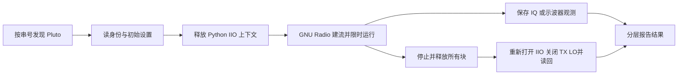

# GNU Radio 开发与排障经验

## 流程设计



Python 发射链为 `analog.sig_source_c → iio.fmcomms2_sink_fc32`；接收链为 `iio.fmcomms2_source_fc32 → blocks.head → blocks.vector_sink_c`。离线链复用同一信号源，有限样本后分析 FFT。硬件链自带采样时钟，不添加 Throttle。

## 从 GRC 到可测试脚本

1. 用 `tone_offline.grc` 验证 complex 类型、Fs、频率、幅度和有限样本 Head。图中 Head 使流程自然结束；grcc 关于没有 Throttle 的警告对这个有限离线生成任务可接受。
2. 编译、执行并确认 `tone_offline.c64` 为 262144 个 complex64、RMS 约 0.25。输出是无头、交错 float32 I/Q 原始文件；Python 脚本的 `iq.npy` 则包含 NumPy 格式头，读法不同。
3. 硬件执行使用独立手写 `radio_test.py`，保存身份/配置/结果并处理停止。不要把自定义清理代码加到 GRC 自动生成 Python 中；再次生成会覆盖。
4. 如需在 GRC 中查看硬件配置，添加 PlutoSDR Sink/Source，使用本目录 JSON 参数；不要直接运行无时限的 TX 图，实测入口使用限时 Python 脚本。

```powershell
$env:PATH='<LOCAL_PATH>;<LOCAL_PATH>;'+$env:PATH
& <LOCAL_PATH> -B <LOCAL_PATH> -o sdr_testbench\generated sdr_testbench\tone_offline.grc
Push-Location sdr_testbench\generated
& <LOCAL_PATH> -B tone_offline.py
Pop-Location
```

`generated/` 可重建，不作为手工维护源文件。GRC 图可通过 Radioconda 的 GNU Radio Companion 快捷方式打开。

## API 应以本机块模板为准

本机模板位于 `<LOCAL_PATH>` / `iio_pluto_source.block.yml`。

本版本没有 `gnuradio.iio.pluto_sink`，直接调用会 AttributeError。GRC 的 Pluto 块实际生成：

```python
iio.fmcomms2_sink_fc32(uri, [True, True], 32768, False)
iio.fmcomms2_source_fc32(uri, [True, True], 32768)
```

`[True, True]` 是一个复通道的 I/Q 扫描使能，与两个独立 RF 发射通道无关。Sink 用 `set_attenuation(0, 正数dB)`；底层 PHY 的 `hardwaregain` 读回为负数。Source 使用 `set_gain_mode(0, 'manual')` 和 `set_gain(0, 10)`。Source 无 `set_bandwidth`，本实现先通过底层 PHY 设置 RX 带宽，再释放上下文。

## USB 独占问题：已实测的根因与修复

故障表现：`iio.Context('usb:…')` 可以读到身份，但接着创建 GNU Radio Source 报 `Unable to create context`，还可能出现误导性的 `Unable to find host`。

隔离实验确认：持有 Python libiio Context 时，GNU Radio 再开同一 USB 接口失败；先 `del context` 再构造 GNU Radio Source 成功。故流程必须分阶段持有 USB。`gc.collect()` 不能释放仍被变量、设备对象或异常 traceback 引用的上下文。

本实现把流图对象限制在 `run_graph()` 局部作用域内；异常转文本返回，避免带着 USB 对象的 traceback 被上层 finally 持有，离开后再打开底层上下文收尾。将多个函数堆在一个全局上下文里会重新引入争用。

USB URI 本次从 `usb:4.9.5` 变为 `usb:4.10.5`，所以不硬编码总线/设备编号。每次扫描按不可变串号选择并核对 `hw_serial`，避免 USB 重新枚举后找错设备。一次目录中记录当时实际 URI。

## 两套 Python 与路径经验

修改 PATH 后，简单的 `python` 可能变成 Radioconda Python，继而 `import pyvisa` 失败。使用绝对解释器路径：GNU Radio 在 Radioconda 中运行，示波器在系统 Python 中运行，通过子进程协同，不安装第二套混杂驱动。

Radioconda 的 `Library\bin` 必须加入当前子进程 PATH，DLL 才能稳定加载。使用 `-X utf8 -B` 处理中文项目路径并避免生成字节码污染。

## 测量与判据

- FFT 针对最后最多 65536 点，加 Hann 窗、减均值；100 kHz 峰值本次落在 100012.207 Hz 的 FFT 栅格。
- `rms_iq` 是 GNU Radio complex float 的均方根，**不是 ADC 原始计数、dBm 或伏特**。早期结果名 `rms_counts` 命名不准确，原始记录保留，当前源码已纠正。
- `RX_STREAM_PASS` 仅判定有效且非零的数据，背景噪声也能通过，不能证明 RX 灵敏度/频响。
- Scope 测量串行通过 SCPI 获取，字段 `during` 是发射开始标记后采样，三次查询不保证全部处于 2 秒窗内，不用于严格时序结论。截图在发射结束后读取。
- TX 与 RX 各自正常工作、物理链路闭环、绝对校准是不同证据层次；本次只能覆盖部分，保持未验证项明确。

## 后续接入项目

先独立完成外接 SDR 自回环与信号源基线，再用于 FPGA TX→SDR RX 或 SDR TX→FPGA RX 定位发射/接收路径。需要确认目标 80 MHz 是否属于该 Pluto 的保证频段；本设备标准频段不覆盖 80 MHz，本测试没有解除限制。后续如需下变频/不同硬件，应单独明确方案，不能沿用当前 434 MHz 结果证明项目 80 MHz 性能。

参考：[GNU Radio Pluto Sink](https://wiki.gnuradio.org/index.php/PlutoSDR_Sink)、[ADI Pluto 说明](https://wiki.analog.com/university/tools/pluto)、[Keysight 示波器规格](https://www.keysight.com/zz/en/product/DSOX1102A/oscilloscope-70-100-mhz-2-analog-channels.html)。
